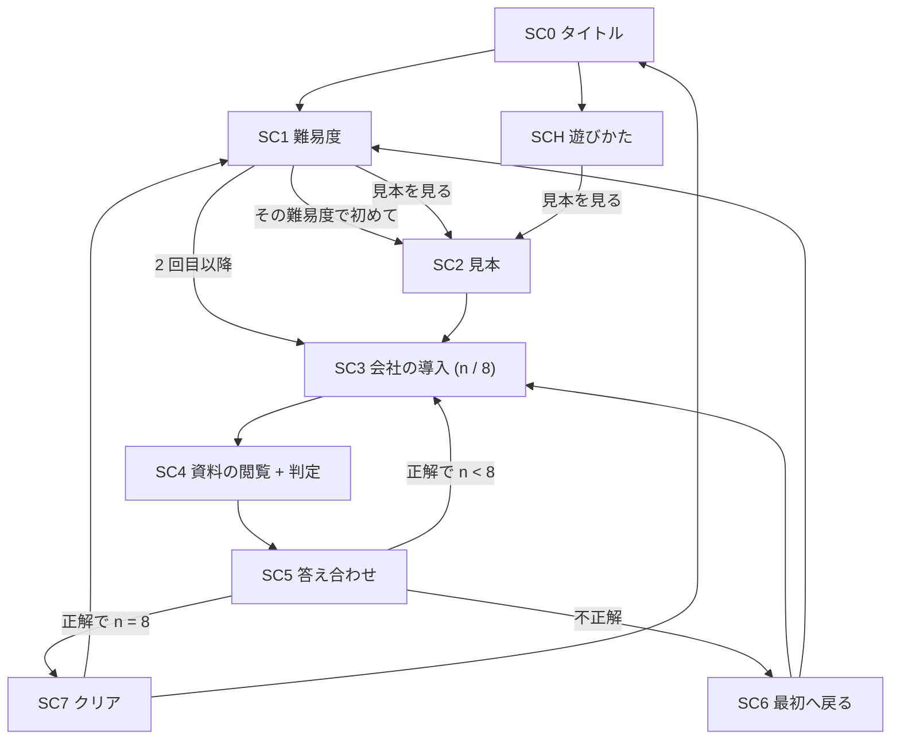

# 遊びの体験 (UI/UX) の案

Task #19。担当: ビジネス領域の進める役 (2026-11-04)。要件: [requirements.md](../requirements.md) (凍結)。方針: [charter.md](../charter.md)。
人間の言葉: 「ゲームのUI/UXはあなたに任せますが、単調すぎてもつまらないから、ちゃんとbiz側で案出ししてdevと協業しろ」(2026-11-04)。受け入れ条件 7:「演出は単調でない (UI/UX の案は docs/ に記録し、ビジネスと技術が合意している)」。

このページは 3 つの節で作る: **§1〜§4 案 (Sub-task #33)**、§5 技術の見立て (#34)、§6 推奨と画面ごとの要素の一覧 (#35)。

**数字と事実の印**: **人間が言った** / **文書にある** (出典つき) / **測った** / **導いた** (式と入力を示す) / **仮定**。印の無い数字は書かない。**設計の選択 (部品の大きさ・数・長さなど) は「仮定」で、責任者が決める既定**。

## 1. 単調になる所 (遊びの流れの上で)

遊びの流れ (要件・受け入れ条件 1〜4): タイトル → 難易度 → 1 社ずつ資料束 (決算短信 5 画面 + IR スライド 5 画面) を読む → 判定 (異変のあり・なし) → 答え合わせ → 8 社連続でクリア / 間違えたら最初へ。

| # | 単調になる所 | 根拠 | 印 |
| --- | --- | --- | --- |
| M1 | 1 周で同じ形の画面を 8 社分 (資料束 8 つ = 80 画面) 読む。画面の形・配色・語彙が最後まで同じ。**ただし、資料の本体の書式を毎回同じにするのは、遊び手が「正常」を覚えるために要る** (D-G1 の既定。下の「変えない所」)。だから崩してよいのは**資料の外**の見た目だけ | 要件 (8 社 × 10 画面)・open-decisions D-G1・[research.md](research.md) §1.2 (先行例は説明文をいつも同じ書き方にして正常を覚えさせる) | 導いた (8 × 10) |
| M2 | 毎回「読む → 2 択を押す」の同じ操作。読み方に工夫の余地が無い | 要件 (判定は 2 択) | 導いた |
| M3 | 間違えるたびに 1 社目に戻る。**正答率 80% の遊び手がクリアするまでに答える問題の数の期待値は約 24.8 問** (正答率 60% だと約 146 問)。1 周の 8 問より、失敗のあとの繰り返しのほうがずっと多い | 式 (1 − pⁿ) ÷ ((1 − p) pⁿ)、n = 8。p = 0.8: pⁿ = 0.168 → 0.832 ÷ 0.0336 = 24.8。p = 0.6: pⁿ = 0.0168 → 0.983 ÷ 0.00672 = 146 | 導いた (正答率は仮定) |
| M4 | 難易度ごとの問題は 25 問以上 (要件) で、**1 回クリアするまでの期待の問題数 (正答率 80% で 24.8 問。M3) に合わせた数** (plan-comparison §3.4 の根拠)。1 周 (8 問) の重複を避けるだけなら 8 問で足りる。失敗が続くと、期待を超えて同じ問題に出会うのは避けられない。P3 (尽きるまで同じ問題を出さない) を前提にすると、25 問以内に終わる回は重複が無い。**25 問を超えて重複に出会う回の割合は、正答率 80% で 35.3%、60% で 87.2%** (中央値は 19 問・103 問)。「必ず出会う」ではなく、**うまい遊び手は約 1/3、つまずく遊び手はほぼ必ず** | 要件・M3 | 導いた (連続の正答数を状態にした漸化式を 400 問目まで計算。正答率は仮定) |
| M5 | 答え合わせが「正解/不正解」と文章だけだと、見逃した異変を見て終わりで、次の周に活きない | 先行例 (答え合わせで見逃した異変の場所を確認できる) | 文書にある ([research.md](research.md) §1.2) |
| M6 | 異変の有無の比率は 50% (決めた)。「全部正常」と押し続ける・勘で押す手に、推理の必要が無い | open-decisions D-G4 (比率の既定は plan-comparison §7) | 導いた (勘でクリアする確率 0.5⁸ = 0.4%) |

- 繰り返しが避けられない遊び手が多いこと (M3・M4) への対策は、重さを抑える: 軽い部品 (P3 の抽選・R5 の戻り・P1 の段の割当て) だけを選ぶ。
- M3・M4 は、**ルール (8 社連続・間違えたら最初へ) が人間の言葉と要件で決まっているので、ルールそのものは変えない**。変えるのは、繰り返したときに飽きない見せ方と、出題の選び方だけ。「途中から再開」「セーブ」は、受け入れ条件 3 (間違えると最初の会社に戻る) を変えるので案に入れない。
- 単調さの原因は、**見た目 (M1)・操作 (M2)・進行 (M3・M4)・答え合わせ (M5)** の 4 つに分かれる。案の筋は、これに対応させて分けた (§3)。

## 2. 守る制約

### 2.1 資料の本体を変えない線 (正常を覚えさせる)

異変は「正常からのずれ」で、正常が見えなければ判定できない。open-decisions D-G1 の既定は、**毎回同じ書式 + 各難易度の最初に正常な見本** (plan-comparison §0)。charter の高くつく失敗 1 (正しく読んだのに不正解になる) を避けるため、**どの案も次の線を守る**。

| | 内容 |
| --- | --- |
| **変えない所** (遊び手が覚える正常) | 資料の本体 = 決算短信の 5 画面と IR スライドの 5 画面の、書式・配色・字体・文字の大きさ・表の列の位置・用語・単位の表記。**全社・全問・全難易度で同じ**。資料の紙面は常に明るい同じ配色 (読みやすさのため) |
| **変えてよい所** | 資料の外 = 外枠・背景・時刻の表示・会社の導入・判定のボタン・答え合わせの演出。同じ資料束の中でそろっていれば、社ごとに変えてよい |
| 定義 | 資料の本体の見た目が社ごとに違って見えること自体は異変にしない。異変は、問題データで指定した規則の破れだけ (charter: 検証器) |

### 2.2 制約の一覧

| 制約 | 出所 | 案への効き |
| --- | --- | --- |
| 実在の企業名・ロゴ・人物を使わない | 要件 受け入れ条件 8 | 社章・社名は架空。社章は幾何形の自作 |
| 「８番出口」の見た目・言い回しを真似ない。題名は紛らわしくない | 要件 受け入れ条件 11・この Task の指示 | 地下通路・黄色い案内標識・白地に黒の番号看板・「出口」「異変を見逃すな」の言い回し・歩く視点は使わない。型 (異変を判定してループを抜ける) だけを借りる ([research.md](research.md) §1.1) |
| PC の幅でもスマホの幅 (320〜414 px) でも横にはみ出さない | 要件 受け入れ条件 9 | 資料束の 10 画面を 1 画面ずつ切り替える形。道具は片手の親指で押せる大きさ (44 × 44 CSS px 以上。下の行) |
| 外部への通信をしない静的サイト | charter (セキュリティ) | 外部の字体・画像・音を取りにいかない。保存はブラウザの中だけ |
| **初回の読み込みが 1 MB 未満** | charter (品質の水準) | **plan-comparison の「1 回 3 MB・音つき +5 MB」の仮定は charter と合わない** (3 MB は仮定のまま)。画像は使わず、CSS と SVG で作る |
| **字体は端末のものだけ** | charter 1 MB 未満・測った: 日本語 Web フォントを自前で置くと、1 書体で約 4.5 MB (NotoSansJP-Regular.otf は 4,533,028 バイト。noto-cjk リポジトリの Content-Length) | 紙の資料室の見た目 (U1) のために明朝体などを同梱しない。端末の字体の指定 (font-family の並び) で作る |
| 音は入れない (既定) | 転送量が理由ではない (Web Audio で合成する音はファイルが要らず、転送量はほぼ 0)。理由: 人間の言葉にも要件にも音は無い・公開後は訂正だけ・期限 | 責任者が決める既定 (仮定)。入れたくなったら、合成音の小さな効果音だけ |
| 費用 0 円 | 要件 | 有料のフォント・素材を使わない |
| UI/UX の範囲は責任者が決める | 要件の UI/UX の行「責任者に任された」(人間が言った。2026-11-04) | plan-comparison §7 が「人間の言葉にも成功の定義にも無いので入れない」とした追加オプションのうち、**遊びの体験の部品 (O1 の一部 = P5、O3 = U1、O5 = R7)** は、要件の凍結 (2026-11-04) で責任者が決めてよい範囲に入った。入れない: 公開の仕方・共有 (O2)・題材・費用を広げるもの |
| 公開後は誤りの訂正だけ | 要件 | 演出は後から足さない。公開の前に決めきる |
| 期限: 2026-11-04 の朝 | 人間が言った | 演出の工数が、問題の数・正しさに先行しない。小さく確実な演出を優先 |
| タップ・クリックの的の大きさ | WCAG 2.2 の達成基準 2.5.8 (最小 24 × 24 CSS px、AA)・2.5.5 (44 × 44 CSS px、AAA) | 既定は 44 × 44 CSS px 以上 (仮定。2.5.5 に合わせる) |
| 問題の数字・異変の定義・答え合わせの文言は、問題のデータ 1 か所から作る | charter (single source of truth) | 演出のための文言・位置も問題データから出す。画面側に直書きしない |

## 3. 部品の候補 (案の材料)

案は、次の部品の組み合わせで作る。各部品の「要る問題データ」は、charter の single source of truth のために、画面側でなく問題・会社・異変の種類のデータに持たせるもの (技術の見立て §5 で訂正済み: 当初の案の項目のうち、セル ID・対応表・式の文字列・問題ごとの導入文は持たない)。大きさ (小・中・大) は**仮定**で、時間は #34 で技術が出す。

### 3.1 見た目の筋 (M1 に効く)

| 部品 | 内容 | 要る問題データ | 大きさ |
| --- | --- | --- | --- |
| V1 舞台の設定 | 遊び手は「架空の資料室で、決算の資料を閲覧票と照らす係」。**資料の外**の枠 (閲覧票の枠・ページ送りのしおり) に紙の資料室の語彙を使う。資料の本体は §2.1 の線を守って変えない | なし | 小 |
| V2 時刻の経過 | 閲覧票の時刻が 1 社目 18:00 から 1 時間ずつ進み、8 社目は翌 1:00。クリアで翌朝 6:00 (朝の画面)。**間違えて 1 社目に戻ると、18:00 の夕方に戻る** (ループの表現)。変えるのは**資料の外**の背景色の 8 段 (CSS の変数だけ)。資料の紙面は変えない。「決算が出た夜」の設定 | なし (社の順番だけ) | 小 |
| V3 社ごとの閲覧票 | **資料の外**の閲覧票 (社名・業種・社章) に、会社の設定 (#39。docs/plans/companies.md §4) の**社章 (Unicode の幾何図形の記号 1 文字。文字として表示)** と、会社ごとの社色・淡い背景色を出す。会社が変わったことが一目で分かる。**社章と配色は資料の本体に入れない** (§2.1)。会社は 10 社 (予備 4) | 会社の設定の社章 (記号 1 文字)・社色・淡い色 (docs/plans/companies.md §4。#39)。配色は会社ごと | 中 (社章の作成と、実在の商標との照合) |
| V4 紙の質感 | 資料の外の机の面の質感 (CSS のグラデーション) と影。画像を使わない。資料の紙面自体は無地のまま | なし | 小 |

### 3.2 操作の筋 (M2 に効く)

| 部品 | 内容 | 要る問題データ | 大きさ |
| --- | --- | --- | --- |
| T1 印 | 画面の下の「印」スイッチを入れると、数字や文を押す (PC はクリック、スマホはタップ) たびに「怪しい」の印を付け外しできる。スイッチが切れているときは、押しても何も起きない (スクロール中の誤タップを避ける)。判定の前に、疑う箇所を絞る | なし (セルの ID は設計の `path`) | 中 |
| T2 検算 | 印を付けた 2 つの数字を選ぶと、差・比を表示する小さな電卓。**正否は教えない** (計算結果だけ) | なし (値は `path` で引く) | 中 |
| T3 並べて見る | 短信と IR の同じ項目を 2 列に並べる (スマホは上下)。資料のあいだの食い違いを探す手段 | なし (対応は全問で同じ共通の表 1 つ。検証器の資料間の規則と同じ表。§5) | 中〜大 |
| T4 道具の段階 | **やさしい = 印 + 検算** (やさしいの異変は見た目と計算で、遊び手は知識なし。合計が合わないかを 7 桁の暗算で探させない)。**むずかしい = 印 + 検算 + 並べて見る** (むずかしいの異変は会計と資料のあいだの食い違いが多め = 受け入れ条件 6。並べて見るはそのため) | 難易度 | 小 (T1〜T3 が前提) |

### 3.3 進行の筋 (M3・M4 に効く)

| 部品 | 内容 | 要る問題データ | 大きさ |
| --- | --- | --- | --- |
| P0 見本 | 各難易度の最初の 1 回は、遊びの前に**正常な資料束を 1 つ**、「これが正常です」の注釈つきで見せる (D-G1 の既定。plan-comparison の A/B-C6)。飛ばせる。**見本は出題のプールから外す** (出題に混ぜると、後で出たとき「見本だから正常」と考えずに当たる)。専用の資料束を 1 つ持つか、難易度ごとに +1 問にして要件の 25 問を守る (どちらにするかは #35 の要素の一覧で決める) | 見本のファイル 1 つ (プールの外) | 小 |
| P1 段階 | 8 社を 3 段 (1〜2 社目 = 目立つ異変、3〜5 社目 = 中、6〜8 社目 = 紛らわしい異変) に分け、各段に合う難しさの問題を重みつきで抽選。1 社目は毎回易しい → 失敗後の再挑戦が重くなりすぎない。**問題の段の割当ては、出会う回数の比に寄せる** (下の案 U3 の導出) | `Problem.tier` (難しさ 3 段) | 中 |
| P2 導入の 1 行 | 資料束の最初に、**どんな会社か**を 1 行 (業種・事業の説明。例: 「機械の部品を作る会社」)。**文は問題データの業種・事業のフィールドから作る** (自由な文にすると、短信の概況や IR のセグメントの事業の記述と食い違いうる。データの 1 か所から資料と導入の両方を出せば、照合が要らない)。**数字や増減の主張を含めない**: 検証器は導入文を見ないので、「大型の設備投資があった期」のような文は、資料の数字と食い違って正常な問題が異変に見える (むずかしいは資料のあいだの食い違いが異変なので、不正解になる)。数字を含む導入文にするなら、問題データの数字から文を作るか、検証器の規則に入れる (全問に当てる工数が増える) | `Company.business` (会社の設定。問題ごとの導入文は持たない) | 小 (数字を含めない場合) |
| P3 出題の抽選 | 1 周の中で同じ問題を出さない。直前の周に出た問題は後回し。難易度の問題が尽きたら、最も昔に出たものから | 問題 ID | 小 |
| P4 持ち時間 | 終盤だけ残り時間を表示。**時間切れは不正解として扱う** (受け入れ条件 3 の「間違えると最初の会社に戻る」に当たる) | なし | 小〜中 |
| P5 記録 | 最高の到達社数・通算のクリア回数・見つけた異変の種類数を、ブラウザの中だけに保存 (図鑑の最小版 = plan-comparison の O1 の一部。入れてよい根拠は §2.2 の UI/UX の行) | `AnomalyKind.id` (保存のキー。変えない) | 中 |

### 3.4 答え合わせとクリアの筋 (M5 に効く)

| 部品 | 内容 | 要る問題データ | 大きさ |
| --- | --- | --- | --- |
| R1 場所の示し | 異変の画面に切り替えて、異変のセルを枠で囲み、「何が・何と食い違うか」を 1 文で出す (要件 受け入れ条件 4) | なし (`anomaly.places`・`explanation` は設計に既にある) | 小 (要件) |
| R2 検算の見せ方 | 異変の根拠の式を 1 行 (例: 「資産 1,234 ≠ 負債 + 純資産 1,243」)。正常な問題は、整合を確かめた主要な式を 2〜3 行出して「異変なし」の根拠を示す | なし (式は検証器の規則が数値から作る。§5) | 中 |
| R3 印の照合 | T1 で付けた印と異変の位置を重ねて、当たり・外れ・見逃しを示す | なし (印のセル ID と `places` の突き合わせ) | 小 (T1 が前提) |
| R4 判定票 | 答え合わせを「判定票」(照合済・要再確認のスタンプ) として見せる。CSS のアニメーションだけ | なし | 小 |
| R5 戻りの演出 | 間違えたときの「最初へ戻る」を、閲覧票を差し戻す短い遷移 (長さの既定は 1 秒以内、仮定) にし、何社目まで進んだかを出す。飛ばせる | 到達社数 | 小 |
| R6 完了票 | クリア = 8 社分の閲覧票が揃った「完了票」と朝の画面。結果の共有 (plan-comparison の O2) は入れない | なし | 小 |
| R7 解説の 1 行 | 異変の種類ごとの一般的な見かたを 1 行 (plan-comparison の O5。入れてよい根拠は §2.2 の UI/UX の行)。学びになるが、問題ごとでなく**種類ごと**に書く | `AnomalyKind.tip` (種類ごとの 1 行) | 小 |

## 4. 案

案は、**筋 (どの単調さをどう崩すか) が違う**ように分けた。U0 は基準 (比べるための最小)。

### 案 U0: ミニマル (基準。plan-comparison の「基本の演出」)

- 文字と表だけ。白地。「n / 8 社目」の表示。判定は 2 つのボタン。
- 答え合わせは R1 (場所の示し) だけ。間違えたら「最初に戻ります」と文字で出して 1 社目へ。
- クリアは「クリア」の文字。P0 (見本。D-G1 の既定)・P3 (出題の抽選) は入れる (正常を覚えさせる・要件 25 問を活かす最低限)。
- **単調さへの効き**: M1〜M6 のどれにも効かない。要件は満たす。「人に見せられる」(成功の定義) を満たすかは人間の好み (plan-comparison §6)。

### 案 U1: 舞台の筋「資料室の夜」 (見た目で崩す)

- 部品: V1 + V2 + V3 + V4 + R4 + R5 + R6 (+ P0・R1・P3)。plan-comparison の **O3 (雰囲気のある演出、6 h、仮定) に当たる** (社章と時刻の経過で O3 より少し広い)。厚くした O4 (音つき、12 h) とは別で、音は入れない。
- **§2.1 の線を守る**: 資料の本体は変えない。変わるのは閲覧票・背景・時刻だけ。
- 遊びの流れ: タイトル = 資料室の入口 (閲覧票を取る)。社が進むごとに時刻が進み、資料の外が少しずつ暗く (深夜へ) なる。8 社目の判定を終えると朝になる。会社ごとに閲覧票の配色と社章が変わる。答え合わせは判定票のスタンプ。
- **単調さへの効き**: M1 に効く。ただし**資料の外だけ**なので、80 画面の資料自体の同じ形は残る (D-G1 のため崩せない)。8 社を区別でき、進み具合が環境で分かる。M5 は R4 の雰囲気だけ。M2・M3・M4・M6 には効かない。
- 人間の言葉との整合: 「単調すぎてもつまらない」に対して、見た目の変化は伝わりやすい。成功の定義「人に見せられる」に寄与する。
- 懸念: (1) 資料の紙面は常に明るい同じ配色にするので、暗い背景との境目のコントラスト (会計の数字を読む画面なので、紙面のコントラストを落とせない)。(2) V3 の社章の作成が、問題の数 (25 問以上 × 2 難易度) ではなく業種の数 (4〜6) で済むかは、会社の設定の作りかた次第 (技術に確認)。(3) 社章の商標の照合: 当初の案は幾何形の SVG で、実在の商標と偶然重なりうるとして照合の Sub-task を見込んだ。**#39 の合意で社章は記号 1 文字 (◆ ● ■ ▲ など。図形の組み合わせ・意匠化なし) に決まった**ので、特定の企業の識別に当たる可能性は低い (仮定。法務の専門家の判断は無い)。**既定: 照合の Sub-task は設けない** (D-R5 の免責は表示する)。責任者が変えてよい。

### 案 U2: 道具の筋「検算机」 (操作で崩す)

- 部品: T1 + T2 + T3 + T4 + R1 + R2 + R3 (+ P0・P3)。見た目は U0 のまま。**§2.1 の線を守る**: 印・検算・並べて見るは、資料の本体を変えない (並べて見るは、同じ資料の別の見せ方で、書式は同じ)。
- 遊びの流れ: 資料束を読みながら、数字や文に印を付け、検算で差・比を確かめ、むずかしいでは短信と IR を並べて見る (やさしいも印と検算は使える)。判定のあと、印と異変の位置を重ねて答え合わせ。
- **単調さへの効き**: M2 に強く効く (読む・疑う・確かめる・判定する)。M5 に効く (R2・R3 で学びになる)。M6 に効く (勘ではなく調べる手段がある)。M1・M3・M4 には効かない。
- 人間の言葉との整合: 題材 (決算書の読み方) と操作が結びつく。むずかしい (会計の基礎がある人向け) の楽しみの中心になりうる。
- 懸念: 操作が増えるとテンポが落ちる (印・検算は**任意**にし、使わなくても判定できる)。スマホで数字を狙ってタップする難しさ。T3 は対応表のデータが要り、問題 1 問あたりの作成の手間が増える。電卓が答えを導くので、検算の使いすぎで「異変の有無が計算で決まる」ゲームになりうる (T2 は 2 つの数字の演算だけで、規則の判定はしない)。

### 案 U3: 進行の筋「8 社の起承転結」 (進行で崩す)

- 部品: P0 + P1 + P2 + P3 + P5 + R5 (+ R1)。見た目は U0 のまま。**§2.1 の線を守る**。
- 遊びの流れ: 各難易度の最初に正常な見本 (P0)。各社の最初に 1 行の導入 (P2、どんな会社か)。1〜2 社目は目立つ異変・易しい問題、後半は紛らわしい問題 (P1)。失敗しても 1 社目は易しいので再挑戦が軽い。最高到達社数が残る (P5)。
- **単調さへの効き**: M3・M4 に効く (失敗後の繰り返しが毎回違う・最初が軽い・出題が偏らない)。M1 には弱く効く (導入の 1 行だけ)。M2・M5・M6 には効かない。
- 人間の言葉との整合: 「8 社」の節目が意味を持つ。
- 懸念: **問題の段の割当ては、均等に割ると偏る**。k 社目に来る回数の期待値は p^(k−1) ÷ p⁸ (導いた: 8 社連続の遊びで、連続 k−1 回正解の状態に着く回数。p = 0.8 で 1 社目から 5.96・4.77・3.81・3.05・2.44・1.95・1.56・1.25、計 24.8 = M3 の期待値と一致)。段ごとでは、1〜2 社目が 10.7 回 (43%)、3〜5 社目が 9.3 回 (38%)、6〜8 社目が 4.8 回 (19%)。25 問を均等に 3 段 (6.3・9.4・9.4 問) に割ると、序盤の目立つ異変が 1 問あたり約 1.7 回出て、真っ先に覚えられる。**出会う回数の比 (43 : 38 : 19) に寄せ、25 問を約 11・9・5 問に割ると、1 問あたり約 1 回に揃う** (導いた: 10.7 ÷ 11 = 0.97、9.3 ÷ 9 = 1.03、4.8 ÷ 5 = 0.96。正答率 80% の仮定。低いほど序盤が増える)。そのぶん、紛らわしい異変の問題は 5 問と少なく、**問題の数の下限 (25 問) を守ったまま、序盤の問題を厚くする**必要がある。厳密な割当てでなく**重みつきの抽選**にして緩和する。問題ごとの「難しさ 3 段」の付与は、問題の作成 (B-B5〜B8) の仕事に増える。「紛らわしい異変」は、正常に見える書き方が異変に見える危険 (tech-assessment §5 の技術のリスク 3) と隣り合うので、一次資料での確認が要る。

### 案 U4: 組み合わせ (§6 で推奨を出す)

筋は直交している (U1 = 見た目、U2 = 操作、U3 = 進行) ので、**部品を選んで組み合わせられる**。組み合わせの候補と、その推奨は #35 (§6) で、技術の見立て (§5) を使って出す。

## 5. 技術の見立て

相談: #34 (2026-11-04 01:45)。答え: 技術の Sub-task #41 (Task #21 の組。監視役のレビュー 2 回で合意)。**正本は ブランチ calliope/foundation の docs/plans/ux-tech-assessment.md (commit 86dcd68)**。ここには、案の選択に使う部分だけを取り込む。選ぶのはビジネス。
**印**: 工数は**すべて仮定** (実装 h、係数 1.5 をかける前。製品の実装は未着手で、1 部品の単価の実測は無い。部品ごとの作るものの数え上げ。単体テストと E2E 1 本を含み、共通の土台 #27・#28 は含まない)。スマホの収まり・`prefers-reduced-motion`・保存の失敗・出題の当たり率は技術が**測った**。技術が「見立て」とした判断(測れない判断)は、**仮定 (技術の見立て)** と書き、測った事実と区別する。公開の通し (#30) の人の確認の対象になる。

### 5.1 結論

- **全部品が、設計の範囲 (静的・外部通信なし・フレームワークなし・初回 1 MB 未満) で作れる**。1 MB への効きは問題データ (60 問で約 160 KiB、導いた) が大きく、部品のコード・CSS・SVG は小さい (仮定: 圧縮後 100 KiB 以下)。
- **スマホ (320・360・375・414 px) で、44 × 44 CSS px の的の表・5 つのタブ・固定バーは、横にはみ出さない** (測った。macOS の Chrome)。ただし 44 px の行にすると 1 画面が縦に長い (幅 320 で、貸借対照表 1,301 px・キャッシュ・フロー 1,389 px は測った。32 px の行なら貸借対照表 736 px は導いた: 23 行 × 32)。
- **問題データへの追加は少なく、問題ごとの作業を増やさない**。足すのは、任意項目 4 つ (`Company.business`・`Company.emblem`・`AnomalyKind.tip`・`Problem.tier`) と見本のファイルだけ。セル ID・異変の位置は設計の `path` で足り、短信 ↔ IR の対応表 (T3) と検算の式 (R2) は、**問題に持たず検証器の規則から作る** (二重に持つと食い違うため。charter の失敗 2)。
- 技術が勧める組み合わせ (仮定 (技術の見立て)): T1 + T2 + T4、R1〜R3、V1・V2・V4・R4〜R6、P0・P3、手順を直した P1。**慎重**: P4 (勧めない)、V3 (社章。商標の照合に人の目)、T3 (スマホは短い対応だけ成り立つ)。

### 5.2 部品ごとの見立て

| 部品 | 実現性 | 工数 (仮定) | スマホ | 問題データへの追加 | 注意 (技術のリスク) |
| --- | --- | --- | --- | --- | --- |
| V1 舞台の設定 | ○ | 0.5 | ○ | なし | 実在の名前・「８番出口」の言い回しは人の確認 |
| V2 時刻の経過 | ○ | 1.5 | ○ | なし | 段は何社目かから決まる純粋な関数。**実際の時計は使わない**。8 段の背景と文字のコントラストを WCAG の式で単体テスト (本文 4.5:1 以上) |
| V3 社ごとの閲覧票 | △ | 3 (仮定。SVG を作る関数を前提にした見積もり) | ○ | 技術は `Company.emblem` と業種 → 配色の表を提案したが、**#39 で決まった会社の設定 (社章 = 記号 1 文字、色 = 会社ごとに社色と淡い色) を正本にする** (下の 5.5) | 技術の見立て: 社章は指定から関数で作るので手間は社章の数では増えない (仮定 (技術の見立て))。#39 の記号 1 文字なら、作る関数が要らず、3 h は上限とみなせる (仮定)。商標の照合は §4 案 U1 の懸念 3 |
| V4 紙の質感 | ○ | 0.5 | ○ | なし | 重い影を画面全体に重ねない |
| T1 印 | ○ | 3 | ○ | なし | 印は状態 (`reading.marks`)。セルは `button` 相当 + `aria-pressed` (PC のキーボード・読み上げ) |
| T2 検算 | ○ | 3 | ○ | なし | 正否は教えない。単位の違う組は「比べられない」。差の向きは固定 |
| T3 並べて見る | △ | 4 | △ (仮定 (技術の見立て)) | 対応表は問題に持たず、共通の表 1 つ (検証器の資料間の規則と同じ表。試作の「短信-」の規則が 20 件 = 表の大きさの目安) | **スマホは短い対応 (5〜8 組) か 1 組ずつの切り替えが成り立つ (仮定 (技術の見立て)。5 組を上下 2 段で 831 px は測った)**。20 組を上下 2 段にすると約 1,760 px (導いた)。対応は「同じ定義の数字どうし」に限る |
| T4 道具の段階 | ○ | 0.5 | ○ | なし | |
| P0 見本 | ○ | 2 | ○ | 見本のファイル (`problems/` の外。プールに混ざらない) | |
| P1 段階 | △ | 4 | ○ | `Problem.tier` | **設計の初版の出題手順 (会社を先に選ぶ) では効かなかった** (測った: 序盤の枠が狙いの段になる割合 0.56。段の指定なしの 0.44 とほぼ同じ)。**枠を先に決める手順に設計を直した** (序盤 1.00、終盤 0.64〜0.90)。**会社が多いほどよい** (8 社で 7・8 社目 0.84・0.64、12 社で 0.90・0.77。**10 社 (#39 で決まった数) は、私が同じ試作 `draw-tiers.py` の会社の数を 10 に変えて測った (400 プール × 50 回): 1〜8 社目 1.00・1.00・1.00・0.99・0.98・0.97・0.88・0.74。1 社目に段 3 が出る割合 0**)。データの条件: 難易度 × 段の問題数が目標の比 11 : 9 : 5 の ±1 |
| P2 導入の 1 行 | ○ | 1 | ○ | `Company.business` (問題ごとでなく会社に持つ) | 検証器は文を見ない。`business` と業種・セグメント名の矛盾 (電機部品の会社に「食品を作る会社」) は、会社の設定の確認の項目に入れる |
| P3 出題の抽選 | ○ | 2 | ○ | なし | 履歴を引数にする純粋な関数。seed 固定でテスト可能 |
| P4 持ち時間 | △ **勧めない** | 4 | ○ | なし | (a) WCAG 2.2 の 2.2.1 (時間制限の調整) の例外に当たるか判断が要る (要件・charter は WCAG 準拠を求めない) (b) 時間切れ = 最初へは M3 の重さを悪化させる (c) タブを隠したときの仕様と確認が要る |
| P5 記録 | ○ | 2.5 | ○ | `AnomalyKind.id` が保存のキー (変えない約束) | `localStorage` を try/catch で包む (測った: 禁じられた環境で `SecurityError`。プライベートウィンドウは測っていない)。外部通信なし |
| R1 場所の示し | ○ | 2 | ○ | なし (`anomaly.places`・`explanation` は既存) | |
| R2 検算の見せ方 | △ | 4 | ○ | なし (式は検証器の規則が作る) | 式の文字列を問題に書かない。**異変の問題は、規則が作る式の数字と `explanation` の数字が食い違うと画面の中で自己矛盾する** → 単体テストで含まれることを確かめる。正常な問題の「確かめた式」は、主要な規則 (貸借・損益・CF) を固定で選ぶ |
| R3 印の照合 | ○ | 1 | ○ | なし | T1 が前提 |
| R4 判定票 | ○ | 1 | ○ | なし | `prefers-reduced-motion` で止める |
| R5 戻りの演出 | ○ | 1.5 | ○ | なし | 遷移中の入力を二重に受けない |
| R6 完了票 | ○ | 1.5 | ○ | なし | |
| R7 解説の 1 行 | ○ | 0.5 + 文言 | ○ | `AnomalyKind.tip` | 文言は異変の種類の一覧の作業に入れる (問題ごとに書かない) |

### 5.3 案ごとの工数 (部品の足し算。仮定)

| 案 | 部品 | 実装 h (係数の前) | K = 1.5 (計画の仮定) | K = 2.9 (測った n = 2 の上限) |
| --- | --- | --- | --- | --- |
| U0 基準 | P0 2 + P3 2 + R1 2 | 6 | 9 | 17.4 |
| U1 舞台 | V1・V2・V3・V4・R4・R5・R6 + (P0・R1・P3) | 15.5 | 23.3 | 45.0 |
| U2 道具 | T1・T2・T3・T4・R2・R3 + (P0・R1・P3) | 21.5 | 32.3 | 62.4 |
| U3 進行 | P1・P2・P5・R5 + (P0・R1・P3) | 15 | 22.5 | 43.5 |
| 全部 (P4 を除く) | 21 部品のうち P4 以外 | 39 | 58.5 | 113.1 |

- 実装 h は技術の部品ごとの数え上げ (仮定)。**K は往復を含む係数**: 1.5 は plan-comparison の計画の仮定。**測った値は、制作 + レビューの往復で実装の約 2.4〜2.9 倍** (tech-assessment §4。n = 2、区間に重なりあり。plan-comparison §0・§8)。2.9 は測った上限 (2.4 が下限)。
- **案どうしの順位は、係数で変わらない** (全部が実装 h に比例する)。変わるのは桁: 全部入りは 58.5 h から 113.1 h へ。
- **この h は組の作業時間の仮定で、壁時計の時間ではない。期限 (2026-11-04 の朝) への当てはめには使わない**。技術の推奨「先に T1 を作って時間を測り、残りの単価を置き換える」で置き換える (§5.4 の 6 とあわせて §6 で扱う)。測った値では、手書きの制作が計画の約 1/10、Task #3 全体の実働が見積もりの約 0.43〜0.51 倍など、計画の仮定は実際より大きい傾向 (plan-comparison §3.5)。
- plan-comparison の O3 (雰囲気のある演出) は、estimate.py で**実装 4 h (Task h は ×1.5 = 6 h)**。V1・V2・V4・R4 を当てると実装 3.5 h、V3 を足すと 6.5 h で、同じ桁。共通の土台は含まない。

### 5.4 技術が案に足した点・危ない点

1. **CSP が `style` 属性を許さない** (vercel.json の `style-src 'self'`)。V2 の背景・V3 の配色・強調を style 属性で作ると、公開版で崩れる。**`data-` 属性 + CSS のセレクタ**で状態を表す。SVG の社章も表現属性 (`fill` など) と CSS のクラスで塗る (CSSOM の `el.style.x = …` は使える。測った)。→ §6 の要素の状態は `data-` 属性で表す前提にする。
2. **PC のキーボードと読み上げ**: 押せる要素には役割とフォーカスが要る (T1 の工数に含めた)。
3. **44 px の行は縦に長い** → 技術の案 (仮定 (技術の見立て)): **印のスイッチが入っている間 (または `@media (pointer: coarse)`) だけ 44 px にする**。読むだけのときは詰めた行で 1 画面に収める。常に 44 px にするなら縦スクロールを許す。どちらも横にははみ出さない。**ビジネスが決める (読みやすさの好み)** → §6 で決める。
4. **固定バーの高さ**: T2 の検算が 2 行だと約 112 px (画面の高さ 667 px の約 17%)、1 行にまとめれば約 60 px (導いた)。→ §6 で決める。
5. **スマホの切り替え**: 上に「決算短信 | IR スライド」、その下に 5 画面のタブが成り立つ (最小幅 60.8 px で 44 px 以上。測った)。スワイプは補助にとどめる (iOS Safari の端のスワイプと衝突しうる。作りは約 1 h、仮定)。10 画面の縦スクロールは非推奨。
6. **測っていないこと**: 実機の指での押しやすさ・iOS Safari と Firefox での見え方・長押しの選択や拡大を抑える CSS の実機での効き・社章と実在の商標の照合・視覚の好み。公開の通し (#30) の人の目に頼る。

### 5.5 案への影響 (私の側の取り込み)

| 技術の見立て | 案への取り込み |
| --- | --- |
| P1 は出題手順を直せば効く。会社が多いほどよい | 「会社」は**プールにある架空の会社の数**で、8 社連続 (要件) とは別。#39 で 10 社 (予備 4) と決まっており、**10 社で測った当たり率は十分** (上の P1 の行)。12 社への増員は要らない (増員の費用は、設定 2 社 + IR の口調 + `business` + 問題の割り振りで、見込まない)。P1 を採る場合の条件は、難易度 × 段の問題数が 11 : 9 : 5 の ±1 になること |
| P4 を勧めない | **採らない**。理由は技術の (a)〜(c) に、M3 を悪化させる点が重なる |
| T3 はスマホで短い対応だけ | T3 は、スマホで 5〜8 組 + 1 組ずつ切り替える見せ方にする。PC は全組 |
| V3 の社章・配色が #39 の設定と食い違う | **正本は #39 の会社の設定** (社章 = 記号 1 文字、色 = 会社ごとに社色と淡い色)。技術の提案 (`Company.emblem` の SVG・業種 → 配色の表) は採らない。10 社は業種も別々で、業種の表と会社ごとの色は中身が同じ。商標の照合の Sub-task は、記号 1 文字なので既定で設けない (U1 の懸念 3) |
| 技術が「過剰」「持たない」とした項目 (セル ID・対応表・式の文字列・問題ごとの導入文) | §3 の「要る問題データ」の列を訂正した (R2 だけでなく、T1〜T3・P2・R1・R3 も)。§6 の項目表はこの訂正後の項目で作る |

### 5.6 他のチケットに足す作業 (部品を採ったとき。行き先は §6 で責任者に渡す)

技術は次の作業を、他の Task の作業に入れると見立てた。#39 は閉じているので、行き先を決め直す必要がある。

| 部品 | 作業 | 技術が書いた行き先 | 今の状況 | 行き先の候補 |
| --- | --- | --- | --- | --- |
| P2 | `Company.business` を 10 社分書く。業種・セグメント名と矛盾しないことを確かめる | #24 の Sub-task | #39 (会社の設定) は closed。#24 は open | #24 に Sub-task を足す (責任者が決める) |
| R7 | `AnomalyKind.tip` (種類ごとの 1 行) を 25 種類以上分書く | #40 (異変の一覧) | #40 は open | #40 の作業に入れる |
| P0 | 見本の資料束も、検証器で正常として確かめる | 検証器 | | 検証器の項目 (技術) |
| V3 | 商標の照合 | | 既定で設けない (案 U1 の懸念 3) | 設けるなら #24 |
| P1 | 難易度 × 段の問題数が 11 : 9 : 5 の ±1 になるように、問題に `tier` を付ける | 問題の作成 | | 問題の作成 (B-B5〜B8) |

## 6. 推奨と画面ごとの要素の一覧

Sub-task #35。§1〜§5 を使って、推奨を 1 つ出し、画面ごとの要素の一覧を技術がそのまま設計に使える粒度で書く。

### 6.1 推奨: 案 U4 = U0 を土台に、3 つの筋から効きの大きい部品を段階つきで採る

**部品の採否 (合計 34 実装 h、仮定)**

| 段階 | 部品 | 実装 h | 理由 (効く単調さ) |
| --- | --- | --- | --- |
| **段階 1** (要件の最低 + 軽い見た目 + 操作の基本。22.5 h) | P0 見本・P3 出題の抽選・R1 場所の示し | 6 | 要件 (受け入れ条件 4・5)・D-G1・M4 の最低限。U0 |
| | V1 舞台・V2 時刻・V4 質感・R4 判定票・R5 戻りの演出・R6 完了票 | 6.5 | M1 (資料の外で 8 社を区別)・M3 (戻りの重さを演出で和らげる)・M5。CSS だけで小さい |
| | V3 社ごとの閲覧票 | 3 | M1。会社の設定 (#39) の社章・色をそのまま出すだけ(上限の見積もり) |
| | T1 印・T2 検算・R3 印の照合 | 7 | M2・M6。判定の前に「調べる」操作が入り、勘で押す手が効きにくくなる |
| **段階 2** (外せる順に並べた。11.5 h) | R2 検算の見せ方 | 4 | M5。答え合わせが「なぜ」を示し、次の周に活きる。規則の式は検証器が作る |
| | P1 段階 | 4 | M3。1〜2 社目は目立つ異変 → 失敗後の再挑戦が軽い。10 社で効く (測った) |
| | P2 導入の 1 行 | 1 | M1。会社ごとの話題 |
| | P5 記録 | 2.5 | M3。自己ベストが周を重ねる理由になる |
| **後回し** | T3 並べて見る・T4 道具の段階 | 4.5 (T3 4 + T4 0.5) | T3 はむずかしいの資料間の食い違いを探しやすくするが、スマホは短い対応だけ、対応表の確認が要る。**T4 は T3 があって初めて難易度で道具が変わる**(T3 なしでは何もしない)ので、T3 と一緒に後回しにする。段階 1・2 が済み、時間が余れば |
| **見送り** | P4 持ち時間 | 4 | 技術の (a)〜(c) と M3 の悪化 |
| | R7 解説の 1 行 | 0.5 + 文言 | 25 種類以上の文言を足すと、公開後は訂正だけ (要件) なので誤りの置き場が増える。R1・R2 が根拠を示すので足りる |

**時間が足りないときに外す順**: 段階 2 の P5 → P2 → P1 → R2。段階 1 は外さない (外すと要件か単調さの下限を割る)。**外すのは実装側 (画面・関数) の作業だけ**。P1 の `tier` と P2 の `business` は、問題を作る Sub-task (#25・#26) と会社の設定 (#24) の中で書くデータなので、**採否を、それらの Sub-task が始まる前に決める** (§6.3 の 11)。

**導出**

1. **単調さの原因は 4 つ (M1 見た目・M2 操作・M3/M4 進行・M5 答え合わせ) あり、筋はそれぞれ別の原因に効く** (§4)。どの筋も単独では全部に効かない。U1 だけでは M2・M3・M4 が、U2 だけでは M1・M3・M4 が、U3 だけでは M1・M2・M5 が残る。
2. 効きの小さい部品 (P4・R7・T3) を外し、**効きの大きい割に小さい部品**を取ると、全部の原因に効く: M1 = V1〜V4・P2、M2 = T1・T2、M3 = P1・P3・P5・R5、M5 = R1〜R4、M6 = T1・T2・R2。
3. **U0 を段階 1 の土台にするので、段階 2 を全部外しても要件は満たす**。期限 (2026-11-04 の朝) と charter の「問題の数・正しさに先行させない」に合う。
4. 正常を覚えさせる線 (§2.1) を守る。演出は資料の外だけに入れ、資料の本体の書式は全社同じ。**charter の高くつく失敗 1 (正しく読んだのに不正解) を、演出が起こさない**。
5. **懸念が小さい部品を選んだ**: 技術のリスクの大きい P4・T3 と、公開後の訂正の置き場を増やす R7 を外し、V3 は #39 の設定を使う。

**他の案との比較**

| 案 | M1 見た目 | M2 操作 | M3・M4 進行 | M5 答え合わせ | M6 勘 | 実装 h (K=1.5 / 2.9) |
| --- | --- | --- | --- | --- | --- | --- |
| U0 基準 | 効かない | 効かない | P3 のみ | R1 のみ | 効かない | 6 (9 / 17.4) |
| U1 舞台 | 資料の外に効く | 効かない | 戻りの演出のみ | 雰囲気のみ | 効かない | 15.5 (23.3 / 45.0) |
| U2 道具 | 効かない | 強く効く | 効かない | R2・R3 で効く | 効く | 21.5 (32.3 / 62.4) |
| U3 進行 | 弱く効く (P2) | 効かない | 強く効く | 効かない | 効かない | 15 (22.5 / 43.5) |
| **U4 推奨** | 資料の外に効く | 効く (T3・T4 を除く) | 効く | 効く | 効く | **34 (51 / 98.6)** |

- 「効く」の評価は §4 の各案の「単調さへの効き」から。実装 h は §5.3 の部品の足し算(仮定。K=2.9 は測った上限)。
- **U4 は、U0 の 6 実装 h に対して +28 実装 h (K=1.5 で +42 h)**。plan-comparison の既定 (O3 だけ) の **6 h は、estimate.py の実装 4 h に K = 1.5 をかけた値 (Task h)** で、案 B の基本は 159.8 h (Task h。plan-comparison §3.4)。U4 の 51 h (K=1.5 をかけた Task h) と同じ尺度で引くと、**O3 より +45 h = 案 B の基本に対し約 +28%** (導いた: (51 − 6) ÷ 159.8 = 28.2%)。測っていない仮定を混ぜた尺度で、絶対値として使わない。plan-comparison §7 の相対値の表 (O3 +5%) は、責任者が U4 で置き換えるか決める。

### 6.2 推奨が守る制約との照合

| 制約 | U4 での扱い |
| --- | --- |
| 実在の名前・ロゴを使わない | 社章は記号 1 文字 (#39)。社名は #39 の検査に合格したもの。「８番出口」の見た目・言い回しは使わない(§2.2) |
| 初回 1 MB 未満・外部通信なし | 画像・Web フォント・音なし。字体は端末のもの。部品のコード・CSS は小さい (技術の仮定: 圧縮後 100 KiB 以下) |
| スマホ 320〜414 px で横にはみ出さない | 測った(技術 §2)。タブ 5 つ・的 44 px・固定バーが収まる |
| 正常を覚えさせる (D-G1) | §2.1 の線 + P0 |
| 公開後は誤りの訂正だけ | R7 を見送り、文言の置き場を増やさない |

### 6.3 責任者が決める事項 (人間に聞かない。UI/UX は責任者に任された)

| # | 事項 | 選択肢 | 推奨 (既定) と理由 |
| --- | --- | --- | --- |
| 1 | 表の行の高さ | 常に 44 px / 印スイッチが入っている間だけ 44 px | **印スイッチ中だけ**。読むことが主で、44 px だと貸借対照表が 1,301 px (幅 320、測った)。詰めた行なら 736 px (導いた)。どちらも横にははみ出さない |
| 2 | 検算の表示 | バーの高さ約 60 px の中に収める / バー自体を 2 段 (約 112 px) にする | **バーの高さは約 60 px のまま、その中で「差の行」と「比の行」の最大 2 段**。技術が 320 px で測ったところ、道具バー 1 本は折り返さず 61 px (上の線込み) だが、検算の結果に使える幅は 154 px で、「差・比を 1 行」だと 7 桁 (差 −1,234,567 / 比 0.83) から欠ける。2 段なら全幅で 10 桁まで欠けない。61 ÷ 667 = 約 9% (導いた)。バー自体を 2 段にすると約 17% |
| 3 | 判定の入口 | 判定のボタンを常に 2 つ出す / 「判定する」を押すと判定のパネル (「異変あり」「異変なし」「読みに戻る」) が開く | **「判定する」で開く 2 段階** (SC4-9・SC4-10)。判定は即確定で取り消しが無い (受け入れ条件 3) のに、印のスイッチと同じ下の帯に 2 つのボタンを並べると、親指が当たって 7 社目から 1 社目に戻される。パネルで選ぶ手が 1 つ増えるが、「判定する」を押すだけなら何も起きないので誤タップが安全で、固定領域も小さい |
| 3b | 固定領域の合計 (スマホ) | | 上: 帯 (SC4-1) 32 px + 資料の切替とタブ (SC4-2) 44 × 2 = 120 px。下: 道具バー (印・検算の結果・「判定する」を 1 本に。約 60 px)。**合計約 180 px = 画面の高さ 667 px の約 27%** (導いた。行の高さは仮定)。iOS Safari はブラウザ自身の帯の分、見える高さがさらに小さい (測っていない) |
| 4 | 商標の照合 Sub-task | 設ける / 設けない | **設けない**。社章は記号 1 文字で、特定の企業の識別に当たる可能性は低い (仮定。法務の専門家の判断は無い)。D-R5 の免責は表示 |
| 5 | 段の割当て (P1) | 11 : 9 : 5 / 均等 | **11 : 9 : 5 (±1)**。k 社目に着く回数の比 43 : 38 : 19 に合わせ、1 問あたりの出会う回数が約 1 に揃う (導いた。§4 案 U3) |
| 6 | 見本 (P0) の置き場 | 専用の資料束 1 つ / 難易度ごとに +1 問 | **専用の資料束 1 つ (プールの外)**。要件の 25 問を動かさず、技術の見立ての形 (`problems/` の外) と合う |
| 7 | 追加の項目の行き先 | §5.6 | P2 の `business` = #24 に Sub-task を足す、P5 の保存キー = `AnomalyKind.id` (#40 で変えない約束にする)、P1 の `tier` = 問題の作成の仕事に入れる |
| 8 | 音 | 入れない / 合成音の効果音 | **入れない**(§2.2)。要件・人間の言葉にない |
| 9 | 時間切れ | 採らない (P4 を見送り) | 受け入れ条件 3 の「間違えると戻る」だけで十分 |
| 10 | 実機の確認 | 公開の通し (#30) で人の目 | 技術が測れなかった: 実機の指での押しやすさ・iOS Safari と Firefox・長押しの選択や拡大を抑える CSS の効き・視覚の好み |
| 11 | P1・P2 の採否の期日 | #25・#26・#24 の Sub-task の開始前に決める / 後で決める | **開始前に決める。推奨は採る**。後で付けると 50 問に `tier` を付け直す (a)、または外してから `tier` の割当ての制約だけが問題の作成をしばる (b) が起きる。責任者が #25・#26・#24 に伝える |
| 12 | タブの複製 | 許容 / 防ぐ | **許容** (技術の推奨)。タブを複製すると、判定前の状態が複製側に残る (測った: `window.open`。3 つのエンジンとも)。設計 §5.3 が `?seed=N` で同じ出題の再現を既に許しているので、新しい穴にならない |
| 13 | 遊びかたから開いた見本 (SCH-5) の難易度 | SCH は SC1 を経て開く / SCH から開いた SC2 は「始める」を出さず、閉じると SCH に戻る (SC2 の上に「やさしい / むずかしい」の切り替え、既定はやさしい。SC1 から来た SC2 は選んだ難易度に固定) | **後者** (技術の推奨)。遊びかたを読む流れを SC1 に遷移させず、閉じたら元に戻る |

### 6.4 画面の遷移

- **画面だけの状態 (保存しない)**: SC2・SC3・SC6・SCH。再読み込みすると、保存された走行の位置の画面になる。出題の確定 (PICK) は、SC2 を閉じたとき (SC3 に入るとき) に行う。
- **保存と読み出しは reduce (状態遷移) の外で行う** (serialize・hydrate)。壊れた値は捨てて SC0 (タイトル) に戻る。「タイトルへ」(TO_TITLE) は、走行も直近の判定の結果も捨てる。記録 (P5) の更新は、判定の書き込みと同時に 1 回だけ。ブラウザの履歴 API で画面の段階を表さない。
- 「最初へ戻る」(SC6) は、受け入れ条件 3 のとおり 1 社目に戻る。SC3 の 1 社目は、新しい抽選 (P3) で別の問題。
- どの画面からも、画面の隅の「タイトルへ」で SC0 に戻れる。**走行中に戻ると、その周は捨てる** (確認を 1 回挟む)。

### 6.5 画面ごとの要素の一覧

**書き方**: 要素 ID は「画面 ID-番号」。「出所」は、表示する値の出どころ (P = 問題データ、S = ゲームの状態、K = 固定の文言、L = ブラウザ内の保存)。「状態」は、見た目の変わる状態。「スマホ」は幅 320〜414 px での違い (PC は 1024 px 以上を基準)。部品の ID (V・T・P・R) は §3。**全画面共通**: (1) 資料の本体は §2.1 の線を守る。(2) タップ・クリックの的は 44 × 44 CSS px 以上 (仮定)。**資料の表の行は、通常は詰めた行 (32 px 前後) で 1 画面に収め、印のスイッチが入っている間だけ 44 px にする** (§6.3 の決める事項 1)。(3) **要素の状態 (段・印・強調・開閉) は `data-` 属性 + CSS のセレクタで表し、`style` 属性を使わない** (CSP。§5.4)。(4) 部品のうち「後回し」(T3) は、採るまで出さない要素を「(後回し)」と書いた。

#### SC0 タイトル

| ID | 要素 | 内容 | 出所 | 状態 | スマホ | 部品 |
| --- | --- | --- | --- | --- | --- | --- |
| SC0-1 | 題名 | ゲームの題名 (責任者が決める。「８番出口」と紛らわしくない) | K | | 1 行で折り返す | |
| SC0-2 | 副題 | 「異変を探して、決算書のループを抜けろ」など 1 行 (文は仮) | K | | 同 | |
| SC0-3 | 開始ボタン | 押すと SC1 | | 通常・フォーカス・押下 | 幅いっぱい | |
| SC0-4 | 遊びかたリンク | 押すと SCH | | | | |
| SC0-5 | 最高の記録 | 難易度ごとの最高到達社数・クリア回数 | L | 記録なしのときは非表示 | 2 行 | P5 |
| SC0-6 | 免責 | 架空の会社であること・投資判断の助言ではないこと (D-R5) | K | | 本文と同じ 16 px 以上 (仮定) | |
| SC0-7 | ライセンス表示 | MIT・リポジトリへのリンク | K | | | |
| SC0-8 | 舞台の背景 | 入口の絵 (CSS と SVG) | | | 縮小 | V1・V4 |

#### SC1 難易度

| ID | 要素 | 内容 | 出所 | 状態 | スマホ | 部品 |
| --- | --- | --- | --- | --- | --- | --- |
| SC1-1 | 難易度カード × 2 | 「やさしい」「むずかしい」。1 文の説明 (やさしい = 知識なしでも。むずかしい = 会計の基礎がある人向け) | K | 通常・フォーカス・押下 | 縦に並べる | |
| SC1-2 | 道具の説明 | 両方の難易度で使える道具 = 印・検算。(後回し: T3・T4 を採ったら、むずかしいに +並べて見る) | K | | | T4 |
| SC1-3 | 最高の記録 | 難易度ごとの最高到達社数 | L | 記録なしのときは非表示 | | P5 |
| SC1-4 | 戻るリンク | SC0 へ | | | | |
| SC1-5 | 見本を見る | 難易度ごとに、いつでも見本 (SC2) を開く。飛ばしたあとでも見られる | S | | | P0 |

#### SCH 遊びかた

| ID | 要素 | 内容 | 出所 | 状態 | スマホ | 部品 |
| --- | --- | --- | --- | --- | --- | --- |
| SCH-1 | ルール | 8 社連続で正しく判定するとクリア。間違えたら最初へ。判定は「異変あり」「異変なし」 | K | | | |
| SCH-2 | 正常の説明 | 資料の書式は毎回同じ。異変は、見た目・計算・会計・資料のあいだの食い違い (やさしいは見た目と計算、むずかしいは会計と資料のあいだが多め) | K | | | |
| SCH-3 | 道具の説明 | 印・検算の使いかた (任意であること)。(後回し) 並べて見る | K | | | T1・T2 |
| SCH-4 | 閉じる | 元の画面に戻る | | | | |
| SCH-5 | 見本を見る | SC2 を開く (難易度の切り替えつき。閉じると SCH に戻る) | | | | P0 |

#### SC2 見本

| ID | 要素 | 内容 | 出所 | 状態 | スマホ | 部品 |
| --- | --- | --- | --- | --- | --- | --- |
| SC2-1 | 見出し | 「これが正常です」 | K | | | P0 |
| SC2-2 | 資料の本体 | 見本の資料束 (SC4-4 と同じ表示) | P (見本) | ページ送りできる | 同 SC4 | P0 |
| SC2-3 | 注釈 | 資料の重要な箇所に 3 つ程度の注釈 (「合計は一致している」など) | P (見本) | 開閉 | 下に積む | P0 |
| SC2-4 | 始めるボタン | 押すと SC3 (1 社目)。飛ばせる。**SCH から開いた SC2 では出さず、閉じると SCH に戻る** (§6.3 の 13) | | 出す・出さない | 画面下に固定 | P0 |
| SC2-5 | 難易度の切り替え | 「やさしい / むずかしい」。**SCH から開いた SC2 だけ**、既定はやさしい。SC1 から来た SC2 は選んだ難易度に固定 | S | 2 状態 | | P0 |

#### SC3 会社の導入 (閲覧票)

| ID | 要素 | 内容 | 出所 | 状態 | スマホ | 部品 |
| --- | --- | --- | --- | --- | --- | --- |
| SC3-1 | 進行 | 「n / 8 社目」と、8 つの印の列 (済・今・未) | S | 8 状態 | 1 行 | |
| SC3-2 | 時刻 | 18:00 から 1 時間ずつ。8 社目は翌 1:00 | S | 8 段 | 小さく | V2 |
| SC3-3 | 社名 | 架空の会社名 | P | | | |
| SC3-4 | 社章 | 記号 1 文字 (文字として表示)。社色で出す | P (`Company` の社章・社色。#39) | | 縮小 | V3 |
| SC3-5 | 業種・事業 | 業種と、導入の 1 行 (業種・事業のフィールドから作る) | P | | | P2 |
| SC3-6 | 資料を開くボタン | 押すと SC4 | | | | |

#### SC4 資料の閲覧 + 判定

| ID | 要素 | 内容 | 出所 | 状態 | スマホ | 部品 |
| --- | --- | --- | --- | --- | --- | --- |
| SC4-1 | 閲覧票の帯 | 「n / 8 社目」・社名・時刻。常に上に見える | S, P | | 1 行に縮める | V2・V3 |
| SC4-2 | ページ送り | 上に「決算短信 | IR スライド」の 2 つ、その下に 5 画面のタブ (計 10 ページ)。「前へ・次へ」。今のページ・読んだ印 | S | 今・読み済・未 | 上部に固定。タブ 5 つは 1 行に収まる (最小幅 60.8 px、測った)。スワイプは補助のみ | |
| SC4-3 | ページ名 | 画面の名前 (例: 「連結貸借対照表」) | P | | | |
| SC4-4 | 資料の本体 | 表と文。§2.1 の線のとおり、全社同じ書式 | P | 印あり・印なし | 表は横スクロールせず、幅に収める (320〜414 px で測った)。行は通常詰め、印スイッチ中は 44 px。**スイッチを切り替えるとき、見ていた行の画面上の位置を保つ** (行の高さが約 1.4 倍に変わっても、押そうとした数字が画面の外へずれない。方法は技術が決める。測っていない) | T1 |
| SC4-5 | 印の付いたセル | 枠を付けて目立たせる | S | 付・外 | | T1 |
| SC4-6 | 道具バー | 「印」スイッチ・検算の結果 (2 つ選んだとき)・「判定する」(SC4-9) を 1 本に並べる。(後回し)「並べて見る」 | S | スイッチの入切 | 画面の下に固定 (約 60 px)。合計の固定領域は §6.3 の 3b | T1・T2 |
| SC4-7 | 検算の表示 | 印を付けた 2 つの数字から、差・比を、バーの高さ約 60 px の中の**最大 2 段 (差の行・比の行)** で表示 (正否は出さない)。単位の違う組は「比べられない」。差は当期 − 前期の向きに固定 | S | 閉・2 つ選択済・結果 | 固定バーの中の 2 段 (バー全体で約 61 px、測った。320 px で結果に使える幅 154 px)。バー自体を 2 段 (約 112 px) にしない | T2 |
| SC4-8 | (後回し) 並べて見る | 短信と IR の対応する項目を 2 列。対応は共通の表 1 つ (問題に持たない) | 共通の表 | 閉・開 | 上下に積み、5〜8 組か 1 組ずつの切り替え | T3 |
| SC4-9 | 「判定する」ボタン | 押すと判定のパネル (SC4-10) を開くだけ。何も確定しない。常に見える | | 通常・押下 | 道具バーの右端 | |
| SC4-10 | 判定のパネル | 「異変あり」「異変なし」「読みに戻る」。**「異変あり」「異変なし」を押した時点で、結果を走行の状態に書き込む** (§6.6)。書き込んだあとに SC5 を表示する | S | 開・閉・無効 (書き込み中) | 下から開くシート。ボタン間の間隔 8 px 以上 (仮定)。**「判定する」を素早く 2 回押しても確定しない**: シートの「判定する」と同じ位置には「読みに戻る」を置く、またはシートが開いてから短い間は入力を受けない (どちらかは技術が決める) | |

#### SC5 答え合わせ

| ID | 要素 | 内容 | 出所 | 状態 | スマホ | 部品 |
| --- | --- | --- | --- | --- | --- | --- |
| SC5-1 | 結果 | 「正解」「不正解」と、判定票のスタンプ | S | 2 状態 | | R4 |
| SC5-2 | 判定と正解 | 「あなた: 異変あり / 正解: 異変なし」 | S, P | | | |
| SC5-3 | 異変の画面 | 異変のあった画面に切り替え、異変のセルを枠で囲む | P (`anomaly.places` の `path`) | 異変あり問題のみ | | R1 |
| SC5-4 | 異変の説明 | 何が・何と食い違うかの 1 文 | P (`anomaly.explanation`) | 異変あり問題のみ | | R1 |
| SC5-5 | 根拠の式 | 規則の式を 1 行。数字は資料の値から検証器の規則が作り、`explanation` の数字と食い違わない(単体テストで確かめる) | 検証器の規則 | 異変あり問題のみ | | R2 |
| SC5-6 | 確かめた式 | 正常な問題で、整合を確かめた主要な式 2〜3 行 (貸借・損益・CF を固定で選ぶ) | 検証器の規則 | 異変なし問題のみ | | R2 |
| SC5-7 | 印の照合 | 自分の印と異変の位置。当たり・外れ・見逃し | S, P | 3 状態 | | R3 |
| SC5-8 | 次へボタン | 正解で n < 8 =「次の会社へ」。正解で n = 8 =「結果を見る」。不正解 =「最初に戻る」 | S | 3 状態 | 画面下に固定 | |

#### SC6 最初へ戻る

| ID | 要素 | 内容 | 出所 | 状態 | スマホ | 部品 |
| --- | --- | --- | --- | --- | --- | --- |
| SC6-1 | 到達社数 | 「n 社目まで進みました」 | S | | | R5 |
| SC6-2 | 記録の更新 | 最高到達を更新したとき「自己ベスト」 | S, L | 更新・非更新 | | P5 |
| SC6-3 | 戻りの演出 | 閲覧票が差し戻され、時刻が 18:00 に戻る。飛ばせる | | | | R5・V2 |
| SC6-4 | もう一度ボタン | 同じ難易度で SC3 (1 社目) | | | | |
| SC6-5 | 難易度を選び直す | SC1 へ | | | | |

#### SC7 クリア

| ID | 要素 | 内容 | 出所 | 状態 | スマホ | 部品 |
| --- | --- | --- | --- | --- | --- | --- |
| SC7-1 | 完了票 | 8 社分の閲覧票が揃った表。翌朝 6:00 の画面 | S | | | R6・V2 |
| SC7-2 | 記録 | クリア回数・見つけた異変の種類数 | L | | | P5 |
| SC7-3 | もう一度ボタン | 同じ難易度で SC3 | | | | |
| SC7-4 | 別の難易度ボタン | SC1 へ | | | | |
| SC7-5 | タイトルへ | SC0 へ | | | | |

#### 全画面で共通の要素

| ID | 要素 | 内容 | 出所 | 部品 |
| --- | --- | --- | --- | --- |
| G-1 | 「タイトルへ」リンク | 画面の隅。走行中は確認を 1 回挟む | | |
| G-2 | 動きの抑制 | `prefers-reduced-motion` のとき、遷移・スタンプのアニメーションを止める (切り替えは即時) | K | V・R |
| G-3 | キーボード操作 (PC) | ← → でページ送り、Tab でボタン、Enter で決定。判定には割り当てない (誤操作の防止) | | |
| G-4 | 読み上げ | 答え合わせの結果は `aria-live` で通知。印は `aria-pressed` | | R・T |

### 6.6 状態と保存

| 状態 | 内容 | 保存先 | 失う条件 |
| --- | --- | --- | --- |
| 走行 (周) | 難易度・出題の順 (8 問の ID)・今の社数・各社で付けた印・**直近の判定の結果** (問題 ID・判定・正誤) | セッション (タブを閉じるまで。再読み込みで続きから) | タブを閉じる・「タイトルへ」で捨てる・**不正解の判定を書き込んだ時点で捨てる** |
| 出題の履歴 | 直前の周に出た問題 ID (P3 の後回し用) | ブラウザ内 (永続) | ブラウザのデータを消す |
| 見本の済 | 難易度ごとに見本を見たか | ブラウザ内 (永続) | 同上 |
| 記録 | 難易度ごとの最高到達・クリア回数・見つけた異変の種類 ID の集合 (P5) | ブラウザ内 (永続) | 同上 |
| 抽選の seed | テストでは固定できる | 引数 (テスト用) | |

- **判定を押した時点で結果を書き込む** (SC4-10)。設計の状態 (reading → revealed) の遷移で表す: 「異変あり」「異変なし」を押すと、**判定の結果を持つ revealed に変わり、その状態を丸ごと保存する** (不正解でも)。**不正解の revealed から reading に戻る遷移は RESTART (最初に戻る) だけ**なので、再読み込みしても同じ問題を判定し直せず、「不正解で走行を捨てる」はこの遷移で満たす。社数は「次へ」(NEXT) で進む (正解の revealed でも、社数は NEXT まで進まない)。印は reading の `marks` に持ち、revealed に持ち越す (SC5-7 の照合用)。RESTART の回数 (`?seed=N` の続きの数え方) を状態に足す。SC5 は書き込んだあとの表示で、再読み込みしても同じ答え合わせが出る。SC5 から SC4 には戻れない (受け入れ条件 3)。「最初に戻る」を押すと SC6 → SC3 (1 社目、新しい抽選)。
- 保存は、ブラウザ内の `localStorage` / `sessionStorage` だけ。外部への通信は無い (charter)。読み書きが失敗しても (プライベートモードなど) 遊べること。

### 6.7 問題・会社・異変の種類のデータに持たせる項目 (single source of truth)

画面側に直書きせず、問題のデータから出す項目。T・P・R の部品を採用するほど増える (技術の見立ては §5)。

| 項目 | 内容 | 使う所 | 追加か |
| --- | --- | --- | --- |
| `Problem.id`・`difficulty` | 問題の ID・難易度 | SC3・P3 | 既存 |
| `Problem.tier` | 難しさ 3 段。正常な問題にも付ける。難易度 × 段の問題数は 11 : 9 : 5 の ±1 | P1 | **追加 (任意)** |
| `Company` の社名・業種・セグメント名 | 社名・業種 | SC3・SC4-1 | 既存 |
| `Company.business` | 事業の説明 1 文 (数字・増減の語を含めない。業種・セグメント名と矛盾しない) | SC3-5 (P2) | **追加 (任意)** |
| `Company` の社章・社色・淡い色 | 社章 = 記号 1 文字、色 2 つ (#39 の会社の設定) | SC3-4・V3 | 既存 (#39) |
| 資料のセルの `path` | セル ID・画面 ID を兼ねる | T1・T2・R1・R3 | 既存 |
| `anomaly` (`places`・`explanation`) | 異変の位置・文言 | SC5-3・SC5-4 | 既存 |
| 規則の式 | 検証器の規則が数値から作る。問題に持たない | SC5-5・SC5-6 | 検証器の仕事 |
| 短信 ↔ IR の対応 | 共通の表 1 つ (検証器の資料間の規則と同じ)。問題に持たない | SC4-8 (後回し) | 共通の表 |
| `AnomalyKind.id` | 保存のキー(変えない約束) | P5 | 既存 |
| 見本のファイル | `{ problem (anomaly: null), notes: 画面 ID → 注釈の文 }`。`problems/` の外 | SC2 | **追加** |

採らない部品 (P4 持ち時間・R7 解説の 1 行) の項目 (`AnomalyKind.tip` など) は、採るまで持たせない。

### 6.8 受け入れ条件との対応と確かめ方

| 受け入れ条件 | 対応する画面・部品 | 確かめ方 (技術 §5) |
| --- | --- | --- |
| 1 難易度を選んで遊べる | SC0・SC1 | E2E (Playwright) |
| 2 1 問ごとに資料束を読み「あり・なし」を答える | SC3・SC4 | E2E。出題は `?seed=N` で固定し、`data-problem-id` から問題の JSON を読んで正解を知る |
| 3 正解で次へ、8 社連続でクリア、間違えると最初へ | SC5・SC6・SC7 | E2E。**不正解の判定のあとで再読み込みしても SC4 に戻れず、「最初に戻る」で 1 社目になる** (1 本)。正解の判定のあとの再読み込みで、同じ問題を判定し直せない |
| 4 答えたあと異変の場所と内容 | SC5-3〜SC5-6 | E2E: `places` の `data-path` が強調される |
| 7 演出は単調でない | §6.1 の U4 | 本ページで技術と合意する (§6.9。条件つきの合意を反映済み) |
| 9 PC・スマホ (320〜414 px) で横にはみ出さない | 全画面 | E2E 375 px。技術が 320・360・375・414 px で測った |
| 部品 | | 印: スイッチを入れてセルを押すと `data-marked`。切ると変わらない。検算: 2 つ選ぶと結果が JSON から計算した値と一致。`prefers-reduced-motion`: 遷移・スタンプを省く。保存の失敗: 注入しても遊べる。V2 のコントラスト: 8 段の背景と文字で WCAG の式 4.5:1 以上 |

### 6.9 技術との合意

技術の返事 (技術の Sub-task #50、監視役のレビュー 4 回で合意。#35 のコメント。試作と測定: ブランチ calliope/ux-check の `docs/plans/spike/ux-toolbar/`) は、**U4 への条件つきの合意**。条件を次のとおり §6 に反映した。

| 条件 | 内容 | 反映 |
| --- | --- | --- |
| 1 | 道具バー 1 本は 320・360・375・414 px で折り返さず 61 px (測った。Chromium・WebKit・Firefox、macOS。実機ではない)。検算の結果に使える幅は 320 px で 154 px (文字 120% で 141 px) で、「差・比を 1 行」は 7 桁から欠ける | §6.3 の 2・SC4-7 を「バーの高さ約 60 px の中の最大 2 段 (差の行・比の行)」に直した |
| 2 | 「不正解で走行を捨てる」は、revealed (不正解) から reading に戻る遷移が RESTART だけであることで満たす。revealed を丸ごと保存してよい。社数は NEXT で進む。印は `reading.marks` で持ち、revealed に持ち越す | §6.6 を直した |
| 3 | 保存と読み出しは reduce の外 (serialize・hydrate)。TO_TITLE は走行も直近の判定の結果も捨てる。記録の更新は判定の書き込みと同時に 1 回。SC2・SC3・SC6・SCH は画面だけの状態。PICK は SC2 を閉じたとき | §6.4 に反映した |
| 4 (責任者が決める) | タブの複製で、判定前の状態が複製側に残る (測った)。技術の推奨は許容 | §6.3 の 12 |
| (決める事項) | SCH → 見本を見る → SC2 には難易度が無い。技術の推奨は、SCH から開いた SC2 では「始める」を出さず、上に難易度の切り替え (既定はやさしい) | §6.3 の 13・SC2-4・SC2-5・SCH-5 |
| 技術の持ち分 | design.md §5.2 に、遷移の無いボタン 4 つ (SC6-5 難易度を選び直す・SC7-3 もう一度・SC7-4 別の難易度・SC1-4 戻る) の action を足す | 技術の仕事 |

- 測っていない: 実機 (iOS Safari・Android) の見え方、端末の文字拡大の実際、safe-area の効き。公開の通し (#30) の人の確認。
- (1) 設計に使える粒度か: 使える。上の不足以外に矛盾は見つからなかった (技術の返事)。
- 要件の受け入れ条件 7 の「ビジネスと技術が合意している」: 技術の条件 1〜3 を反映したので、**技術責任者に反映後の版を send して合意を得る** (進める役の最後の手順)。
