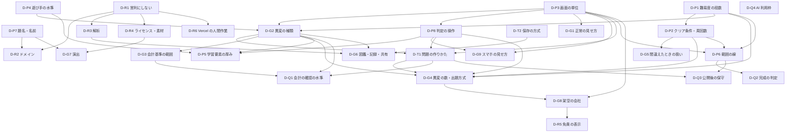

# 未決の洗い出し (目的から導いた決定の DAG)

Sub-task: #5 (Task #3)。作成日: 2026-11-03。根拠: docs/requirements.md (起案の理解、承認済み)、docs/plans/research.md (#4、合意済み)、人間の言葉の原文 (requirements.md の根拠欄)。
orchestra-core の grilling 2 に従う: 固定の項目表から選ばず、「目的が達成されたと言えるには、何が決まっている必要があるか」から導く。
印: **人間が言った** / **文書にある** / **導いた** / **仮定** / **未確認** (research.md と同じ)。
このページは決める事柄を並べるだけで、答えは出さない (答えの候補と、それが案の比較 (#6) でどう扱われるかまで書く)。
決定の ID は `D-` で始める (D-P2 など)。人間への問いの番号 (責任者が「Q」と連番で振る) とは別で、人間向けの文面では内部の ID を使わない。「起案の問い 1・3」は、起案のときに人間へ送った問いの番号 (requirements.md の「Q1 の承認」「Q3 の選択 1」)。

## 0. 目的と、決まっていること (聞き直さない)

目的: 「異変を探してループを抜けるタイプのブラウザゲームを作る。題材は投資家向けの決算書と IR」。成功の定義: 「URL を開けばブラウザで遊べ、人に見せられる」。(requirements.md)

| 決まっていること | 出所 |
| --- | --- |
| 題材は投資家向けの決算書と IR。異変を探してループを抜ける型 | 人間が言った (2026-11-03) |
| 難易度を選べる。やさしいは見た目と計算の異変、むずかしいは会計の異変を多めにする | 人間が言った (「難易度ごとでいいかも！」) |
| リポジトリは calliope-pro/kessan-8 (公開) | 人間が言った |
| 公開する場所は Vercel の静的サイト | 人間が承認 (起案の問い 3 の選択 1) |
| 架空の会社だけを使う。実在の企業名・ロゴ・人物は使わない | 人間が承認 (起案の問い 1) |
| 費用は 0 円 (無料枠の範囲)。期限は無し | 人間が承認 (起案の問い 1) |
| 日本語だけ。PC のブラウザを優先し、スマホでも遊べる | 人間が承認 (起案の問い 1) |
| 課題管理は GitHub Issues と Projects。人間への質問は責任者の会話の中 | 人間が言った・推測 (requirements.md) |
| 進め方はオーケストラが自動。人間は判断が要るときだけ答える | 人間が言った |

「既存作品の名前・見た目を真似ない」は人間の要件ではなく、Task の仕様 (責任者の指示)。人間の要件と混ぜない (research.md §4)。

## 1. 決める事柄の一覧

列の意味: **誰が** = 人間 (オーケストラの外。関門を通ったものだけ聞く) / 責任者 (オーケストラの中) / 技術 (技術責任者の見立てが要る。凍結の前は見立てまで)。**別の答えなら** = 答えが変わると何が変わるか (何も変わらないものは決定ではないので載せない)。

### P: 範囲と目的に直結するもの

| ID | 決める事柄 | 目的とのつながり | 別の答えなら何が変わるか | 依存 | 誰が | 答えの候補 (答えではない) |
| --- | --- | --- | --- | --- | --- | --- |
| D-P1 | 難易度の段数と名前 | 要件の「難易度を選べる」。人間の言葉は「やさしい」「むずかしい」の 2 つに触れるが、中間があるかは言っていない | 段数が増えると、異変の種類の割り当て (D-G2)・問題の数 (D-G4)・工数が段数に比例して増える。研究の先行例は 3 段 (かんたん・ふつう・むずかしい) | なし | 人間 (価値判断。人間の言葉の「例」を超える) | 2 段 (やさしい・むずかしい) / 3 段 (間に 1 つ足す) |
| D-P2 | クリア条件と周回数 (何問連続で正しく判定するとクリアか)。あわせて 1 回のプレイの目安の長さ (クリアまで何分か) | 「ループを抜ける」の定義。成功の定義の「遊べる」と、「人に見せられる」相手が最後まで遊ぶか | 数が大きいと、1 周が長く、問題数 (工数) が増え、間違えたときの戻りの重さ (D-G5) も変わる。数が小さいと、すぐ終わり「ゲームになっていない」恐れ。1 回の長さは「周回数 × 1 問の所要 (D-P3・D-P8 で決まる)」で決まり、案ごとに大きく違うので、案の比較の表に出す (導いた) | D-P1 | 人間 (価値判断・好み)。1 回の長さの期待値は plan-comparison.md §2 の表で見る | 5 前後 / 8 / 10 以上。難易度ごとに変えるかも含む |
| D-P3 | 1 問の画面の単位 (遊び手が 1 回に見て判定する対象)。人間の言葉は「決算書, IRとか」で、IR を入れるかも含む | 何が「異変を探す」画面かで、遊びの全体が決まる | 決算短信のサマリー 1 枚か、添付資料の数ページか、IR スライド 1 枚か、複数の資料の組かで、画面の数・異変の種類 (D-G2)・スマホでの見せ方 (D-G9)・工数が大きく変わる。IR を外すと、人間の言葉の一部を落とすことになる (外したものとして §6 に載せ、人間の選択で明示する) | なし | 責任者 (案の筋を分ける軸として #6 で並べ、人間に選んでもらう) | サマリー (表 1 枚) 中心 (IR を外す) / サマリー + 財務諸表 + 注記 (IR を外す) / 決算短信 + IR スライド (IR を入れる) |
| D-P4 | 想定する遊び手の水準 | 「人に見せられる」の相手は誰か。会計の異変 (むずかしい) は簿記・財務の知識を求める (research.md §2.3) | 知識前提なしにすると、むずかしいの異変を「学べる」作りにする必要があり (D-P5)、前提ありにすると、遊び手の範囲が狭く、「人に見せられる」の幅が変わる | なし | 責任者 (要件から導く: 人間の言葉で難易度ごとに分けている。聞かない)。凍結のときの理解の表に「推測」の行として載せる | 簿記を知らない人でも楽しめる / 基礎知識がある人向け / 難易度ごとに変える |
| D-P5 | 学習要素の厚み (答え合わせ・解説をどこまで書くか) | 人間の言葉は「ゲーム」「やるのとかいいかな」で、学習目的は言っていない。ただし答え合わせ (異変の場所を示す) は型の標準 (research.md §1.2) で、足すことにならない | 異変の場所を示すだけなら標準の範囲で工数も小さい。理由・用語の解説まで足すと、問題ごとの文章量 (工数) と会計の正確さの確認 (D-Q1) の負担が増え、人間が言っていない「学習」という目的を足すことになる | D-P4・D-G2・D-P8 | 責任者 (標準の範囲は D-P4 の答えを見て決める)。用語の解説まで足すかは、追加オプション (O5・O6) の問いで人間が答える (plan-comparison.md §7。推奨・既定は入れない) | 異変の場所を示すだけ (標準) / 短い理由 (1 行) / 用語の解説つき |
| D-P6 | 範囲の線: 最初の公開に何を入れ、何を後に回すか (段階公開の有無) | 期限は無いが、「URL を開けば遊べる」に至る最小を決める | 段階公開にすると、先に出す範囲 (例: 短信のみ) の完成の定義が別に要る。一括にすると、全部が揃うまで公開できない (1 回目の公開が遅い)。段階公開にすると、1 回目の公開は早いが、合計の工数は一括より増え、完成も遅れる (plan-comparison.md §6: 案 B で、計画の仮定 +47.2 h・経路 +35.8 h、測定反映 +27.0 h・経路 +30.4 h。導いた) | D-P1・D-P2・D-P3 | 人間 (範囲は価値判断) | 一括 / 短信のみを先に出し、IR を後から足す (段階公開) |
| D-P7 | 題名・名前 (ゲームの題、サブタイトル、ストア名、共有時の名) と、公開 URL の名前 (リポジトリ名 kessan-8 のままか、題名に合わせるか) | 「人に見せられる」。既存作品の名前は商標登録済み (research.md §4、J-PlatPat 2026-11-03)。連想を避けるか、型の遊びのままに寄せるかは好み | 題名に既存作品の語を使うと商標権に触れる可能性が高い。名前を一度公開すると、変更に URL・共有の再発行の手間がかかる (取り消しの費用)。URL は Vercel の既定のサブドメインとして kessan-8.vercel.app にできる可能性がある (測った: 2026-11-03 時点で未使用の応答 404 DEPLOYMENT_NOT_FOUND。取得できるかは Vercel の画面で確かめるまで未確認)。商標は名前の登録なので、題名だけ避け、周回数 8 とリポジトリ名で型を示すのは問題にならないと考えられる (仮定。法務の専門家の判断ではない)。周回数 8 を使うかは D-P2 で決める | なし | 人間 (価値判断・取り消しの費用・法務に響く) | 題名: 既存作品と連想の無い題 / 型を明示するが固有の語を避けた題。URL: kessan-8 のまま / 題名に合わせる |
| D-P8 | 判定の操作 (異変の有無だけを答える 2 択か、異変の場所を指すか) | 「正常なら進み、異変があれば引き返す」の判定を、遊び手がどう行うか。型の核 | 場所を指す方式は、答え合わせ (D-P5) で何を示すかが明確で、当てずっぽうが効かない一方、スマホで表の 1 マスを押せるか (D-G9)・問題のデータに異変の位置が要るか (D-T1)・工数が変わる。2 択は作りが単純だが、当てずっぽうで半分当たるので、周回数 (D-P2)・異変の比率 (D-G4) との兼ね合いが要る。先行例は 2 択 (承認 / 変更をリクエスト)、答え合わせで場所を示す (research.md §1.2) | D-P3 | 責任者 (遊びの設計。案の軸ではなく既定を置く)。人間に聞くのは、案の選択で遊びの手触りが変わるときだけ | 2 択 (異変あり / なし) / 場所を指す / 2 択 + 答え合わせで場所を示す |

### G: 遊びの中身

| ID | 決める事柄 | 目的とのつながり | 別の答えなら何が変わるか | 依存 | 誰が | 答えの候補 |
| --- | --- | --- | --- | --- | --- | --- |
| D-G1 | 正常の見せ方 (遊び手が「正常」をどう覚えるか) | 異変は正常からのずれ。正常が分からなければ判定できない (先行例は、説明文をいつも同じ書き方にしている。research.md §1.2) | 見せ方が無いと、やさしいでも何が異変か判定できず遊べない。毎回同じ書式にすると画面の作りは楽だが、変化が乏しい。最初に見本を見せると、1 周の長さが伸びる | D-P3 | 責任者 (遊びの設計。人間に聞かない) | 毎回同じ書式 / 開始時に見本 / 前の問題と比較できる表示 |
| D-G2 | 異変の種類と、難易度への割り当て | 要件: やさしい = 見た目と計算、むずかしい = 会計 | 種類を増やすと、正常と異変の境界の確認 (D-Q1) の負担と問題制作の工数が増える。継続企業の前提・注記・監査の異変 (research.md §2.3) を範囲に入れるかで、むずかしいの深さが変わる | D-P1・D-P3・D-P4 | 責任者 (種類の候補は research.md にある)。範囲に注記・継続企業・監査を入れるかは、D-P4 の答えを見て責任者が決める | 見た目 (単位・符号・誤植) / 計算 (合計・増減率・比率) / 貸借の等式・CF の整合 / 注記・継続企業・監査 / 定性と数字の矛盾 / チャートの作法 |
| D-G3 | 会計基準と様式の範囲 | 実在の様式は日本基準・IFRS・米国基準・連結・非連結の組み合わせがある (research.md §2.1) | 日本基準 (連結) だけにすれば、画面と異変の確認が単純で、正確さを保ちやすい。IFRS を足すと、異変の「正常」の基準が増え、確認の負担が増える | D-G2 | 責任者 | 日本基準・連結のみ / 日本基準 (連結・非連結) / IFRS も |
| D-G4 | 異変の数と出題の方式 (固定の問題を並べるか、抽選か。異変ありとなしの比率。問題のプールの大きさ) | 「ループ」の遊びの核。再プレイの面白さと、問題制作の工数を決める | プールが小さいと、すぐに全問を覚えられる。大きいと、問題の制作と正確さの確認 (D-Q1) の工数が増える。比率を変えると、判定の緊張が変わる。判定の操作が 2 択 (D-P8) だと、当てずっぽうでも半分は当たるので、周回数 (D-P2) と比率の組み合わせでクリアのしやすさが大きく変わる | D-P1・D-P2・D-P8・D-G2・D-T1 | 責任者 (数と比率)。プールの大きさは工数と引き換えなので、案の軸 (#6) に載せる | プール数十 / 数百 / 生成で無限。異変ありの比率 (半々 / 偏らせる) |
| D-G5 | 間違えたときの扱い (最初に戻る / 少し戻る / 続ける) | 人間の言葉は「ループを抜ける」。型の共通は「最初に戻る」(research.md §1.1) | 「最初に戻る」は型どおりの緊張が出るが、周回数 (D-P2) が大きいと理不尽に感じる。戻りが軽いと、クリアしやすく緊張が薄い | D-P2 | 責任者 (型の範囲の設計) | 最初に戻る / 難易度ごとに変える / 1 つ戻る |
| D-G6 | 図鑑・記録・共有 (見つけた異変の図鑑、進行の保存、結果の共有) | 「人に見せられる」。静的サイトなのでサーバを持たない (Vercel の静的サイト、人間が承認) | 図鑑は保存の仕組み (ブラウザ内) の工数が要る。共有は、外部サービスの規約・OGP 画像・個人情報に関わる (D-R3・D-R5)。ランキングはサーバが要り、公開方式 (Vercel の静的サイト) と費用 0 円の前提に衝突する | D-G2・D-R3・D-T2 | 責任者 (図鑑・保存)。ランキング等、公開方式と費用に響くものは、人間に諮る | 図鑑のみ / 図鑑 + 結果共有 / ランキング (サーバ要) |
| D-G7 | 演出 (見た目の雰囲気、音の有無、遷移の演出) | 「人に見せられる」の見栄え。好みの領域 | 音素材・フォント・画像は、素材の権利と費用 (0 円) に響く (D-R4)。演出が厚いと工数が増える。既存作品に連想させる見た目は避ける (D-P7) | D-R4・D-P7 | 追加オプション (O3・O4) の問いで人間が答える (plan-comparison.md §7。推奨・既定は O3 だけ) | ミニマル (文字と表だけ) / 雰囲気のある配色・遷移 / 音つき |
| D-G8 | 架空の会社の設定 (数・業種・名前の付けかた・世界観の有無) | 要件: 架空の会社だけを使う | 会社の数が増えると、問題の多様性は上がるが、設定の整合の確認の工数が増える。要件は「実在の企業名を使わない」で上場会社に限らないので、名前は国税庁の法人番号公表サイトの全件データ (非上場も含む。CSV/XML) と突き合わせ、完全一致を避ける。実在しない地名や造語を使う、明らかに架空と分かる付けかたを既定にすると確認の手間が減る (research.md §4) | D-G4・D-P3 | 責任者 (実在との衝突の確認は、確認の Sub-task で行う) | 数社を使い回す / 問題ごとに生成 / 世界観のある連作 |
| D-G9 | スマホでの見せ方 (表の多い画面を小画面でどう見せるか) | 要件: スマホでも遊べる (PC 優先) | 横スクロール・縮約・縦に並べ替え・拡大操作で、画面の作りと、見つけやすさ (難易度そのもの) が変わる。スマホで表全体を見せられないと、異変が見つからない。判定の操作が「異変の場所を押す」(D-P8) なら、小さな数字を指で押せるかも問題になる | D-P3・D-P8 | 責任者 | 横スクロール / 縦の組み替え / 拡大操作 / スマホは別の簡易表示 |

### R: 公開・規約・費用

| ID | 決める事柄 | 目的とのつながり | 別の答えなら何が変わるか | 依存 | 誰が | 答えの候補 |
| --- | --- | --- | --- | --- | --- | --- |
| D-R1 | 営利にしない前提 (広告・課金・制作の対価を受けるか) | 費用 0 円 (Vercel Hobby)。Hobby は非営利の個人利用に限られ、広告・課金・制作の対価を受けると営利 (research.md §3) | 営利にするなら Pro (有料) が要り、承認済みの「費用 0 円」と衝突する。したがって要件から「営利にしない」が導ける | なし | 責任者 (要件から導く。聞かない)。凍結のときの理解の表に「推測」の行として載せ、人間がずれていれば直せる形にする | 営利にしない (現状) |
| D-R2 | ドメイン (Vercel の既定のサブドメインか、独自ドメインか) | 「URL を開けば」の URL。費用 0 円 | 独自ドメインは年額の費用が出て、承認済みの「費用 0 円」を超える。したがって要件から「既定のサブドメイン」が導ける。題名 (D-P7) を変えると URL が変わる (取り消しの費用) | D-P7・D-R1 | 責任者 (要件から導く。聞かない)。理解の表に「推測」の行として載せる | 既定のサブドメイン |
| D-R3 | アクセス解析・計測の有無 | 公開後の「人に見せられる」の確かめには役立つが、人間は言っていない | 入れると、規約・プライバシー表示・同意の表示が要る。Vercel の Web Analytics は Hobby で月 50,000 イベントまで含まれる ([Hobby プラン](https://vercel.com/docs/plans/hobby)、2026-11-03 に確認) | D-R1 | 責任者 (既定は入れない。人間が言っていない機能を足さない) | 入れない / Vercel の解析 (無料枠) |
| D-R4 | ライセンスと素材 (自分のコードのライセンス、フォント・画像・音の素材の権利) | 公開リポジトリ (人間が言った)。「実在の企業名・ロゴ・人物を使わない」の素材版 | ライセンスを付けないと、第三者の再利用の可否が曖昧。素材に権利のあるものを使うと、公開リポジトリで権利の問題が出る。取り消せないのは、既に公開した版に付けたライセンス (許諾を取り消せない) と、外部からの貢献を受け入れた後の変更。書き手が 1 人のあいだは、以後の版のライセンスは変えられる (法務の専門家の判断ではない) | D-R1 | ライセンス: 人間 (既に公開した版は取り消せないので、最初の公開の前に決める)。素材の方針 (権利のあるものを使わない): 責任者 | MIT / ほかのライセンス / 付けない。素材は自作またはライセンスの明確なもの |
| D-R5 | 免責の表示 (架空であること、投資判断の助言ではないこと) | 題材が投資家向けの決算書。実在の企業・人物は使わないが、実在を思わせると誤解される恐れ | 表示を置くと、画面に 1 か所の文言が増える (工数は小さい)。置かないと、実在の企業と誤認される恐れ | D-G8 | 責任者 (文面)。法務の専門家の判断は無い (research.md §5) | 起動画面とフッターに表示 / 表示しない |
| D-R6 | Vercel のアカウントと GitHub 連携の人間の作業 (新しいリポジトリへの連携の許可と、プロジェクトの取り込み) | 公開 (成功の定義) の前提。DAG に入れないと、公開の Task が人間待ちで止まる (#4 のレビューの申し送り) | アカウントは既にある: calliope-pro の公開リポジトリ 10 件の homepage が *.vercel.app で、そのうち genome-assembly-game の GitHub deployments は 25 件、最新は vercel[bot] による Production (2025-08-11)。したがって Vercel のアカウントと GitHub 連携は既にあり、残る人間の作業は、kessan-8 への連携の許可 (GitHub App の対象リポジトリに足す。対象が「すべて」なら不要) と、Vercel の画面でのプロジェクトの取り込み。Vercel CLI はこの端末に無く、オーケストラはログインできない | D-R1 | 人間の作業 (オーケストラではできない)。判断は要らない。所要時間は 5〜10 分 (仮定: 画面操作 2〜3 手順。測っていない。実装後の公開の Task で、人間に頼む 1 件として所要時間つきで書く) | 人間が連携を許可し、取り込む |

### Q: 品質と完了

| ID | 決める事柄 | 目的とのつながり | 別の答えなら何が変わるか | 依存 | 誰が | 答えの候補 |
| --- | --- | --- | --- | --- | --- | --- |
| D-Q1 | 会計の正しさの確認の水準 (正常と異変の境界を、誰がどこまで確認するか) | 異変の判定が成り立つ条件。正常を異変と扱うと、会計の分かる遊び手が不正解になる (research.md §2.3、レビューの指摘) | 確認を厚くすると、会計の分かる人の手間 (人間の作業) か、一次資料に基づく確認 Sub-task の工数が増える。薄いと、誤った異変が公開される。むずかしいの正常データの水準 (売上債権の水準など。research.md の未確認: 一律の目安の出典が無い) も、ここで責任者が決める: 確認 Sub-task で、一次資料と同業の実例の範囲に収め、一律の数字を異変の根拠にしない | D-G2・D-G3・D-T1 | 責任者 (確認の方法は Sub-task にする)。会計の分かる人間に頼むかは、人間にしか分からない事実なので、必要なら人間に聞く | オーケストラが一次資料 (財規・作成要領) で確認 / 人間または会計の分かる人が確認 / 免責の表示 (D-R5) で担保 |
| D-Q2 | 「人に見せられる」の確かめかた (完成の受け入れ条件の組み立て) | 成功の定義 (承認済み) を確かめる方法。受け入れ条件が「成果物がある」だけだと、本当の目的を確かめられない | 機械的な確認 (URL が開き、全難易度がクリアできる) はオーケストラの仕事で、人間の手間は無い。人間のテストプレイは、決定ではなく「人間に頼む作業」(所要時間つき) として、必要と判断した時だけ頼む | D-P6 | 責任者 (確かめかた)。人間のテストプレイを頼む場合は、人間に頼む作業として所要時間つきで送る | URL が開き全難易度がクリアできる自動確認 / 人間のテストプレイ (人間に頼む作業) |
| D-Q3 | 公開後の保守 (問題の追加・訂正・不具合対応) | 期限は無いが、公開後の扱いは言っていない | 保守するなら、問題追加の仕組み (D-T1) と訂正の手順が要る。しないなら、公開時点で完結させる (範囲 D-P6 に響く) | D-P6・D-T1 | 責任者 (影響が小さい: 後から問題の追加を頼めば済む。既定は誤りの訂正のみ)。凍結のときの理解の表に「推測」の行として載せる | 公開後は凍結 / 問題の追加と訂正を行う |
| D-Q4 | オーケストラの実行コスト (AI の利用枠) の扱い: 費用 0 円に含めるか。契約の上限を超えた従量課金 (extra usage) を許すか (許すなら上限額)。同時に動かす組の数 | 要件の「費用 0 円 (無料枠の範囲)」が公開費用だけを指すのか、AI の利用枠も含むのか。黙って置いた仮定 | 含める / 課金を使わないなら、契約の上限の中に収まる作り方 (工数の上限・同時に動かす組の数の制限) が制約になる。契約は Max で extra usage が有効 (測った。plan-comparison.md §3.5。上限額は人間にしか分からない)。課金を許すなら、費用 0 円に反するので、上限額を決める必要がある。既定のまま上限を超えると、止まらずに従量課金される | なし | 人間 (費用の定義)。オーケストラは課金の設定を変えられず、使用率も読めないので、extra usage を切るか上限額を 0 にする作業 (1〜2 分。仮定) を人間に頼み、開発の最初の Task の前に済ませる (blocking) | 契約の上限の中でだけ (extra usage の課金は使わない。同時に 2 組から。既定でなく推奨。人間の設定が要る) / extra usage の課金も許す (上限額と組の数を決める) |

### T: 技術に響くもの (凍結の前は技術責任者の見立てまで。設計・実装は凍結の後)

| ID | 決める事柄 | 目的とのつながり | 別の答えなら何が変わるか | 依存 | 誰が | 答えの候補 |
| --- | --- | --- | --- | --- | --- | --- |
| D-T1 | 問題の作りかた (人が 1 問ずつ書く / 数値を生成して異変を注入する) | 「異変を探す」の核の作り方。工数と拡張性、正確さの確認 (D-Q1) が変わる | 手書きは 1 問ごとの正確さを確かめやすいが、プールを増やす工数が問題数に比例する。生成は、規則 (等式・比率) を守る正常データの生成と、異変の注入の設計が要り、初期工数が大きいが、プールが大きくなる。生成の正常データは、会計の整合 (research.md §2.3) をすべて満たす必要がある。判定の操作が「場所を指す」(D-P8) なら、問題のデータに異変の位置を持たせる必要がある (実現性は技術の見立て: 仮定) | D-P3・D-P8・D-G2 | 技術 (見立て)。案の軸として #6 に載せる | 手書き固定 / 生成 + 注入 / 手書きのテンプレート + 数値だけ変える |
| D-T2 | 保存の方式 (進行・図鑑をブラウザのみに保存するか) | 静的サイトの前提 (サーバ無し)。先行例はブラウザ保存 (research.md §1.2) | ブラウザのみにすると、別端末で引き継げないが、個人情報を扱わず、規約・同意の問題が出ない。サーバに置くと、費用 0 円・静的サイトと衝突する | なし | 技術 | ブラウザのみ (localStorage 等) / 保存しない |

## 2. 黙って置いていた仮定 (すべて決定として上の表に載せた)

| 仮定 | 載せた先 |
| --- | --- |
| AI の利用枠は費用 0 円に含まれない | D-Q4 |
| URL は Vercel の既定のサブドメインでよい | D-R2 |
| サーバを持たない (ランキング等は無い) | D-G6・D-T2 |
| 実在の様式の文面を再現せず、項目の並びだけ参考にする | D-G3 (様式の範囲) と research.md §2.1 の仮定 |
| 営利にしない | D-R1 |
| 人間が会計の確認をしない (オーケストラで確認する) | D-Q1 |
| 題名は既存作品と連想の無いものにする | D-P7 (人間の価値判断。仮定を既定にしない。周回数 8 は D-P2) |
| 解析・計測は入れない | D-R3 |
| 学習目的は人間が言っていない | D-P5 |
| 判定は「異変の有無を答える 2 択」でよい (先行例の型をそのまま) | D-P8 |
| Vercel のアカウントは無い (人間に作ってもらう) | D-R6 (gh で既にあると測った。残る作業は連携の許可と取り込み) |

## 3. 費用・取り消しの費用・規約に触れる所の点検

| 所 | 内容 | 載せた先 |
| --- | --- | --- |
| 費用が出る | 独自ドメイン (年額)、Vercel Pro (営利にする場合)、素材の購入、AI の利用枠と、上限を超えた分の従量課金 (extra usage。契約は Max で有効: 測った) | D-R2・D-R1・D-R4・D-Q4 |
| 取り消しに手間がかかる | 題名・URL の公開後の変更 (共有の再発行)、ライセンス (既に公開した版は取り消せない。以後の版は、外部からの貢献を受け入れる前なら変えられる)、リポジトリ名 (承認済み) | D-P7・D-R2・D-R4 |
| 他者・規約・法令に触れる | 商標「８番出口」 (登録済み)、Vercel Hobby の営利制限、実在の企業名との衝突、素材の権利、免責 | D-P7・D-R1・D-G8・D-R4・D-R5 |
| ほかの決定の前提 (期限・資源の上限・役割) | 期限は無し。資源は無料枠と AI の利用枠 (D-Q4)。役割は、人間は判断だけ、人間の作業は D-R6・D-Q2 に限る | D-R6・D-Q2・D-Q4 |

## 4. 決定の DAG (依存の向き: 上流が決まらないと下流を決められない)

根 (依存が無い): D-P1・D-P3・D-P4・D-P7・D-R1・D-Q4・D-T2。これらから決められる。

## 5. 案の比較 (#6) への引き継ぎ

**案の筋を分ける軸** (#6 で案ごとに答えを変えて並べる。人間は案を選ぶことで答える): **D-P3 (画面の単位。IR を入れるかを含む)** と **D-T1 (問題の作りかた)** の 2 つだけ。D-P1 (難易度の段数)・D-P5 (解説)・D-G6 (図鑑・共有)・D-G7 (演出) は、全案共通の追加オプションの問い (plan-comparison.md §7。既定は O3 だけ)。D-P6 (最初の公開の範囲) は別の問い。答えで工数・日程・費用・リスクが大きく変わる軸は、案の 2 つ。

**人間に決めてほしい点 (案の比較の最後に載せる。関門を通るもの)**: D-P2 (クリア条件・周回数・1 回の長さ)・D-P6 (最初の公開の範囲。案の軸でもあるが、案を選んでも段階公開は決まらないので別の問いにする)・D-P7 (題名・名前と、公開 URL の名前)・D-R4 のうちライセンス (既に公開した版は取り消せない)・D-Q4 (AI の利用枠の扱い。extra usage の課金を許すか、含めるか。実測の桁を見せて、使えるかを聞く。extra usage を切る作業を、開発の最初の Task の前に頼む。blocking)。案の選択と追加オプションの問いもある (plan-comparison.md §7)。

**人間の作業 (判断は要らない)**: D-R6 (Vercel の連携の許可と取り込み。所要時間は仮定で 5〜10 分)。人間のテストプレイは、必要と判断した時だけ、人間に頼む作業として所要時間つきで送る (D-Q2)。

**要件から導ける、または影響が小さい (聞かない。凍結のときの理解の表に「推測」の行として載せる)**: D-R1 (営利にしない)・D-R2 (既定のサブドメイン。D-P7 で URL の名前を人間が選ぶ場合を除く)・D-P4 (遊び手の水準: 難易度ごとに変える)・D-Q3 (公開後の保守: 誤りの訂正のみ)。

**責任者が決めて記録する点 (人間に聞かない)**: D-P8 (判定の操作)・D-G1・D-G2 (範囲の線は D-P4 次第)・D-G3・D-G4・D-G5・D-G8・D-G9・D-R3・D-R4 のうち素材の方針・D-R5・D-Q1 (確認の方法)・D-Q2 (確かめかた)・D-T2。

案の比較での扱い: 各案で、上の「案の筋を分ける軸」の答えを変え、それ以外の決定は案ごとに既定値を置いて「仮定」と明示する。#4 の申し送りは、決まった先がある: 商標の表記ゆれ・図形商標は、plan-comparison.md §7 の D-P7 の行 (表記ゆれと称呼の文字検索は 0 件・同じ 1 件。図形のみ・検索していない語順は公開の前に決めた題で再検索)、売上債権の適正な水準は、plan-comparison.md §8 (D-Q1 の確認 Sub-task で責任者が決める。人間への問いにしない)。

**責任者への申し送り (領域のあいだの相談)**: #6 の工数・日程は、D-T1 (問題の作りかた)・D-T2・D-G9・D-P8 の実現性と工数に技術の見立てが要る。#6 の見積もりの前に、技術責任者に相談のチケットを出すこと (orchestrating-business の手順 3、freezing.md の「領域のあいだの相談」)。出ない間は、#6 は技術の見立てを仮定として明示して進める。

## 6. 範囲から外したもの (別の行に残す)

| 外したもの | 理由 |
| --- | --- |
| 英語など多言語 | 要件で日本語だけ (人間が承認) |
| アプリストア向けの配布・ネイティブアプリ | 要件はブラウザで遊ぶこと |
| ユーザーアカウント・ログイン | 静的サイトで、個人情報を扱わない前提 (D-T2) |
| 実在の企業の決算の再現 | 要件で実在の企業名を使わない |
| 有料化・広告 | D-R1 (営利にしない前提) |
| IR 資料 (決算説明資料) | D-P3 で「IR を外す」案が選ばれた場合だけ。人間の言葉「決算書, IRとか」の IR を落とすことになるので、選ばれたら人間の選択として明示する |
