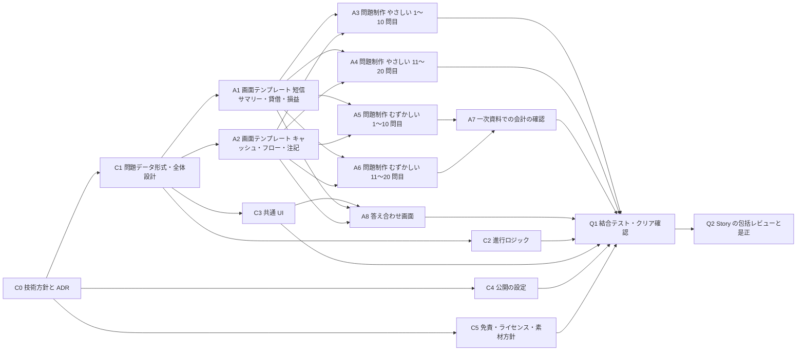
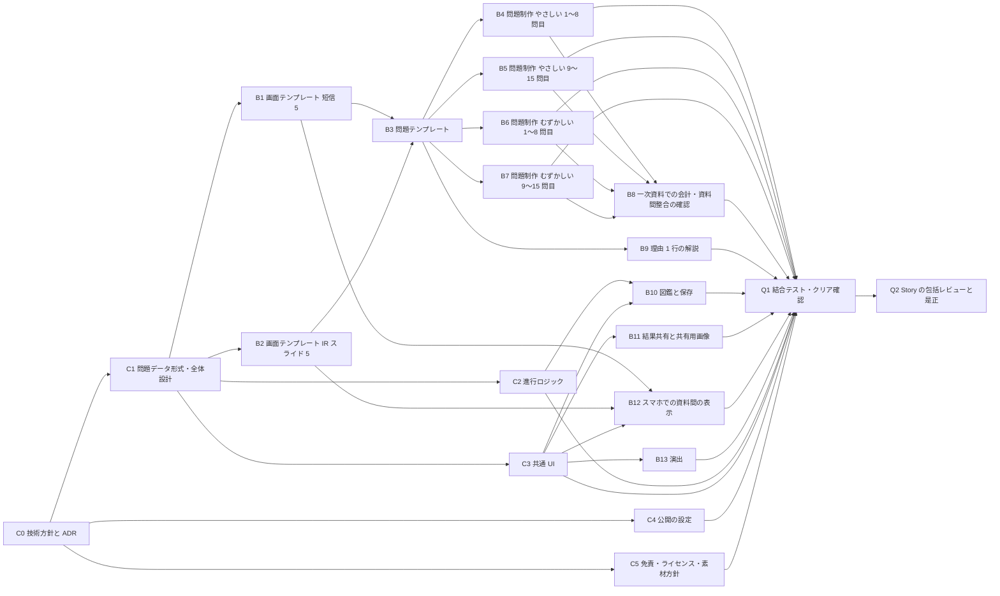
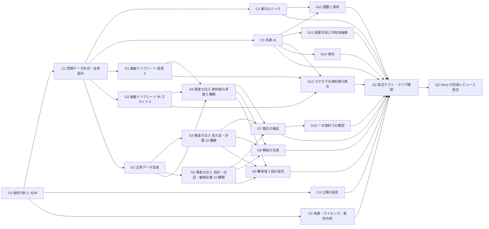

# 案の作成と比較 (遊びの中身・作業の依存・工数・日程・費用・推奨)

Sub-task: #6 (Task #3)。作成日: 2026-11-03。根拠: docs/requirements.md (承認済みの起案の理解)、docs/plans/research.md (#4)、docs/plans/open-decisions.md (#5)。
このページは、人間が案を選ぶためのページの材料。責任者が問いの文面を書く。数字の再現は `docs/plans/estimate.py` (標準ライブラリのみ。`python3 docs/plans/estimate.py`)。

## 0. このページの読みかた

**数字の印**: **人間が言った** / **文書にある** (出典つき) / **測った** / **導いた** (式と入力を示す) / **仮定** (測っていない。人間が確かめるまで要件にしない)。印の無い数字は書かない。

**工数・日程は、すべて仮定から導いた相対比較の材料で、実測ではない。** 案のあいだの大小と、「何が効いて順位が変わるか」(§5 感度) を見るためのもので、「何時間で終わる」という約束ではない。測る手順は §8。
- 工数の単位: 「組 (進める役と監視役) の作業時間」(h)。1 つの Task は、ケース表の固定・実装・レビューの往復を含む。 **仮定**
- 日程の単位: 作業の経過時間。1 時間の作業 = 1 時間の経過、と置く。 **仮定**
- 案のあいだで同じ前提で数える (数え方がずれないように、下の「見積もりの単位」を全案で共通にした)。

### 全案で共通の前提 (すべて仮定。人間が決める点 (§7) は、決まるまでこの値で比べる)

| 項目 | 全案共通の値 | 印 |
| --- | --- | --- |
| クリア条件 | 連続 5 問を正しく判定する。人間が決める (open-decisions の P2) | 仮定 |
| 間違えたときの扱い | 最初に戻る (型の標準。research.md §1.1) | 仮定 (G5 の既定) |
| 判定の操作 | 異変の有無を 2 択で答え、答え合わせで異変の場所を示す (先行例と同じ。research.md §1.2) | 仮定 (P8 の既定) |
| 会計基準の範囲 | 日本基準・連結のみ。実在の様式の文面は再現せず、項目の並びだけ参考にする | 仮定 (G3 の既定) |
| 会社 | 架空の会社だけ (実在企業を使わない) | 人間が承認 (Q1) |
| 異変ありの問題の比率 | 約 7 割 (残りは正常) | 仮定 |
| 費用・公開 | 公開は Vercel の静的サイト、費用 0 円 (無料枠の範囲) | 人間が承認 (Q1・Q3) |
| 営利にしない | 広告・課金・制作の対価を受けない | 導いた (費用 0 円 + Vercel Hobby の非営利制限。research.md §3) |

### 見積もりの単位 (全案共通。すべて仮定)

| 項目 | 値 | 印 |
| --- | --- | --- |
| Task の見積もり = 実装時間 × 1.5 (ケース表の固定とレビューの往復を実装の 5 割と置く) | 係数 1.5 | 仮定 |
| 画面テンプレート 1 つ | 実装 2 h | 仮定 |
| 問題 1 問の制作 (手書き。サマリー 1 画面中心) | 実装 0.5 h | 仮定 |
| 問題 1 問の制作 (資料束。短信と IR を組み合わせる) | 実装 1.0 h | 仮定 (サマリー 1 画面の 2 倍) |
| 一次資料での会計の確認 | 1 問あたり実装 0.25 h (短信中心)、0.4 h (資料間の整合を含む) | 仮定 |
| 異変の種類 1 つの実装 (生成して注入する場合) | 実装 1.0 h | 仮定 |
| 解説 (種類ごと) | 理由 1 行 0.2 h、理由 + 用語の解説の生成テンプレート 0.3 h | 仮定 |
| 共通の基盤 (進行ロジック・共通 UI・公開の設定・方針) | 実装 計 18 h (基盤 4 + 6 + 公開 2 + 1 + 方針 2 + 全体設計 3) | 仮定 |
| Story の包括レビューと是正 | 4 Story × 1 h (係数を掛けない) | 仮定 |
| 1 問の所要 (遊び手が見て判定するまで) | 案 A 45 秒、案 B 90 秒 (資料をまたぐため)、案 C 60 秒 | 仮定 |
| 1 回のページの転送量 | 案 A 2 MB、案 B 3 MB、案 C 8 MB (音を含む) | 仮定 (測っていない。実装後に測る) |

## 1. 人間の言葉と案の対応 (外した範囲は別の行に残す)

| 人間の言葉の原文 (requirements.md) | 案 A | 案 B | 案 C |
| --- | --- | --- | --- |
| 「8番出口みたいなゲーム作りたい！！」(2026-11-03) | 判定ループの型を使う (固有の名前・見た目は真似ない) | 同じ | 同じ |
| 「投資家向け決算書, IRとかについてやるのとかいいかな〜」 | **決算書だけ。IR は外す** (人間の言葉の一部を落とす) | 決算書と IR の両方 | 決算書と IR の両方 |
| 「難易度ごとでいいかも！」(やさしい = 見た目と計算、むずかしい = 会計を多めに) | 2 段 (要件どおり) | 2 段 (要件どおり) | 3 段 (ふつうを足す。人間が言っていない) |
| 「新しいrepoがいいな！！！」「レポはpublicで！」 | 満たす | 満たす | 満たす |
| URL を開けばブラウザで遊べ、人に見せられる (成功の定義) | 満たす (見栄えは最小) | 満たす (見栄えは標準) | 満たす (見栄えは厚い) |
| 架空の会社だけ。実在の企業名・ロゴ・人物は使わない | 満たす | 満たす | 満たす |
| 費用 0 円 (無料枠の範囲)・期限なし | 満たす | 満たす | 満たす。ただし転送量が無料枠に近い (§3) |
| 日本語だけ。PC 優先でスマホでも遊べる | 満たす | 満たす (資料間の表示に追加の作業) | 満たす (同上) |
| オーケストラが自動で作る。人間は判断が要るときだけ答える | 人間の作業は少ない | 同じ | 同じ |

**人間の言葉に無いもの (先回りして足さない)**: ふつう (3 段目)、無限の問題 (生成)、音つきの演出、ランキング。案 C はこのうち 3 つを含む。案 A・B は含まない。

## 2. 案の筋と、遊びの中身

3 案は、**問題の作りかた** (open-decisions の T1) と **画面の単位** (P3) が違う筋で、規模の大小だけの違いではない。

- **案 A 「決算短信の一枚」**: 決算短信 (サマリーと財務諸表) の 1 つの資料を深く読む。問題は人が 1 問ずつ書く。IR は外す。いちばん軽い。
- **案 B 「決算短信 + IR」**: 決算短信と IR スライドを組み合わせ、資料のあいだの食い違いも異変にする。問題は、手書きのテンプレート (会社 × 資料束) に数値を当てはめて作る。人間の言葉をすべて満たす標準の案。
- **案 C 「生成する決算」**: 数値を生成して異変を注入する。問題が無限になり、難易度を 3 段にし、解説と演出を厚くする。いちばん大きく、技術の見立てへの依存がいちばん大きい。

| 項目 | 案 A | 案 B | 案 C | 印 |
| --- | --- | --- | --- | --- |
| 画面の単位 (P3) | 決算短信 1 つ (サマリー・貸借・損益・CF・注記の 5 画面) | 短信 5 画面 + IR スライド 5 画面を組にした資料束 | B と同じ画面。問題ごとに数値が違う | 仮定 |
| 異変の種類 | 20 種類 (見た目 5・計算 5・会計 10) | 25 種類 (A の 20 + 資料間の矛盾 5) | 25 種類 (B と同じ) | 導いた (research.md §2.3 の種類の数え方に基づく設計値) |
| 難易度の分けかた | やさしい = 見た目と計算。むずかしい = 会計を多めに (会計 7 割、残り 3 割は見た目・計算を混ぜる) | A と同じ。むずかしいは資料間の矛盾も含む | やさしい・ふつう・むずかしいの 3 段。ふつうは見た目・計算に軽い会計を混ぜる | 仮定 (要件は「会計を多めに」だけで、割合を言っていない) |
| 問題の数 | 40 問 (難易度ごと 20 問) | 30 問 (難易度ごと 15 問) | 生成 (数に上限なし) | 仮定 |
| 全問を見終えるまでの最短の周回 (同じ難易度) | 4 周 (20 ÷ 5) | 3 周 (15 ÷ 5) | 上限なし | 導いた (プール ÷ クリア条件の 5) |
| 1 回のクリアまでの最短の時間 | 3.8 分 | 7.5 分 | 5 分 | 導いた (5 問 × 1 問の所要)。間違えると最初からなので実際は長い |
| 当てずっぽうでクリアする確率 | 3.1% (2 択で 5 連続) | 3.1% | 3.1% | 導いた ((1/2)^5。周回数 8 なら 0.39%) |
| 答え合わせ・解説 | 異変の場所を示すだけ (型の標準) | 場所 + 理由 1 行 | 場所 + 理由 + 用語の解説 (種類ごとの生成テンプレート) | 仮定 (P5) |
| 演出 | ミニマル (文字と表だけ) | 雰囲気のある配色・遷移 (控えめ) | 厚い (遷移・音つき) | 仮定 (G7) |
| 図鑑・保存・共有 | なし (進行のみ) | 図鑑 (ブラウザ内の保存)・結果共有 | 図鑑・結果共有 | 仮定 (G6) |
| 会社の設定 | 6 社を使い回す | 8 社を使い回す | 規則から名前と設定を生成 | 仮定 (G8) |

## 3. 各案の Story / Task の依存 (DAG)・工数・日程・費用・リスク・取り消しの費用

Story は 5 つ: **基盤** (進行・UI・方針)・**中身** (画面テンプレート・問題)・**遊び** (答え合わせ・図鑑・共有・スマホ・演出)・**公開** (公開の設定・免責・ライセンス)・**品質** (結合テスト・包括レビュー)。案によって、中身・遊びの Task が違う。Task の ID は案ごとに `案-番号` (例: A-C1 は案 A の共通の基盤の Task)。人間の作業は DAG に入れず、日程の欄に別に書く。

### 案 A 「決算短信の一枚」

| ID | Task | Story | 実装 (h) | 見積もり (h) | 依存 | 最早開始 (h) |
| --- | --- | --- | --- | --- | --- | --- |
| A-C0 | 技術方針と ADR | 基盤 | 2 | 3 | (根) | 0 |
| A-C1 | 問題データ形式・全体設計 | 基盤 | 3 | 4.5 | A-C0 | 3 |
| A-C2 | 進行ロジック (判定・周回・戻り・クリア) | 基盤 | 4 | 6 | A-C1 | 7.5 |
| A-C3 | 共通 UI (タイトル・難易度選択・結果・答え合わせ・スマホの土台) | 基盤 | 6 | 9 | A-C1 | 7.5 |
| A-C4 | 公開の設定 (Vercel・ビルド・CI) | 公開 | 2 | 3 | A-C0 | 3 |
| A-C5 | 免責・ライセンス・素材方針 | 公開 | 1 | 1.5 | A-C0 | 3 |
| A-A1 | 画面テンプレート: 短信サマリー・貸借・損益 | 中身 | 6 | 9 | A-C1 | 7.5 |
| A-A2 | 画面テンプレート: キャッシュ・フロー・注記 | 中身 | 4 | 6 | A-C1 | 7.5 |
| A-A3 | 問題制作 やさしい 1〜10 問目 | 中身 | 5 | 7.5 | A-A1・A-A2 | 16.5 |
| A-A4 | 問題制作 やさしい 11〜20 問目 | 中身 | 5 | 7.5 | A-A1・A-A2 | 16.5 |
| A-A5 | 問題制作 むずかしい 1〜10 問目 | 中身 | 5 | 7.5 | A-A1・A-A2 | 16.5 |
| A-A6 | 問題制作 むずかしい 11〜20 問目 | 中身 | 5 | 7.5 | A-A1・A-A2 | 16.5 |
| A-A7 | 一次資料での会計の確認 (むずかしい 20 問 × 0.25) | 中身 | 5 | 7.5 | A-A5・A-A6 | 24 |
| A-A8 | 答え合わせ画面 (異変の場所を示す) | 遊び | 2 | 3 | A-C3・A-A1・A-A2 | 16.5 |
| A-Q1 | 結合テスト・クリア確認 (全難易度) | 品質 | 3 | 4.5 | A-A3・A-A4・A-A7・A-A8・A-C2・A-C3・A-C4・A-C5 | 31.5 |
| A-Q2 | Story の包括レビューと是正 (4 Story × 1 時間) | 品質 | 2.7 | 4 | A-Q1 | 36 |

- 総工数: **91 h** (Task 16 個)。クリティカルパス: **40 h** (A-C0 → A-C1 → A-A1 → A-A5 → A-A7 → A-Q1 → A-Q2)。並列の幅: **5** 組。 導いた (Task の見積もりの和、最早開始の日程)
- 経過時間: 作業を 8 時間/日と置くと 5 日、24 時間/日と置くと 1.7 日 (人間の返事待ちを除く)。 導いた (パス ÷ 稼働時間。稼働時間は仮定)
- 費用: 公開 0 円 (人間が承認)。転送量は月 1 万回の利用で 20 GB、Hobby の目安 100 GB の 20% (文書にある: Vercel Hobby。月 1 万回は仮定)。AI の利用枠は未測定で、総工数が目安 (Q4)。
- リスク:
  - IR を外すので、人間の言葉「決算書, IRとか」の一部を落とした企画になる。選ばれたら人間の選択として明示する (open-decisions §6)。 導いた
  - 問題が 40 問で、同じ難易度を遊び続けると 4 周で全問を見終える (導いた)。再プレイの価値が早く尽きる。
  - むずかしい 20 問の会計の確認 (A-A7) を一次資料で行う負担。正常と異変の境界を誤ると、会計の分かる遊び手が不正解になる (research.md §2.3)。
- 取り消しの費用: 公開後に IR を足す場合、案 B との差分 78 h (導いた: B の総工数 − A の総工数。A の問題を再利用できなければ。再利用の可否は仮定)。問題データの形式を共通にしておけば (A-C1)、画面と問題を足すだけで拡張できる (仮定)。A は最も取り消しが安い。

### 案 B 「決算短信 + IR」

| ID | Task | Story | 実装 (h) | 見積もり (h) | 依存 | 最早開始 (h) |
| --- | --- | --- | --- | --- | --- | --- |
| B-C0 | 技術方針と ADR | 基盤 | 2 | 3 | (根) | 0 |
| B-C1 | 問題データ形式・全体設計 | 基盤 | 3 | 4.5 | B-C0 | 3 |
| B-C2 | 進行ロジック (判定・周回・戻り・クリア) | 基盤 | 4 | 6 | B-C1 | 7.5 |
| B-C3 | 共通 UI (タイトル・難易度選択・結果・答え合わせ・スマホの土台) | 基盤 | 6 | 9 | B-C1 | 7.5 |
| B-C4 | 公開の設定 (Vercel・ビルド・CI) | 公開 | 2 | 3 | B-C0 | 3 |
| B-C5 | 免責・ライセンス・素材方針 | 公開 | 1 | 1.5 | B-C0 | 3 |
| B-B1 | 画面テンプレート: 短信 5 (サマリー・貸借・損益・CF・注記) | 中身 | 10 | 15 | B-C1 | 7.5 |
| B-B2 | 画面テンプレート: IR スライド 5 (ハイライト・業績・セグメント・見通し・補足) | 中身 | 10 | 15 | B-C1 | 7.5 |
| B-B3 | 問題テンプレート (会社 × 資料束) の設計 | 中身 | 6 | 9 | B-B1・B-B2 | 22.5 |
| B-B4 | 問題制作 やさしい 1〜8 問目 (資料束) | 中身 | 8 | 12 | B-B3 | 31.5 |
| B-B5 | 問題制作 やさしい 9〜15 問目 | 中身 | 7 | 10.5 | B-B3 | 31.5 |
| B-B6 | 問題制作 むずかしい 1〜8 問目 | 中身 | 8 | 12 | B-B3 | 31.5 |
| B-B7 | 問題制作 むずかしい 9〜15 問目 | 中身 | 7 | 10.5 | B-B3 | 31.5 |
| B-B8 | 一次資料での会計・資料間整合の確認 (30 問 × 0.4) | 中身 | 12 | 18 | B-B4・B-B5・B-B6・B-B7 | 43.5 |
| B-B9 | 理由 1 行の解説 (異変 25 種類 × 0.2) | 中身 | 5 | 7.5 | B-B3 | 31.5 |
| B-B10 | 図鑑と保存 (ブラウザ内) | 遊び | 4 | 6 | B-C2・B-C3 | 16.5 |
| B-B11 | 結果共有と共有用画像 | 遊び | 3 | 4.5 | B-C3 | 16.5 |
| B-B12 | スマホでの資料間の表示 | 遊び | 5 | 7.5 | B-B1・B-B2・B-C3 | 22.5 |
| B-B13 | 演出 (雰囲気のある配色・遷移) | 遊び | 4 | 6 | B-C3 | 16.5 |
| B-Q1 | 結合テスト・クリア確認 (全難易度) | 品質 | 3 | 4.5 | B-B4・B-B5・B-B6・B-B7・B-B8・B-B9・B-B10・B-B11・B-B12・B-B13・B-C2・B-C3・B-C4・B-C5 | 61.5 |
| B-Q2 | Story の包括レビューと是正 (4 Story × 1 時間) | 品質 | 2.7 | 4 | B-Q1 | 66 |

- 総工数: **169 h** (Task 21 個)。クリティカルパス: **70 h** (B-C0 → B-C1 → B-B1 → B-B3 → B-B4 → B-B8 → B-Q1 → B-Q2)。並列の幅: **5** 組。 導いた
- 経過時間: 8 時間/日で 8.8 日、24 時間/日で 2.9 日 (人間の返事待ちを除く)。 導いた
- 費用: 公開 0 円。転送量は月 1 万回で 30 GB (Hobby の目安 100 GB の 30%)。AI の利用枠は未測定で、総工数が目安。
- リスク:
  - 資料をまたぐ画面 (短信と IR) をスマホで見せる難しさ (open-decisions G9)。B-B12 の 7.5 h はこれの見積もりで、仮定。表を縮めると異変が見つからなくなり、難易度そのものが変わる。
  - IR 資料には定型の様式が無い (research.md §2.2)。IR 画面は解説記事の共通の並びからの設計で、「らしさ」の評価は人間の好みになる。 導いた
  - 問題が 30 問で、3 周で全問を見終える (導いた)。
  - 手書きの単価が想定より高い場合、案 B の総工数が最も伸びる (§5)。
- 取り消しの費用: IR を後から外すのは容易 (IR 画面と資料間の問題を使わないだけ)。生成 (案 C) を足す場合、手書きの問題を残したまま足せる (問題データの形式を共通にしておけば。仮定)。

### 案 C 「生成する決算」

| ID | Task | Story | 実装 (h) | 見積もり (h) | 依存 | 最早開始 (h) |
| --- | --- | --- | --- | --- | --- | --- |
| C-C0 | 技術方針と ADR | 基盤 | 2 | 3 | (根) | 0 |
| C-C1 | 問題データ形式・全体設計 | 基盤 | 3 | 4.5 | C-C0 | 3 |
| C-C2 | 進行ロジック (判定・周回・戻り・クリア) | 基盤 | 4 | 6 | C-C1 | 7.5 |
| C-C3 | 共通 UI (タイトル・難易度選択・結果・答え合わせ・スマホの土台) | 基盤 | 6 | 9 | C-C1 | 7.5 |
| C-C4 | 公開の設定 (Vercel・ビルド・CI) | 公開 | 2 | 3 | C-C0 | 3 |
| C-C5 | 免責・ライセンス・素材方針 | 公開 | 1 | 1.5 | C-C0 | 3 |
| C-G1 | 画面テンプレート: 短信 5 | 中身 | 10 | 15 | C-C1 | 7.5 |
| C-G2 | 画面テンプレート: IR スライド 5 | 中身 | 10 | 15 | C-C1 | 7.5 |
| C-G3 | 正常データ生成 (貸借の等式・損益の連鎖・CF の連動・比率) | 生成 | 12 | 18 | C-C1 | 7.5 |
| C-G4 | 異変の注入: 見た目・計算 10 種類 | 生成 | 10 | 15 | C-G3 | 25.5 |
| C-G5 | 異変の注入: 会計・注記・継続企業 10 種類 | 生成 | 10 | 15 | C-G3 | 25.5 |
| C-G6 | 異変の注入: 資料間の矛盾 5 種類 (IR と短信) | 生成 | 5 | 7.5 | C-G3・C-G1・C-G2 | 25.5 |
| C-G7 | 整合の検証 (正常データが全規則を満たす・異変が 1 つだけを変える) | 生成 | 8 | 12 | C-G4・C-G5・C-G6 | 40.5 |
| C-G8 | 解説の生成 (種類ごとのテンプレート 25 × 0.3) | 生成 | 7.5 | 11.2 | C-G4・C-G5・C-G6 | 40.5 |
| C-G9 | 難易度 3 段の設定 (ふつうを足す) | 生成 | 3 | 4.5 | C-G4・C-G5・C-G6 | 40.5 |
| C-G10 | 一次資料での確認 (生成規則と異変規則のレビュー) | 中身 | 8 | 12 | C-G7 | 52.5 |
| C-G11 | 図鑑と保存 | 遊び | 4 | 6 | C-C2・C-C3 | 16.5 |
| C-G12 | 結果共有と共有用画像 | 遊び | 3 | 4.5 | C-C3 | 16.5 |
| C-G13 | スマホでの資料間の表示 | 遊び | 5 | 7.5 | C-G1・C-G2・C-C3 | 22.5 |
| C-G14 | 演出 (厚い: 遷移・音つき) | 遊び | 8 | 12 | C-C3 | 16.5 |
| C-Q1 | 結合テスト・クリア確認 (全難易度) | 品質 | 3 | 4.5 | C-G7・C-G8・C-G9・C-G10・C-G11・C-G12・C-G13・C-G14・C-C2・C-C3・C-C4・C-C5 | 64.5 |
| C-Q2 | Story の包括レビューと是正 (4 Story × 1 時間) | 品質 | 2.7 | 4 | C-Q1 | 69 |

- 総工数: **190.8 h** (Task 22 個)。クリティカルパス: **73 h** (C-C0 → C-C1 → C-G3 → C-G4 → C-G7 → C-G10 → C-Q1 → C-Q2)。並列の幅: **6** 組。 導いた
- 経過時間: 8 時間/日で 9.1 日、24 時間/日で 3 日 (人間の返事待ちを除く)。 導いた
- 費用: 公開 0 円。**転送量は月 1 万回で 80 GB (Hobby の目安 100 GB の 80%)。月 12,500 回で 100 GB に届く** (導いた: 100 GB ÷ 8 MB。8 MB は仮定)。音を外せば小さくなる。AI の利用枠は未測定で、総工数が目安。
- リスク:
  - **生成した正常データが、会計の整合 (貸借の等式・損益の連鎖・CF の連動・比率) をすべて満たすことは、まだ測っていない。** 技術の見立て (仮定)。満たせないと、正常を異変と扱う問題が出る。
  - 生成が想定より難しい場合 (2 倍) の総工数は 274 h で、基準の案 B (169 h) より 105 h 多い (導いた、§5)。
  - 機械的に作った異変が「作り物らしい」と感じられ、面白さが落ちる恐れ (好みで、測れない)。
  - ふつう (3 段目)・音つき・無限の問題は、人間が言っていない。先回りして足している。
- 取り消しの費用: 生成が整合を満たせないと分かったとき、生成まわりの Task (C-G3〜G10) の約 **95.2 h** を捨て、案 B 相当の内容 (B-B3〜B9 の約 **79.5 h**) を新たに作ることになる (導いた: Task の見積もりの和)。分かるのが遅いほど損失が大きい。

### 全案共通の取り消しの費用

- 題名・URL の公開後の変更は、共有の再発行の手間がかかる (open-decisions P7・R2)。商標「８番出口」は登録済みで、題名に既存作品の語を使うと権利に触れる可能性が高い (research.md §4、測った)。
- ライセンスは公開後の変更が困難 (R4)。

### 人間の作業 (DAG に入れない。案によらず同じ)

| 作業 | 時間 | 印 |
| --- | --- | --- |
| 案の選択に答える | 数分 | 仮定 |
| 凍結のときの理解の表の確認 (承認) | 数分 | 仮定 |
| Vercel の連携の許可と取り込み (公開の設定 C-C4 の後) | 5〜10 分 | 仮定 (open-decisions R6。Vercel のアカウントは既にある: 測った) |
| 人間のテストプレイ (必要な場合だけ) | 案 A 約 10 分・案 B 約 20 分・案 C 約 15 分 | 仮定 (最短のプレイ時間の約 3 倍を丸めた値。クリアまで何度か間違える想定) |

人間の返事待ち: 案の選択と理解の表の承認は、返事の待ち日数の既定が 3 日 (orchestra の設定の既定値) なので、最長で 3 日 + 3 日。凍結の前は開発の Task に着手できない (導いた: 凍結後に分解して起票する決まり)。Vercel の作業は、公開の設定 (C-C4) が終わった時点で頼めば、結合テスト (Q1) の前に済み、クリティカルパスは伸びない (導いた。ただし返事が遅ければ最長 3 日伸びる)。

## 4. 3 案の比較

| 項目 | 案 A 決算短信の一枚 | 案 B 決算短信 + IR | 案 C 生成する決算 | 印 |
| --- | --- | --- | --- | --- |
| 人間の言葉との対応 | IR を落とす | すべて満たす | すべて満たし、人間が言っていない 3 つを足す | §1 |
| 総工数 | **91 h** | **169 h** | **190.8 h** | 導いた (仮定から) |
| クリティカルパス | 40 h | 70 h | 73 h | 導いた |
| 並列の幅 | 5 組 | 5 組 | 6 組 | 導いた |
| 経過日数 (8 時間/日・人間待ちを除く) | 5 日 | 8.8 日 | 9.1 日 | 導いた (稼働時間は仮定) |
| 公開の費用 | 0 円 | 0 円 | 0 円 | 人間が承認 |
| 転送量 (月 1 万回、Hobby の目安 100 GB に対し) | 20% | 30% | 80% | 導いた (転送量は仮定) |
| 問題の数 | 40 問 | 30 問 | 上限なし | 仮定 |
| 技術の見立てへの依存 | 小 (手書き) | 小〜中 (資料間の表示) | **大 (生成の整合が未測定)** | 仮定 |
| 取り消しの費用 | 小 (B への拡張 78 h) | 小〜中 | **大 (失敗時に約 95.2 h を捨て、約 79.5 h を足す)** | 導いた |
| 人間の作業 | 少ない | 少ない | 少ない | §3 |
| 人間が言っていないものを足すか | 足さない (IR を落とす) | 足さない | 足す (ふつう・音・無限) | §1 |

## 5. 感度: 数字の前提を変えると順位は変わるか

前提 (すべて仮定) を動かして、総工数 / クリティカルパス (h) を出し直した。

| 前提を変える | 案 A 総工数 / パス | 案 B 総工数 / パス | 案 C 総工数 / パス | 総工数の順 |
| --- | --- | --- | --- | --- |
| 基準 (内容・生成とも 1 倍) | 91 / 40 | 169 / 70 | 190.8 / 73 | A < B < C |
| 内容・生成とも 0.5 倍 | 72.2 / 32.5 | 133.8 / 55 | 143.1 / 46.8 | A < B < C |
| 内容・生成とも 1.5 倍 | 109.8 / 47.5 | 204.2 / 85 | 238.4 / 101.5 | A < B < C |
| 生成だけ 2 倍 (生成が想定より難しい) | 91 / 40 | 169 / 70 | 274 / 118 | A < B < C |
| 内容の制作だけ 2 倍 (手書きが想定より遅い) | 128.5 / 55 | 239.5 / 100 | 202.8 / 85 | A < C < B |

読み取り (導いた):
- 案 A の総工数がいちばん小さい順位は、どの前提でも変わらない。
- **案 B と案 C の順位は、手書きの単価と生成の難しさで入れ替わる。** 手書きの制作が 2 倍遅いと、案 B は 239.5 h、案 C は 202.8 h で、案 C が 36.8 h 少なくなる。逆に生成が 2 倍難しいと、案 C は 274 h で、基準の案 B (169 h) より 105 h 多くなる。
- 案 C のばらつきは、案 B より大きく、生成の難しさが当たるかが未測定なので、損失の側に偏る (取り消しの費用の欄)。

## 6. 推奨と導出

**推奨: 案 B 「決算短信 + IR」。**

導出:
1. **人間の言葉を満たす案に絞る**: 「決算書, IRとか」の IR を落とす案 A は、人間の言葉の一部を落とす (§1)。人間が IR を外したいと言った事実は無いので、既定にしない。
2. **人間が言っていないものを先回りして足さない**: 案 C のふつう (3 段目)・音つきの演出・無限の問題は、人間が言っていない (§1)。足すかどうかは、案 B を選んだ後に、人間が追加として決められる。
3. **取り消しの費用が小さく、あとで足せる**: 案 B は問題データの形式を共通にしておけば、後から生成 (案 C) を足せる (仮定)。案 C は生成が整合を満たさないと分かったときの損失が大きい (約 95.2 h を捨て、約 79.5 h を足す。導いた)。
4. **数字の不確かさが案 B のほうが小さい**: 生成の難しさは測っていない (技術の見立て: 仮定)。案 B の手書きの単価は、測りやすい (最初の数問で測れる、§8)。
5. **費用 0 円の範囲に余裕がある**: 案 C は音つきで転送量が無料枠の 80% に達する (導いた、転送量は仮定)。案 B は 30%。

**この推奨が逆転する条件** (§5 より): 手書きの制作が想定の 2 倍以上遅いと分かれば、案 C の総工数のほうが小さくなりうる。ただし、案 C は生成の整合が未測定で、その場合も損失の側に偏る。したがって、実装の最初に、手書き 1 問の制作時間と、生成した正常データ 1 件の整合の検証を測り、案 B と案 C の差を再評価するのが安全 (§8)。

**案 B の中の選択** (人間が決める点と重なる): 最初の公開の範囲 (open-decisions P6) を、案 A 相当 (短信のみ) に絞って先に出し、IR 画面を後から足す段階公開にもできる。取り消しの費用が小さい (A の拡張は 78 h)。人間が望むなら、案 B を選んだうえで決められる。

## 7. 人間に決めてほしい点 (推奨つき。責任者が問いの文面を書く)

案の選択のほかに、案を選んでも決まらない点が 6 つある (open-decisions §5)。案の筋を分ける軸 (P3・T1・P1・P5・G7・G6・P6) は、案を選ぶことで答えが出るので別の問いにしない。

| ID | 決めてほしいこと | 選択肢 | 推奨と導出 | 区分 |
| --- | --- | --- | --- | --- |
| (案) | 案の選択 | 案 A / 案 B / 案 C | 案 B (§6) | blocking (後続の全 Task を止める) |
| P2 | クリア条件・周回数 | 5 前後 / 8 / 10 以上 | **5**。導出: 2 択だと当てずっぽうでクリアする確率は 5 連続で 3.1%、8 連続で 0.39%。5 でも運だけで通る確率は低く、最短の時間は案 B で 7.5 分と、人に見せやすい長さ (導いた)。8 は既存作品を連想させる (P7) | blocking (問題の数と案の比較の前提) |
| P4 | 想定する遊び手の水準 | 知識なしでも楽しめる / 基礎知識がある人向け / 難易度ごとに変える | **難易度ごとに変える**。導出: 人間の言葉で既にやさしい = 見た目と計算 (知識が要らない)、むずかしい = 会計 (知識が要る) と分けている。その分けかたの延長 | non-blocking (既定: 難易度ごとに変える) |
| P7 | 題名・名前と、周回数 8 の扱い | 既存作品と連想の無い題 / 型を明示するが固有の語を避けた題。8 を使う / 避ける | **連想の無い題。周回数は 8 を避け 5 (P2)**。導出: 「８番出口」は登録商標 (測った。research.md §4)。リポジトリ名 kessan-8 の 8 は人間の承認済みだが、題名と周回数は別 (仮定)。連想を避ける価値と好みの比較は人間の価値判断 | blocking (公開後の変更は URL・共有の再発行の手間がかかる) |
| R4 | ソースコードのライセンス | MIT / ほかのライセンス / 付けない | **MIT**。導出: 公開リポジトリ (人間が言った) で、制約が少なく、先行例 (research.md §1.2) も MIT。素材は別のライセンス (責任者が方針を決める)。公開後の変更は困難 | non-blocking (既定: MIT。期限までに返事が無ければ MIT) |
| Q3 | 公開後の保守 | 凍結 / 誤りの訂正のみ / 問題の追加も行う | **誤りの訂正のみ**。導出: 人間は保守を言っていない。会計の誤りは誤情報になるので訂正は要る。問題の追加は人間の追加の判断 | non-blocking (既定: 訂正のみ) |
| Q4 | AI の利用枠を費用 0 円に含めるか | 公開の費用だけ / AI の利用枠も含める (上限を決める) | **公開の費用だけ**。導出: 要件の費用 0 円は、公開方式の選択 (Vercel の無料枠) の文脈の承認 (Q1・Q3)。人間は「完全にオーケストラ自動実装」を求めており、AI の利用を前提にしている (人間の言葉)。総工数は参考として §4 に出した | non-blocking (既定: 公開の費用だけ) |

人間の作業 (判断は要らない): Vercel の連携の許可と取り込み (§3)。凍結のときの理解の表の「推測」の行: 営利にしない (R1)、既定のサブドメイン (R2)。

## 8. 技術の見立て (仮定) と、測る手順

技術責任者の見立てが要る所は、すべて **仮定** として明示している。#6 の見積もりの前に、技術責任者への相談のチケットが出ていれば、その見立てで置き換える (open-decisions §5 の申し送り)。

| 仮定 | 効く所 | 測る手順 (測れば「測った」に変わる) |
| --- | --- | --- |
| 手書き 1 問の制作時間 (サマリー 0.5 h・資料束 1.0 h) | 案 A・B の総工数 | 最初の 3〜5 問を作り、時間を記録する |
| 生成した正常データが会計の整合をすべて満たす実現性と工数 (12 h + 異変 25 種類) | 案 C の総工数・取り消しの費用 | 正常データ 1 件を生成し、貸借の等式・損益の連鎖・CF の連動・比率の検証を通す試作を作り、時間と通過率を記録する |
| 資料をまたぐ画面のスマホでの見せ方 (5〜7.5 h) | 案 B・C の総工数、難易度 | 試作 1 画面を小画面で表示し、異変の見つけやすさを確かめる |
| 1 回の転送量 (2・3・8 MB) | 費用 (無料枠) | ビルドの成果物の大きさを測る |
| 基盤の見積もり (共通 18 h) | 全案の総工数 | 基盤の Task の実績で補正する |
| Task の係数 1.5 (テスト固定・レビューの往復) | 全案の総工数 | 最初の Task の実績で補正する |

案の選択の前に、上の手順のうち「手書き 1 問」と「生成の試作」を測れば、案 B と案 C の差 (§5) は仮定から測った値に変わる。測る作業は、責任者が Sub-task として起票する (進める役は自分では起票しない)。

## 9. 外した範囲

| 外したもの | 理由 |
| --- | --- |
| 英語など多言語 | 要件で日本語だけ |
| ネイティブアプリ・アプリストアでの配布 | 要件はブラウザで遊ぶこと |
| ユーザーアカウント・ランキング | 静的サイトで個人情報を扱わない前提 (open-decisions T2・G6) |
| 実在の企業の決算の再現 | 要件で実在企業を使わない |
| 有料化・広告 | 営利にしない前提 (R1) |
| IFRS・米国基準 | 日本基準・連結のみ (G3 の既定。足すと確認の負担が増える) |
| アクセス解析 | 人間が言っていない (R3 の既定: 入れない) |
