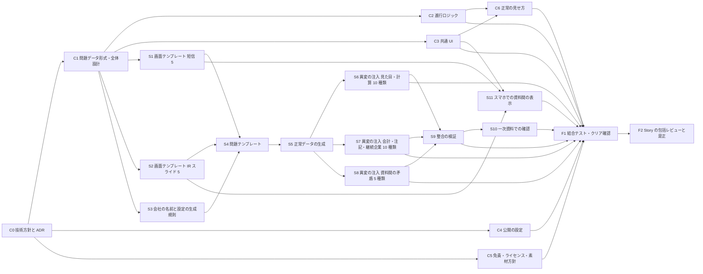

# 案の作成と比較 (遊びの中身・作業の依存・工数・日程・費用・推奨)

Sub-task: #6 (Task #3)。作成日: 2026-11-03。根拠: docs/requirements.md (承認済みの起案の理解)、docs/plans/research.md (#4)、docs/plans/open-decisions.md (#5)。。改訂: #12 (包括レビューの指摘)・#13 (Task #8 の技術の見立ての反映)
このページは、人間が案を選ぶためのページの材料。責任者が問いの文面を書く。数字の再現は `docs/plans/estimate.py` (標準ライブラリのみ。`python3 docs/plans/estimate.py`)。

## 0. このページの読みかた

**責任者の決定 (#13) により、人間向けのページには、総工数の絶対値を出さない。** 測った項目と測っていない項目を分けて見せ、案どうしの差と順位を示す (§4 の差の内訳)。このページの総工数・経路・利用枠の絶対値は、責任者が材料として読むためで、人間向けのページには写さない。

**数字の印**: **人間が言った** / **文書にある** (出典つき) / **測った** / **導いた** (式と入力を示す) / **仮定** (測っていない。人間が確かめるまで要件にしない)。印の無い数字は書かない。

**工数・日程は、計画の仮定と、測った値 (Task #8) を並べて出す。どちらも「何時間で終わる」という約束ではない。** 計画の数字は全部が仮定。「測定反映」の数字は、手書きの問題制作だけを測った値で置き換え、ほかの項目 (基盤・画面テンプレート・一次資料での確認・スマホ表示・係数・包括レビュー・生成の範囲外) は計画の仮定のままなので、**測った項目と測っていない仮定を混ぜた尺度で、絶対値として使えない**。測った値は計画と同じ単位 (組の作業時間)。比べるのは、案どうしの大小と、何が効いて順位が変わるか (§5) だけ。**推奨 (§6) は、工数の絶対値に依らず、人間の言葉と、取り消しの費用と、技術の実現性から導いた。** 工数は、同じ型の先行例の規模と桁が合うかも確かめて添えた (下の参照)。残る測る手順は §8。

**案の軸は 2 つだけ**: 画面の単位 (決算短信のみ / 決算短信 + IR) と、問題の作りかた (手書き / 生成)。図鑑・共有・演出・解説・3 段目の難易度は、案の軸ではなく、**全案で同じ「追加オプション」**として別に並べた (§3.4)。基本の案には含めない (人間が言っていないため)。

- 工数の単位: 「組 (進める役と監視役) の作業時間」(h)。 **仮定**
- 日程の単位: 作業の経過時間。1 時間の作業 = 1 時間の経過と置く。 **仮定**
- 案のあいだで同じ前提で数える (下の「見積もりの単位」は全案で共通)。

**参照 (測った)**: 同じ型の先行例「プルリクエスト #8」のリポジトリ (GitHub API、2026-11-03 に取得): 履歴は 65 commit が 2026-10-30〜2026-11-01 (約 2.5 日)、作者は 2 (人間 27・AI 38)。問題のファイルは難易度ごとに easy 12・normal 12・hard 17 (計 41。index.ts と common.ts を除く)。 → 本ページの案 A・B の問題数 (30) と作業の桁は、この先行例と同じ桁 (導いた)。commit 数は工数ではないので、桁の確認だけに使う。

**測った値の反映 (#13)**: Task #8 の技術の見立て ([tech-assessment.md](tech-assessment.md)、試作は `docs/plans/spike/`) の測った値を反映した。**置き換えたのは、手書きの問題制作の単価だけ**: 短信 5 画面分 + 異変 1 つが、外で確かめられる上限で 2 分 34 秒 (計画の 0.5 h の 0.086 倍)、資料束 (短信 + IR スライド 5 枚 + 資料間の矛盾 1 つ) が 6 分 9 秒 (計画の 1.0 h の 0.103 倍)。n = 1、AI が作成。上側を丸めた 0.10 倍を使う。生成は、整合 67 規則を 1 回目で 100% 通した (N = 20,000) ので実現性は測れたが、工数の倍率 t (導いた 0.012〜0.016、大きな不確かさ) は試作の範囲が小さいので計画の工数に置き換えず、t を動かして示す。基盤・画面テンプレート・一次資料での確認 (A-A8・B-B9・C-S10)・スマホ表示・係数・包括レビューは、測っていない仮定のまま。tech-assessment.md は今の ID で書き直され、冒頭に前の版 (f91b62a) との対応がある。測定の md と試作の一部は、変える前の Task の ID (案 C の G5〜G11 = 本ページの C-S5〜C-S11、結合テストと Story の包括レビュー Q1・Q2 = F1・F2) のまま (reversal.py は両方に対応)。「D-」で始まる ID は決定の ID で、別の物。

### 全案で共通の前提 (すべて仮定。人間が決める点 (§7) は、決まるまでこの値で比べる)

| 項目 | 全案共通の値 | 印 |
| --- | --- | --- |
| クリア条件 | 連続 5 問を正しく判定する。人間が決める (open-decisions の D-P2)。間違えると最初に戻るので、1 回のクリアに要する問題数・時間は最短の何倍にもなる (期待値は §2) | 仮定 |
| 異変ありの問題の比率 | 5 割 (残りは正常)。5 割だと、毎回同じ答えを押し続ける遊び手のクリア確率は 5 連続で 3.1%、8 連続で 0.39%。7 割に偏らせると、毎回「異変あり」を押し続けるだけで 5 連続 16.8%・8 連続 5.8% になる (導いた: 比率の n 乗) | 仮定 (この文書で置いた既定。責任者が決めてチケットに記録する。決定は open-decisions の D-G4) |
| 間違えたときの扱い | 最初に戻る (型の標準。research.md §1.1) | 仮定 (この文書で置いた既定。責任者が決めて記録する。決定は open-decisions の D-G5) |
| 判定の操作 | 異変の有無を 2 択で答え、答え合わせで異変の場所を示す (先行例と同じ。research.md §1.2) | 仮定 (この文書で置いた既定。責任者が決めて記録する。決定は open-decisions の D-P8) |
| 正常の見せ方 | 毎回同じ書式 (画面テンプレートで揃える) + 各難易度の最初の 1 問で、正常な資料を見本として見せる (先行例は説明文を毎回同じ書き方にして正常を覚えさせる。research.md §1.2)。見本の表示は基盤の Task C-C6 | 仮定 (この文書で置いた既定。責任者が決めて記録する。決定は open-decisions の D-G1) |
| 難易度 | 2 段 (やさしい = 見た目と計算、むずかしい = 会計を多めに (会計 7 割、残り 3 割は見た目・計算を混ぜる))。人間の言葉は割合も、中間の段があるかも言っていない | 人間が承認 (理解の表) から導いた (2 段。中間の段は言っていない) + 仮定 (割合) |
| 会計基準の範囲 | 日本基準・連結のみ。実在の様式の文面は再現せず、項目の並びだけ参考にする | 仮定 (この文書で置いた既定。責任者が決めて記録する。決定は open-decisions の D-G3) |
| 会社 | 架空の会社だけ。実在の法人名との衝突は確認する: 国税庁の法人番号公表サイトの全件データ (非上場も含む。research.md §4) と突き合わせ、完全一致を避ける。明らかに架空と分かる付けかた (実在しない地名や造語) を既定にして、確認の手間を減らす。確認の Task を各案に入れた | 人間が承認 (起案の問い 1) |
| 追加要素 | 図鑑・共有・演出の厚み・解説・3 段目は、基本の案に含めない (基本の演出はミニマル)。別に §3.4 のオプション。**推奨・既定は O3 (雰囲気のある演出) だけ足す (§7)** | 仮定 (人間が言っていないものを足さない) |
| 費用・公開 | 公開は Vercel の静的サイト、費用 0 円 (無料枠の範囲) | 人間が承認 (起案の問い 1・3) |
| 営利にしない | 広告・課金・制作の対価を受けない | 導いた (費用 0 円 + Vercel Hobby の非営利制限。research.md §3) |

### 見積もりの単位 (全案共通。測った項目は印に書いた。ほかは仮定)

| 項目 | 値 | 印 |
| --- | --- | --- |
| Task の見積もり = 実装時間 × 1.5 (ケース表の固定と Sub-task のレビューの往復を実装の 5 割と置く) | 係数 1.5。測った往復は、制作の約 1.4〜1.9 倍で、制作 + 往復は約 2.4〜2.9 倍 (n = 2、区間に重なりがある)。計画より大きい。感度で K = 2.9 を出す (§5) | 計画は仮定。測った (n = 2。置き換えない) |
| Task の包括レビュー (別の監視役が Task ごとに行う) | Task 1 件あたり 0.5 h。総工数にだけ足し、日程の経路には入れない | 仮定 |
| Story の包括レビューと是正 | 5 Story × 1 h。経路の最後に入れる | 仮定 |
| 画面テンプレート 1 つ | 実装 2 h | 仮定 |
| 問題 1 問の制作 (手書き) | 計画: 短信のみ 0.5 h / 短信 + IR の資料束 1.0 h。**測った (外で確かめられる上限): 短信 2 分 34 秒、資料束 6 分 9 秒 → 計画の約 0.1 倍**。測定反映は実装時間を 0.10 倍にする。画面の描画・会社名の衝突・一次資料の確認・レビューの往復は含まず、置き換えていない | 計画は仮定。測った値で置き換え (n = 1) |
| 一次資料での会計の確認 (全問) | 短信のみ 1 問 0.25 h / 資料間の整合を含む 0.4 h | 仮定 |
| 異変の種類 1 つの実装 (生成して注入する場合) | 実装 1.0 h。貸借・CF の異変は、1 つの数字を変えると落ちる規則が 1 本だけになるのは 26% で、下流の再計算が要るので、やや軽い (試作 6 種類の実績) | 仮定 (見立てを添えた) |
| 架空の会社の設定と、実在の企業名との衝突の確認 | 案 A 実装 1.5 h (6 社)・案 B 2 h (8 社)・案 C 3 h (名前と設定の生成規則) | 仮定 |
| スマホでの表示 | 短信の表のみ 3 h / 短信と IR を組にした資料束 5 h。モックの 1 ページは幅 320〜414 px で横にはみ出さず、作成は約 49 秒〜3 分 57 秒 (測った)。5 h は、判定の操作と資料束の切り替えを含めて妥当か、やや重い (見立て) | 仮定 (測れた部分は表の表示だけ) |
| 共通の基盤 (全体設計・進行ロジック・共通 UI・公開の設定・免責・方針・正常の見せ方) | 実装 計 19.5 h (3 + 4 + 6 + 2 + 1 + 2 + 1.5) | 仮定 |
| 1 問の所要 (遊び手が見て判定するまで) | 案 A 45 秒、案 B・C 90 秒 (資料をまたぐため) | 仮定 |
| 1 回のページの転送量 | 案 A 2 MB、案 B・C 3 MB (基本)。厚い演出 (音つき) は +5 MB。測れた下限: 問題データは資料束 30 問で 77.2 KiB (gzip) で、フレームワーク・フォント・画像は未定のため、全体は測れていない | 仮定 (全体は測っていない。データの下限だけ測った) |

## 1. 人間の言葉と案の対応 (外した範囲は別の行に残す)

| 人間の言葉の原文 (requirements.md) | 案 A | 案 B | 案 C |
| --- | --- | --- | --- |
| 「8番出口みたいなゲーム作りたい！！」(2026-11-03) | 判定ループの型を使う (固有の名前・見た目は真似ない) | 同じ | 同じ |
| 「投資家向け決算書, IRとかについてやるのとかいいかな〜」 | **決算書だけ。IR は外す** (人間の言葉の一部を落とす。外したものとして人間の選択で明示) | 決算書と IR の両方 | 決算書と IR の両方 |
| 「難易度ごとでいいかも！」(やさしい = 見た目と計算、むずかしい = 会計を多めに) | 2 段 (要件どおり) | 2 段 (同じ) | 2 段 (同じ) |
| 「新しいrepoがいいな！！！」「レポはpublicで！」 | 満たす | 満たす | 満たす |
| URL を開けばブラウザで遊べ、人に見せられる (成功の定義) | 「遊べる」は満たす。「人に見せられる」は、基本の演出 (文字と表だけ) で足りるかが人間の好みになる (§7 で、控えめな演出 O3 を推奨) | 同じ | 同じ |
| 架空の会社だけ。実在の企業名・ロゴ・人物は使わない | 満たす | 満たす | 満たす |
| 費用 0 円 (無料枠の範囲)・期限なし | 満たす | 満たす | 満たす |
| 日本語だけ。PC 優先でスマホでも遊べる | 満たす | 満たす (資料間の表示に追加の作業) | 満たす (同上) |
| オーケストラが自動で作る。人間は判断が要るときだけ答える | 人間の作業は少ない | 同じ | 同じ |

**人間の言葉に無いもの**: 図鑑・結果共有・演出の厚み・解説・3 段目・音・無限の問題。このうち問題の数 (有限 / 無限) は、案 C の軸 (生成) の結果で、人間は問題の数について何も言っていない。それ以外はすべて基本の案に含めず、§3.4 のオプションとして別に並べた。

## 2. 案の筋と、遊びの中身

3 案は、**画面の単位** (open-decisions の D-P3) と **問題の作りかた** (D-T1) だけが違う。

- **案 A 「決算短信のみ」**: 決算短信 (サマリーと財務諸表) の 1 つの資料を深く読む。問題は人が 1 問ずつ書く。IR は外す。いちばん軽い。
- **案 B 「決算短信 + IR」**: 決算短信と IR スライドを組み合わせ、資料のあいだの食い違いも異変にする。問題は、手書きのテンプレート (会社 × 資料束) に数値を当てはめて作る。人間の言葉をすべて満たす標準の案。
- **案 C 「決算短信 + IR、生成」**: 案 B と同じ画面・同じ資料束で、数値を生成して異変を注入する。問題が尽きない。技術の見立てへの依存がいちばん大きい。

| 項目 | 案 A | 案 B | 案 C | 印 |
| --- | --- | --- | --- | --- |
| 画面の単位 (D-P3) | 決算短信 5 画面 (サマリー・貸借・損益・CF・注記) | 短信 5 画面 + IR スライド 5 画面を組にした資料束 | 案 B と同じ | 仮定 |
| 異変の種類 | 20 種類 (見た目 5・計算 5・会計 10) | 25 種類 (A の 20 + 資料間の矛盾 5) | 25 種類 (B と同じ) | 仮定 (設計値。種類の候補は research.md §2.3) |
| 難易度の分けかた | やさしい = 見た目と計算 / むずかしい = 会計を多めに (全案共通) | 同じ。むずかしいは資料間の矛盾も含む | 同じ | 人間が言った + 仮定 |
| 問題の数 | 30 問 (難易度ごと 15 問) | 30 問 (難易度ごと 15 問) | 生成 (数に上限なし) | 仮定 |
| 全問を見終えるまでの最短の周回 (同じ難易度) | 3 周 (15 ÷ 5)。周回数 8 なら 2 周 (15 ÷ 8 を切り上げ) | 同じ | 上限なし | 導いた (プール ÷ クリア条件。クリア条件 5 または 8)。間違えると最初に戻るので、実際に 1 回のクリアで見る問題数はこれより多い (下の期待値) |
| 1 回のクリアまでの最短の時間 (5 問。全問正解のとき) | 3.8 分 | 7.5 分 | 7.5 分 | 導いた (5 問 × 1 問の所要)。間違えると最初からなので実際は長い。周回数 8 なら 6・12・12 分 |
| 当てずっぽうでクリアする確率 | 3.1% (比率 5 割・5 連続) | 同じ | 同じ | 導いた ((1/2)^5。8 連続なら 0.39%) |
| 答え合わせ | 異変の場所を示す (全案共通) | 同じ | 同じ | 仮定 |
| 演出 | 基本はミニマル (文字と表だけ。全案共通)。**推奨・既定は O3 を足して、雰囲気のある配色・遷移にする (§7)** | 同じ | 同じ | 仮定 |
| 会社の設定 | 6 社を使い回す | 8 社を使い回す | 規則から名前と設定を生成 | 仮定 |

### クリアまでの期待値 (間違えると最初に戻る型)

1 問を正しく判定する確率を p、連続 n 問でクリアとすると、クリアまでに見る問題数の期待値は (1 − p^n) / ((1 − p) · p^n) (導いた。間違えたら最初から数え直す)。p は遊び手の腕前で、測っていない **仮定** (0.7・0.8・0.9)。1 問の所要は 90 秒 (案 B・C の基本) と、資料束の画面が多いときの 180 秒を並べた (仮定)。

| 1 問を正しく判定する確率 p (仮定) | n=5 の期待問題数 | n=8 の期待問題数 | n=5 の期待時間 (90 秒/問・180 秒/問) | n=8 の期待時間 (90 秒/問・180 秒/問) |
| --- | --- | --- | --- | --- |
| 0.7 | 16.5 問 | 54.5 問 | 24.7 分・49.5 分 | 81.7 分・163.5 分 |
| 0.8 | 10.3 問 | 24.8 問 | 15.4 分・30.8 分 | 37.2 分・74.4 分 |
| 0.9 | 6.9 問 | 13.2 問 | 10.4 分・20.8 分 | 19.8 分・39.7 分 |

- 周回数 5 と 8 の差は大きい: p = 0.8 で、期待問題数は 5 周で 10.3 問、8 周で 24.8 問 (8 周は 5 周の約 2.4 倍)。案 B の 90 秒/問なら 15.4 分と 37.2 分 (導いた)。
- 難易度ごとのプール 15 問に対し、周回数 8・p = 0.8 の期待問題数 24.8 問は 15 問を超える。正答率が普通の遊び手は、1 回のクリアの途中で同じ資料束にまた出会い、答えを覚えた状態で判定する。
- 周回数 8 で同じ資料束にほとんど出会わないようにするには、プールを難易度ごとに 25 問以上にする (p = 0.8 のとき)。手書きの追加工数は、1 難易度あたり +10 問 (計 +20 問): 案 B +42 h、案 A +22.5 h (導いた: 1 問の制作と確認の見積もり × 1.5)。測定反映 (制作を 0.10 倍。確認は計画のまま) では、案 B +15 h、案 A +9 h。案 C は生成なので追加は無い。
- 当てずっぽうでクリアする確率は、周回数が大きいほど小さい (5 連続 3.1%・8 連続 0.39%) が、期待時間は伸びる。

## 3. 各案の Story / Task の依存 (DAG)・工数・日程・費用・リスク・取り消しの費用

Story は 5 つ: **基盤** (進行・UI・方針)・**中身** (画面テンプレート・会社・問題)・**遊び** (スマホでの表示)・**公開** (公開の設定・免責・ライセンス)・**品質** (結合テスト・包括レビュー)。Task の ID は案ごとに `案-番号` (例: A-C1 は案 A の共通の基盤の Task、C-S5 は案 C の生成の Task、A-F1 は案 A の結合テスト)。決定の ID (D-P2 など) とは別。人間の作業は DAG に入れず、日程の欄に別に書く。

### 3.1 案 A 「決算短信のみ」

| ID | Task | Story | 実装 (h) | 見積もり (h) | 測定反映 (h) | 依存 | 最早開始 (h) |
| --- | --- | --- | --- | --- | --- | --- | --- |
| A-C0 | 技術方針と ADR | 基盤 | 2 | 3 | 同じ | (根) | 0 |
| A-C1 | 問題データ形式・全体設計 | 基盤 | 3 | 4.5 | 同じ | A-C0 | 3 |
| A-C2 | 進行ロジック (判定・周回・戻り・クリア) | 基盤 | 4 | 6 | 同じ | A-C1 | 7.5 |
| A-C3 | 共通 UI (タイトル・難易度選択・結果・答え合わせ・スマホの土台) | 基盤 | 6 | 9 | 同じ | A-C1 | 7.5 |
| A-C4 | 公開の設定 (Vercel・ビルド・CI) | 公開 | 2 | 3 | 同じ | A-C0 | 3 |
| A-C5 | 免責・ライセンス・素材方針 | 公開 | 1 | 1.5 | 同じ | A-C0 | 3 |
| A-C6 | 正常の見せ方 (毎回同じ書式の規則と、各難易度の最初の 1 問の見本表示) | 基盤 | 1.5 | 2.2 | 同じ | A-C2・A-C3 | 16.5 |
| A-A1 | 画面テンプレート: 短信サマリー・貸借・損益 | 中身 | 6 | 9 | 同じ | A-C1 | 7.5 |
| A-A2 | 画面テンプレート: キャッシュ・フロー・注記 | 中身 | 4 | 6 | 同じ | A-C1 | 7.5 |
| A-A3 | 架空の会社の設定 (6 社。明らかに架空と分かる付けかた) と、実在の法人名との衝突の確認 (国税庁の法人番号公表サイトの全件データと突き合わせる) | 中身 | 1.5 | 2.2 | 同じ | A-C1 | 7.5 |
| A-A4 | 問題制作 やさしい 1〜8 問目 | 中身 | 4 | 6 | 0.6 | A-A1・A-A2・A-A3 | 16.5 |
| A-A5 | 問題制作 やさしい 9〜15 問目 | 中身 | 3.5 | 5.2 | 0.5 | A-A1・A-A2・A-A3 | 16.5 |
| A-A6 | 問題制作 むずかしい 1〜8 問目 | 中身 | 4 | 6 | 0.6 | A-A1・A-A2・A-A3 | 16.5 |
| A-A7 | 問題制作 むずかしい 9〜15 問目 | 中身 | 3.5 | 5.2 | 0.5 | A-A1・A-A2・A-A3 | 16.5 |
| A-A8 | 一次資料での会計の確認 (全 30 問 × 0.25) | 中身 | 7.5 | 11.2 | 同じ | A-A4・A-A5・A-A6・A-A7 | 22.5 |
| A-A9 | スマホでの表の表示 (短信) | 遊び | 3 | 4.5 | 同じ | A-A1・A-A2・A-C3 | 16.5 |
| A-F1 | 結合テスト・クリア確認 (全難易度) | 品質 | 3 | 4.5 | 同じ | A-A4・A-A5・A-A6・A-A7・A-A8・A-A9・A-C2・A-C3・A-C4・A-C5・A-C6 | 33.8 |
| A-F2 | Story の包括レビューと是正 (5 Story × 1 時間) | 品質 | 3.3 | 5 | 同じ | A-F1 | 38.2 |

- 総工数: **102.2 h** (DAG の和 94.2 h + Task の包括レビュー 8 h。Task 18 個)。クリティカルパス: **43.2 h** (A-C0 → A-C1 → A-A1 → A-A4 → A-A8 → A-F1 → A-F2)。並列の幅: **6** 組。 導いた (Task の見積もりの和、最早開始の日程)。**測定反映** (手書きの問題制作を測った値の 0.10 倍にした。混ぜた尺度): 総工数 **82 h**・クリティカルパス **37.9 h**。
- 経過時間: 作業を 8 時間/日と置くと 5.4 日、24 時間/日と置くと 1.8 日 (人間の返事待ちを除く)。 導いた (パス ÷ 稼働時間。稼働時間は仮定)。測定反映では 8 時間/日で 4.7 日。
- 費用: 公開 0 円 (人間が承認)。転送量は月 1 万回の利用で 20 GB、Hobby の目安 100 GB の 20% (文書にある: Vercel Hobby。月 1 万回・2 MB は仮定)。AI の利用枠は §3.5 (出力トークンで 17.9〜42.0 百万、測定反映で 14.9〜33.7 百万 の桁。実測から導いた)。
- リスク:
  - IR を外すので、人間の言葉「決算書, IRとか」の一部を落とした企画になる (導いた)。選ばれたら人間の選択として明示する (open-decisions §6)。
  - 問題が 30 問で、同じ難易度を遊び続けると 3 周で全問を見終える (導いた)。
  - 会計の確認 (A-A8) の負担。正常と異変の境界を誤ると、会計の分かる遊び手が不正解になる (research.md §2.3)。全 30 問を確認する (やさしいも貸借・CF の正常な数字を見せるため)。
  - 手書きの問題制作は、測った値で小さい (計画の約 0.1 倍。n = 1)。重いのは、会計の確認 (A-A8)・画面テンプレート・基盤で、これらは測っていない仮定。
- 取り消しの費用: 案 A を先に出して後から IR を足す (段階公開) と、IR の追加は **約 104.8 h** (導いた: 案 B にしか無い Task = IR テンプレート・問題テンプレート・資料束の問題 30 問・資料間の確認・スマホの増分に、2 回目の結合テストと包括レビューを足した。案 A の短信の画面・会社・問題は残す)。案 A と IR の追加の合計は 207 h で、一括の案 B (159.8 h) より 47.2 h 多い (§6)。「案 B の総工数 − 案 A の総工数 = 57.5 h」は、案 A の問題が案 B の資料束の問題に置き換わる前提でしか成り立たないので、追加の費用には使わない。問題データの形式を共通にしておけば (A-C1)、拡張できる (仮定)。 測定反映では、IR の追加は約 64.2 h (合計 146.2 h で、一括の案 B の測定反映 119.2 h より 27 h 多い)。

### 3.2 案 B 「決算短信 + IR」

| ID | Task | Story | 実装 (h) | 見積もり (h) | 測定反映 (h) | 依存 | 最早開始 (h) |
| --- | --- | --- | --- | --- | --- | --- | --- |
| B-C0 | 技術方針と ADR | 基盤 | 2 | 3 | 同じ | (根) | 0 |
| B-C1 | 問題データ形式・全体設計 | 基盤 | 3 | 4.5 | 同じ | B-C0 | 3 |
| B-C2 | 進行ロジック (判定・周回・戻り・クリア) | 基盤 | 4 | 6 | 同じ | B-C1 | 7.5 |
| B-C3 | 共通 UI (タイトル・難易度選択・結果・答え合わせ・スマホの土台) | 基盤 | 6 | 9 | 同じ | B-C1 | 7.5 |
| B-C4 | 公開の設定 (Vercel・ビルド・CI) | 公開 | 2 | 3 | 同じ | B-C0 | 3 |
| B-C5 | 免責・ライセンス・素材方針 | 公開 | 1 | 1.5 | 同じ | B-C0 | 3 |
| B-C6 | 正常の見せ方 (毎回同じ書式の規則と、各難易度の最初の 1 問の見本表示) | 基盤 | 1.5 | 2.2 | 同じ | B-C2・B-C3 | 16.5 |
| B-B1 | 画面テンプレート: 短信 5 (サマリー・貸借・損益・CF・注記) | 中身 | 10 | 15 | 同じ | B-C1 | 7.5 |
| B-B2 | 画面テンプレート: IR スライド 5 (ハイライト・業績・セグメント・見通し・補足) | 中身 | 10 | 15 | 同じ | B-C1 | 7.5 |
| B-B3 | 架空の会社の設定 (8 社。明らかに架空と分かる付けかた) と、実在の法人名との衝突の確認 (法人番号公表サイトの全件データ) | 中身 | 2 | 3 | 同じ | B-C1 | 7.5 |
| B-B4 | 問題テンプレート (会社 × 資料束) の設計 | 中身 | 6 | 9 | 同じ | B-B1・B-B2・B-B3 | 22.5 |
| B-B5 | 問題制作 やさしい 1〜8 問目 (資料束) | 中身 | 8 | 12 | 1.2 | B-B4 | 31.5 |
| B-B6 | 問題制作 やさしい 9〜15 問目 | 中身 | 7 | 10.5 | 1.1 | B-B4 | 31.5 |
| B-B7 | 問題制作 むずかしい 1〜8 問目 | 中身 | 8 | 12 | 1.2 | B-B4 | 31.5 |
| B-B8 | 問題制作 むずかしい 9〜15 問目 | 中身 | 7 | 10.5 | 1.1 | B-B4 | 31.5 |
| B-B9 | 一次資料での会計・資料間整合の確認 (全 30 問 × 0.4) | 中身 | 12 | 18 | 同じ | B-B5・B-B6・B-B7・B-B8 | 43.5 |
| B-B10 | スマホでの資料間の表示 | 遊び | 5 | 7.5 | 同じ | B-B1・B-B2・B-C3 | 22.5 |
| B-F1 | 結合テスト・クリア確認 (全難易度) | 品質 | 3 | 4.5 | 同じ | B-B5・B-B6・B-B7・B-B8・B-B9・B-B10・B-C2・B-C3・B-C4・B-C5・B-C6 | 61.5 |
| B-F2 | Story の包括レビューと是正 (5 Story × 1 時間) | 品質 | 3.3 | 5 | 同じ | B-F1 | 66 |

- 総工数: **159.8 h** (DAG の和 151.2 h + Task の包括レビュー 8.5 h。Task 19 個)。クリティカルパス: **71 h** (B-C0 → B-C1 → B-B1 → B-B4 → B-B5 → B-B9 → B-F1 → B-F2)。並列の幅: **5** 組。 導いた。**測定反映** (手書きの問題制作を測った値の 0.10 倍にした。混ぜた尺度): 総工数 **119.2 h**・クリティカルパス **60.2 h**。
- 経過時間: 8 時間/日で 8.9 日、24 時間/日で 3 日 (人間の返事待ちを除く)。 導いた。測定反映では 8 時間/日で 7.5 日。
- 費用: 公開 0 円。転送量は月 1 万回で 30 GB (Hobby の目安 100 GB の 30%)。AI の利用枠は §3.5 (出力トークンで 28.0〜65.7 百万、測定反映で 22.0〜49.0 百万 の桁)。
- リスク:
  - 資料をまたぐ画面 (短信と IR) をスマホで見せる難しさ (open-decisions D-G9)。B-B10 の 7.5 h はこれの見積もり。モックでは、表の表示は幅 320〜414 px で横にはみ出さなかった (測った)。5 h は判定の操作と資料束の切り替えを含めて妥当か、やや重い (見立て)。異変の見つけやすさは、凍結の後に遊び手のテストで確かめる (人の目が要る。案の選択には使わない。責任者の決定)。
  - IR 資料には定型の様式が無い (research.md §2.2)。IR 画面は解説記事の共通の並びからの設計で、「らしさ」の評価は人間の好みになる (導いた)。
  - 問題が 30 問で、3 周で全問を見終える (導いた)。
  - 手書きの単価は、測った (n = 1) 上限で計画の約 0.1 倍で、「想定より高い」は否定された。残る不確かさは、測っていない確認 (B-B9)・画面テンプレート・基盤。n = 1 で、会社の型も 1 つ (見立て)。
- 取り消しの費用: IR を後から外すのは容易 (IR の画面と資料間の問題を使わないだけ)。**後から生成 (案 C) に移る追加は約 79.5 h** (C-S5〜S10 相当。導いた: Task の見積もりの和)。その間も、手書きの 30 問で遊べる (問題データの形式を共通にして、手書きの問題を残したまま足せば。仮定)。案 B と案 C の取り消しの非対称は、失う量ではなく、失敗しても遊べる版が残るかの差 (§6)。 測定反映 (t = 0.015) では約 13 h (生成まわりの確認 C-S10 の 12 h が大半)。

### 3.3 案 C 「決算短信 + IR、生成」

| ID | Task | Story | 実装 (h) | 見積もり (h) | 依存 | 最早開始 (h) |
| --- | --- | --- | --- | --- | --- | --- |
| C-C0 | 技術方針と ADR | 基盤 | 2 | 3 | (根) | 0 |
| C-C1 | 問題データ形式・全体設計 | 基盤 | 3 | 4.5 | C-C0 | 3 |
| C-C2 | 進行ロジック (判定・周回・戻り・クリア) | 基盤 | 4 | 6 | C-C1 | 7.5 |
| C-C3 | 共通 UI (タイトル・難易度選択・結果・答え合わせ・スマホの土台) | 基盤 | 6 | 9 | C-C1 | 7.5 |
| C-C4 | 公開の設定 (Vercel・ビルド・CI) | 公開 | 2 | 3 | C-C0 | 3 |
| C-C5 | 免責・ライセンス・素材方針 | 公開 | 1 | 1.5 | C-C0 | 3 |
| C-C6 | 正常の見せ方 (毎回同じ書式の規則と、各難易度の最初の 1 問の見本表示) | 基盤 | 1.5 | 2.2 | C-C2・C-C3 | 16.5 |
| C-S1 | 画面テンプレート: 短信 5 | 中身 | 10 | 15 | C-C1 | 7.5 |
| C-S2 | 画面テンプレート: IR スライド 5 | 中身 | 10 | 15 | C-C1 | 7.5 |
| C-S3 | 会社の名前と設定の生成規則 (明らかに架空と分かる付けかた) と、実在の法人名との衝突の確認 (法人番号公表サイトの全件データ) | 中身 | 3 | 4.5 | C-C1 | 7.5 |
| C-S4 | 問題テンプレート (会社 × 資料束) の設計 | 中身 | 6 | 9 | C-S1・C-S2・C-S3 | 22.5 |
| C-S5 | 正常データの生成 (貸借の等式・損益の連鎖・CF の連動・比率) | 生成 | 12 | 18 | C-S4 | 31.5 |
| C-S6 | 異変の注入: 見た目・計算 10 種類 | 生成 | 10 | 15 | C-S5 | 49.5 |
| C-S7 | 異変の注入: 会計・注記・継続企業 10 種類 | 生成 | 10 | 15 | C-S5 | 49.5 |
| C-S8 | 異変の注入: 資料間の矛盾 5 種類 (IR と短信) | 生成 | 5 | 7.5 | C-S5 | 49.5 |
| C-S9 | 整合の検証 (正常データが全規則を満たす・異変が 1 つだけを変える) | 生成 | 8 | 12 | C-S6・C-S7・C-S8 | 64.5 |
| C-S10 | 一次資料での確認 (生成の規則と異変の規則のレビュー) | 中身 | 8 | 12 | C-S9 | 76.5 |
| C-S11 | スマホでの資料間の表示 | 遊び | 5 | 7.5 | C-S1・C-S2・C-C3 | 22.5 |
| C-F1 | 結合テスト・クリア確認 (全難易度) | 品質 | 3 | 4.5 | C-S6・C-S7・C-S8・C-S9・C-S10・C-S11・C-C2・C-C3・C-C4・C-C5・C-C6 | 88.5 |
| C-F2 | Story の包括レビューと是正 (5 Story × 1 時間) | 品質 | 3.3 | 5 | C-F1 | 93 |

- 総工数: **178.2 h** (DAG の和 169.2 h + Task の包括レビュー 9 h。Task 20 個)。クリティカルパス: **98 h** (C-C0 → C-C1 → C-S1 → C-S4 → C-S5 → C-S6 → C-S9 → C-S10 → C-F1 → C-F2)。並列の幅: **5** 組。 導いた (案 B より 18.5 h 多い。生成が経路に乗るため、経路も長い)。**測定反映**: 案 C には手書きの制作が無いので、生成の倍率 t = 1 (計画のまま) は 178.2 h。生成の倍率 t = 0.015 (測った試作からの目安。導いた。範囲外は重い可能性が高い) だと総工数 111.8 h・クリティカルパス 53.7 h (混ぜた尺度)。
- 経過時間: 8 時間/日で 12.2 日、24 時間/日で 4.1 日 (人間の返事待ちを除く)。 導いた
- 費用: 公開 0 円。転送量は月 1 万回で 30 GB (Hobby の目安 100 GB の 30%)。AI の利用枠は §3.5 (出力トークンで 31.2〜73.3 百万、測定反映で 19.8〜73.3 百万 の桁)。
- リスク:
  - **生成した正常データが会計の整合 (67 規則: 貸借の等式・損益の連鎖・CF の連動・比率・表示値どうしの別経路の突き合わせ) を満たす実現性は、コアの範囲 (1 期分の連結 3 表 + サマリー) で測れた: 20,000 件が 1 回目で 100%** (測った。素朴な独立乱数は 0%)。範囲外 (注記・IR 側の生成・資料間の矛盾の生成・25 種類のうち 19 種類の注入) は未測定。規則の網羅は、一次資料 (作成要領・財務諸表等規則) との突き合わせ (C-S10) で確かめられる範囲があり、人に頼むかは未決 (D-Q1。責任者が確認の Sub-task で決める)。
  - 生成の倍率 t が計画どおり (1) なら、案 C は 178.2 h で、案 B の測定反映 (119.2 h) より 59 h 多い。t = 0.015 (目安) なら 111.8 h で、案 B より 7.5 h 少ない。範囲外は範囲内より重い可能性が高いので、t の値で順位を決めない (§5)。
  - 機械的に作った異変が「作り物らしい」と感じられ、面白さが落ちる恐れ (好みで、測れない)。
  - 貸借・CF の異変は、1 つの数字を変えるだけでは単独の異変にならない (落ちる規則が 1 本だけになるのは 26% (1,568/6,000)。サマリーの比率 76%・損益 45%・貸借 8%・CF 4%)。サマリーに漏れた規則を再計算する関数が要り、計画の注入 1 種類 1.0 h は貸借・CF ではやや軽い (測った。試作 6 種類で 200/200)。
  - 生成の式と検証の式が同じ出所だと、同じ誤りを見落とす (配当性向を公式でない式で作ったまま検証が通っていた。JPX 作成要領 p.27 の式に直した。測った)。検証には別経路の突き合わせが要る。
- 取り消しの費用: 生成が整合を満たせないと分かったとき、生成まわりの Task (C-S5〜S10) の約 **79.5 h** を捨て、案 B 相当の内容 (B-B5〜B9 の約 **63 h**) を新たに作ることになる (導いた: Task の見積もりの和)。分かるのが遅いほど損失が大きい。 測定反映 (t = 0.015) では、捨てるのは約 **13 h**、足す案 B 相当の内容は約 **22.5 h** (手書きの制作 4.5 h + 確認 B-B9 18 h)。整合の実現性はコアの範囲で測れたので、失敗の確率は下がった (測った)。

### 3.4 追加オプション (全案で同じ。基本の案には含めない。どれも人間が言っていない)

どのオプションも、基本の Task の後から足せる (進行ロジックと共通 UI の後に始まる。多くは基本のパスより先に終わるので、経路は伸びない。例外が 1 つある: 案 B の O7 は経路を 1.5 h 伸ばす。導いた)。取り消しの費用は小さい。

| ID | 追加オプション | 案 A (h) | 案 B (h) | 案 C (h) | 人間が言ったか |
| --- | --- | --- | --- | --- | --- |
| O1 | 図鑑と保存 (ブラウザ内) | 6 | 6 | 6 | 言っていない |
| O2 | 結果共有と共有用画像 | 4.5 | 4.5 | 4.5 | 言っていない |
| O3 | 雰囲気のある演出 (配色・遷移) | 6 | 6 | 6 | 言っていない |
| O4 | 厚い演出 (遷移・音つき。O3 の代わり) | 12 | 12 | 12 | 言っていない |
| O5 | 理由 1 行の解説 (種類 × 0.2 h) | 6 | 7.5 | 7.5 | 言っていない |
| O6 | 理由 + 用語の解説 (種類 × 0.3 h。O5 の代わり) | 9 | 11.2 | 11.2 | 言っていない |
| O7 | ふつう (3 段目の難易度) | 16.9 | 31.5 | 4.5 | 言っていない |
| 全部入り | O1 + O2 + O4 + O6 + O7 | 48.4 | 65.2 | 38.2 | |

- 厚い演出 (O4) は音を含み、転送量が +5 MB (仮定): 月 1 万回で 案 A 70 GB・案 B・C 80 GB (Hobby の目安 100 GB の 80% 前後)。案 B・C は 1 回 8 MB なので、月 12,500 回で 100 GB に届く (導いた: 100 GB ÷ 8 MB)。
- O3 と O4、O5 と O6 は、どちらかを選ぶ。推奨は O3 だけ (§7)。
- O7 (ふつう) は手書きの問題制作を含むので、測定反映では案 A 6.8 h・案 B 11.2 h (制作を 0.10 倍。確認は計画のまま)。
- 全部入りの総工数 = 基本 + 全部入り: 案 A **150.6 h**・案 B **225 h**・案 C **216.5 h** (導いた)。

### 3.5 AI の利用枠 (契約・測った値・案ごとの桁)

人間の費用 0 円 (起案の問い 1) が AI の利用枠を含むかは未決で (§7)、使う桁を人間に見せるために、契約と Task #3 の実績を測った。

**契約 (測った)**: この端末の Claude Code のアカウント情報 (`~/.claude.json` の `oauthAccount` のうち、課金の 3 項目だけを読んだ。2026-11-03) は、課金の種別 `stripe_subscription`、組織の種別 `claude_max`、`hasExtraUsageEnabled` = true。つまり **Max の契約で、extra usage (契約の上限を超えた分の従量課金) が有効**で、契約の上限を超えると、止まらずに従量で課金されうる。**支出の上限額は、この端末からは分からない (人間にしか分からない)。** 要件の費用 0 円とぶつかる。
**既定 (要件の費用 0 円から導いた)**: 契約の上限の中でだけ動かし、extra usage の課金は使わない。**ただし、これはオーケストラだけでは守れない**: extra usage は人間が切るまで有効のままで、オーケストラは課金の設定を変えられず、使用率を読む手段も無い (使用率は人間の利用状況の画面に出る)。**「既定にすれば課金は起きない」とは読めない。** したがって、**人間に頼む作業 (利用状況の画面で extra usage を切るか、上限額を 0 にする。1〜2 分。仮定) が済むまで、開発の Task に着手しない** (開発の最初の Task C-C0 の blocked by にする)。済んだあとは、上限に近づいたかを人間が画面で見て知らせ、そのときに同時に動かす組の数を減らす (止めずに延ばす)。§3 の人間の作業の表にも入れた。

**測った消費 (Task #3 全体)**: `~/.claude/projects/` にある組のセッションの記録から、assistant の usage をメッセージ ID ごとに 1 回だけ合計した (本文は読まない。個人情報・秘密は集計に含めない)。区間は、Sub-task #4〜#6・手直しの #12・技術の見立ての反映の #13 の活動区間と、Task の包括レビュー 2 回。再現は `python3 docs/plans/usage.py` (冒頭の使いかた)。

| 区間 (UTC。2026-11-03) | 実働 (分) | 進める役 (sonnet) の出力 | 監視役 (opus) の出力 | キャッシュ読み (合計) |
| --- | --- | --- | --- | --- |
| #4〜#6 (12:34:32〜13:17:10) | 42.6 | 18.8 万 | 6.7 万 | 3028 万 |
| #12 (13:30:18〜13:45:34) | 15.3 | 8.6 万 | 1.5 万 | 2658 万 |
| #13 (14:06:13〜14:25:49) | 19.6 | 8.5 万 | 1.8 万 | 3288 万 |
| Task #3 の作業 + Sub-task のレビュー (計) | 77.5 | 36.0 万 | 10.0 万 | 8975 万 |
| Task の包括レビュー 1 回目 (13:23:01〜13:29:12。別の監視役) | 6.2 | ― | 3.4 万 | 189 万 |
| Task の包括レビュー 2 回目 (14:26:39〜14:33:54。別の監視役) | 7.3 | ― | 3.3 万 | 473 万 |
| **Task #3 全体 (包括レビューを含む)** | **91.0** | | **出力 52.6 万** | **9636 万** |

- **前の版の表 (42.6 分・出力 25.5 万) は、#4〜#6 だけの区間で、Task #3 全体の約 55% だった。** Task #3 は、そのあとの包括レビューの不可を受けた手直し (#12) と、Task #8 の見立ての反映 (#13) が続いた。前の版の「見積もりの約 24%」は、部分を Task 全体の見積もりで割った誤りだった。
- Task #3 の見積もり 3 h (仮定) に対し、実働は、作業と Sub-task のレビューで 77.5 分 (**0.43 倍**)、包括レビュー 2 回を含めて 91.0 分 (**0.51 倍**)。
- **手直し (測った)**: 測った 2 つの Task (#3・#8) は、どちらも 1 回目の包括レビューが不可で、手直しの Sub-task (#12 約 15 分・#14 約 12 分) と 2 回目のレビューが入った。計画の型 (Task の包括レビュー 0.5 h) には、この手直しが無い。順位には効かず、比と桁に効く。上の実測には、手直しが含まれている。#13 は手直しではなく、Task #8 の完了待ちで加わった作業。

**導いた (出力トークンの率。出力 ÷ 時間)**: 下限 **17.5 万/h** = Task #3 全体 (包括レビューを含む) の出力 52.6 万 ÷ Task #3 の見積もり 3 h (計画の尺度の 1 h あたり)。上限 **41.1 万/h** = コードを書いた Sub-task の経過 1 時間あたりの最大 (Task #8 の #10。tech-assessment §2 #7)。参考: Task #3 全体の経過あたり 34.7 万/h、Task #8 全体 31.9 万/h、Sub-task 別 36.1〜41.1 万/h。幅 (17.5〜41.1 万/h) には、Task #3 全体と Task #8 全体の経過あたりが入り、**Sub-task 別の 36.1〜41.1 万は幅の上端に重なる** (上限が #10 の 41.1 万。#10 は #9 と重なる区間)。案ごとの桁 = 総工数 × この率 (キャッシュ読みも同様):

| 案 | 総工数 | 出力トークン (下限〜上限) | キャッシュ読み (下限〜上限) |
| --- | --- | --- | --- |
| 案 A | 102.2 h | 17.9 〜 42.0 百万 | 32.8 〜 65.0 億 |
| 案 B | 159.8 h | 28.0 〜 65.7 百万 | 51.3 〜 101.5 億 |
| 案 C | 178.2 h | 31.2 〜 73.3 百万 | 57.3 〜 113.3 億 |

測定反映 (手書きの問題制作を 0.10 倍にした総工数。混ぜた尺度。案 C は t = 0.015〜1)。**測った分 (手書きの制作・生成。実際の経過時間) には経過あたりの率 (上限側) を、残り (計画の尺度) には見積もりあたりの率と経過あたりの率の幅を掛けた** (測った分に下限の率を掛けると、計画の尺度を実際の経過に直す割引を二重にかけてしまうため):

| 案 | 総工数 (測定反映) | 出力トークン (下限〜上限) |
| --- | --- | --- |
| 案 A | 82 h | 14.9〜33.7 百万 |
| 案 B | 119.2 h | 22.0〜49.0 百万 |
| 案 C | 111.8〜178.2 h | 19.8〜73.3 百万 |

- 計画の仮定は、測った制作の単価で約 10 倍、Task #3 の見積もり (3 h に対し実働 77.5 分〜91.0 分) で約 2 倍、実際より大きかった。測っていない項目も同じ傾向なら、本当の桁は下側に寄る。上の下限〜上限は、この不確かさを含む (見立て)。
- **実装の作業の率 (測った。Task #8、試作のコードを書いた作業)**: 調べ物・文書の Task #3 と同じ桁だった (経過あたり 31.9 万 vs 34.7 万)。**ただし対象は試作のコードで、製品の実装 (テスト先行・複数ファイル・CI) は測っていない**。最初の実装の Task の usage で補正する (§8)。キャッシュ読みは、文脈の読み直しの量で、契約の上限の数え方次第で効く。

**物差し (人間が今見られるもの)**:
- **今日これまで** (12:34〜14:34 UTC = 日本時間 21:34〜23:34) に、この組 (biz-plan と tech-spike のワークツリーの 8 セッション) が使った出力は **89.9 万トークン** (測った。`python3 docs/plans/usage.py --until 2026-11-03T14:34:00Z <biz-plan のディレクトリ> <tech-spike のディレクトリ>`)。キャッシュ読みは 1.6 億。**責任者の会話の記録の場所は確かめていない**: `~/.claude/projects/` の下には、同じ時間帯 (12:22〜14:33 UTC) に動いた別のワークスペースのセッションが 1 つあり、出力は 9.0 万 (測った。本文は読まず、集計だけ)。責任者の会話かは確かめていないので含めていない。責任者のものなら、今日これまでの出力は約 99.0 万、案 B の倍数は約 28〜66 倍になる (責任者が確かめて決める)。
- 案 B の桁は、この 89.9 万の **約 31〜73 倍** (計画の仮定。測定反映は約 24〜54 倍)。案 A は約 20〜47 倍 (測定反映 約 17〜37 倍)。
- 人間が見るのは、利用状況の画面の**今の週の使用率**。画面は今の率だけで、終わった区間の減りは出ない。今日これまでの出力 89.9 万が週の使用率の何 % を占めたかは、人間が今日の始めに控えた値があれば差で分かる。無ければ、今の使用率のうち今日の分を、自分の他の作業と分けて見積もる。案 B の消費 ≈ (今日の分の使用率) × 上の倍数。

**日程は、同時に動かせる組の数に依る。** 「24 時間/日」「並列の幅 5〜6 組」は、契約の上限が許すときだけ成り立つ。同時に動かす組を k に絞った場合の経過時間 (Task の包括レビューを除く。リスト・スケジューリングで導いた。括弧は 8 時間/日・24 時間/日で割った日数):

| 同時に動かす組の数 | 案 A | 案 B | 案 C |
| --- | --- | --- | --- |
| 1 組 | 94.2 h (11.8 日・3.9 日) | 151.2 h (18.9 日・6.3 日) | 169.2 h (21.2 日・7.1 日) |
| 2 組 | 54.5 h (6.8 日・2.3 日) | 87.5 h (10.9 日・3.6 日) | 110 h (13.8 日・4.6 日) |
| 3 組 | 48.5 h (6.1 日・2 日) | 80 h (10 日・3.3 日) | 98 h (12.2 日・4.1 日) |
| 5 組 | 43.2 h (5.4 日・1.8 日) | 71 h (8.9 日・3 日) | 98 h (12.2 日・4.1 日) |

k = 1 だと案 A でも約 94 h (8 時間/日で 12 日) かかる。ただし、この経過時間は、測っていない項目が人間の作業のような速さで置かれた尺度のまま。測った値はどれも計画より大幅に速かった (Task #3 は見積もりの約 0.43〜0.51 倍、手書きは約 0.1 倍、Task の包括レビューは約 0.2〜0.27 倍)。**Task #3 の実績の比 (0.43〜0.51) で全体を置き直すと、案 B の 1 組の経過は約 65〜76 h** (導いた: 151.2 × 0.43〜0.51)。必要以上に多くの組を同時に許さないための幅として添える。**上限に当たったときは、日程が延びる。extra usage が有効なので、既定 (課金を使わない) のままだと、延びる。許すと、従量課金が始まる** (§7 の D-Q4)。

### 全案共通の取り消しの費用

- 題名・URL の公開後の変更は、共有の再発行の手間がかかる (open-decisions D-P7・D-R2)。商標「８番出口」は登録済みで、題名に既存作品の語を使うと権利に触れる可能性が高い (research.md §4、測った)。
- ライセンス: 既に公開した版に付けたライセンスは取り消せない。書き手が 1 人のあいだは、以後の版は変えられる。取り消せなくなるのは、既に配った版の許諾と、外部からの貢献を受け入れた後の変更 (D-R4。法務の専門家の判断ではない)。

### 人間の作業 (DAG に入れない。案によらず同じ)

| 作業 | 時間 | 印 |
| --- | --- | --- |
| 案の選択に答える | 数分 | 仮定 |
| 凍結のときの理解の表の確認 (承認) | 数分 | 仮定 |
| プロジェクト方針 (charter) の確認 (承認。技術責任者が出す。凍結の後、開発の Task の着手の前) | 数分 | 仮定 |
| Vercel の連携の許可と取り込み (公開の設定 C-C4 の後) | 5〜10 分 | 仮定 (open-decisions D-R6。Vercel のアカウントは既にある: 測った) |
| 利用状況の画面で extra usage を切るか、上限額を 0 にする (§3.5。**開発の最初の Task C-C0 の前に済ませる**) | 1〜2 分 | 仮定 (オーケストラは課金の設定を変えられない。契約は Max で extra usage が有効: 測った) |
| 人間のテストプレイ (必要な場合だけ) | 案 A 約 10 分・案 B と C 約 20 分 | 仮定 (最短のプレイ時間の約 3 倍を丸めた値) |

人間の返事待ち: 案の選択・理解の表・プロジェクト方針・AI の利用枠の扱い (D-Q4。extra usage を切る作業を含む) の 4 回は、いずれも blocking で、期限は送った日から 3 日 (返事の待ち日数の既定)。期限を過ぎたら、同じ問いを再掲して聞き直し、期限を延ばす (上限は無い)。凍結の前は開発の Task に着手できない (導いた: 凍結後に分解して起票する決まり)。方針の承認の待ちも、開発の最初の Task (C-C0) の前に入る。Vercel の作業は、公開の設定 (C-C4) が終わった時点で頼めば、結合テストの前に済み、経路は伸びない (導いた。ただし返事が遅ければ、遅れた分だけ伸びる)。

## 4. 3 案の比較

次の表は、責任者が材料として読むためのもの。人間向けのページには、この表の絶対値を写さず、その下の「差の内訳」を見せる。

| 項目 | 案 A 決算短信のみ | 案 B 決算短信 + IR | 案 C 決算短信 + IR、生成 | 印 |
| --- | --- | --- | --- | --- |
| 人間の言葉との対応 | IR を落とす | すべて満たす | すべて満たす (問題が無限になる) | §1 |
| 基本の総工数 (計画の仮定) | **102.2 h** | **159.8 h** | **178.2 h** | 導いた (全部が仮定) |
| 基本の総工数 (測定反映。混ぜた尺度) | **82 h** | **119.2 h** | **111.8〜178.2 h** (生成の倍率 t = 0.015〜1) | 導いた (手書きの制作は測った値、ほかは仮定) |
| 全部入りの総工数 (§3.4) | 150.6 h | 225 h | 216.5 h | 導いた |
| クリティカルパス | 43.2 h | 71 h | 98 h | 導いた |
| クリティカルパス (測定反映) | 37.9 h | 60.2 h | 53.7〜98 h | 導いた (混ぜた尺度) |
| 並列の幅 | 6 組 | 5 組 | 5 組 | 導いた |
| 経過日数 (8 時間/日・人間待ちを除く) | 5.4 日 | 8.9 日 | 12.2 日 | 導いた (稼働時間は仮定) |
| 公開の費用 | 0 円 | 0 円 | 0 円 | 人間が承認 |
| AI の利用枠 (出力トークン、下限〜上限) | 17.9〜42.0 百万 | 28.0〜65.7 百万 | 31.2〜73.3 百万 | 導いた (§3.5。実測の率 × 総工数) |
| AI の利用枠 (測定反映) | 14.9〜33.7 百万 | 22.0〜49.0 百万 | 19.8〜73.3 百万 | 導いた (混ぜた尺度) |
| 転送量 (基本、月 1 万回、Hobby の目安 100 GB に対し) | 20% | 30% | 30% | 導いた (転送量は仮定) |
| 問題の数 | 30 問 | 30 問 | 上限なし | 仮定 |
| 技術の見立てへの依存 | 小 (手書きの単価は測った) | 小〜中 (資料間の表示。モックで表は収まった: 測った) | **中 (整合はコアの範囲で満たせた: 測った。範囲外の生成・規則の網羅は未測定)** | 測った + 仮定 |
| 取り消しの費用 | 小〜中 (IR を後から足す追加は約 104.8 h。測定反映 64.2 h) | 小〜中 | 計画の仮定では**大** (失敗時に約 79.5 h を捨て、約 63 h を足す)。測定反映 (t = 0.015) では**小〜中** (約 13 h を捨て、約 22.5 h を足す) | 導いた |
| 人間が言っていないものを基本に含むか | 含まない (IR を落とす) | 含まない | 問題が無限になる (生成の結果) | §1 |
| 人間の作業 | 少ない | 少ない | 少ない | §3 |

### 差の内訳 (測った項目と測っていない項目を分けて見せる。人間向けには、絶対値でなくこれを見せる)

測定反映の差 (h)。**測った**項目は、手書きの問題制作 (n = 1) だけ。生成は、実現性は測れたが、工数は倍率 t の幅 (測った試作からの導出)。ほかは測っていない仮定で、人間の作業のような速さで置かれたままの尺度。

| 区分 | 状態 | 案 B − 案 A | 案 C − 案 B (t = 1) | 案 C − 案 B (t = 0.015) |
| --- | --- | --- | --- | --- |
| 画面テンプレート | 測っていない (仮定) | +15.0 | ― | ― |
| 会社の設定・問題テンプレート | 測っていない (仮定) | +9.8 | +1.5 | +1.5 |
| 手書きの問題制作 | **測った** (n = 1。上限で計画の約 0.1 倍) | +2.2 | -4.5 | -4.5 |
| 生成 (正常データ・注入・整合の検証) | 実現性は**測った**。工数は t の幅 (導いた) | ― | +67.5 | +1.0 |
| 一次資料での確認 | 測っていない (測らない判断。責任者の決定) | +6.8 | -6.0 | -6.0 |
| スマホでの表示 | 測っていない (仮定。表のはみ出しは測った) | +3.0 | ― | ― |
| 共通の基盤・公開・方針 | 測っていない (仮定) | ― | ― | ― |
| 結合テスト・Story の包括レビュー | 測っていない (仮定) | ― | ― | ― |
| Task の包括レビュー | 測っていない (測った 2 回は、Task #3 で約 0.2 倍・Task #8 で約 0.27 倍: n = 2) | +0.5 | +0.5 | +0.5 |
| 合計 (混ぜた尺度) | | +37.2 | +59.0 | -7.5 |

読み取り (導いた):
- 案 B と案 A の差 (IR を足す分) は、**測っていない項目 (画面テンプレート・会社と問題テンプレート・確認・スマホの表示) が大半を占める**。測った手書きの制作の差は小さい。
- 案 C と案 B の差は、手書きの制作 (測った。案 B にある) と生成 (案 C にある。t の幅) と確認の単価 (測っていない。案 C 8 h・案 B 12 h) の差で、t = 0.015 のとき測っていない項目の差が残る。測った値だけでは、案 B と案 C の順位は決まらない (同点。§5.2)。
- 案 A は、案 B より、測っていない項目 (IR の画面・資料間の確認) の分だけ小さい。

## 5. 感度: 数字の前提を変えると順位は変わるか

### 5.1 計画の仮定を動かした感度 (全部が仮定)

前提 (すべて仮定) を動かして、総工数 / クリティカルパス (h) を出し直した。

| 前提を変える | 案 A 総工数 / パス | 案 B 総工数 / パス | 案 C 総工数 / パス | 総工数の順 |
| --- | --- | --- | --- | --- |
| 基準 (内容・生成とも 1 倍) | 102.2 / 43.2 | 159.8 / 71 | 178.2 / 98 | A < B < C |
| 内容・生成とも 0.5 倍 | 85.4 / 34.6 | 128.2 / 56 | 138.5 / 69.5 | A < B < C |
| 内容・生成とも 1.5 倍 | 119.1 / 51.9 | 191.2 / 86 | 218 / 126.5 | A < B < C |
| 生成だけ 2 倍 (生成が想定より難しい) | 102.2 / 43.2 | 159.8 / 71 | 245.8 / 143 | A < B < C |
| 内容の制作だけ 2 倍 (手書きが想定より遅い) | 136 / 60.5 | 222.8 / 101 | 190.2 / 110 | A < C < B |

読み取り (導いた):
- 案 A の総工数がいちばん小さい順位は、どの前提でも変わらない。
- 計画の仮定の上では、手書きの制作が 2 倍遅いと、案 B は 222.8 h、案 C は 190.2 h で、案 C が 32.5 h 少なくなる (逆転)。**この前提は、次の 5.2 で、測った値により否定された。**

### 5.2 測った値を入れた感度 (混ぜた尺度)

手書きの問題制作を測った値 (s = 0.10) で置き換え、生成の倍率 t を動かした (Task #8 の `spike/reversal.py` と同じ手順。estimate.py で再現できる)。確認 (A-A8・B-B9・C-S10) は縮めない。総工数 / クリティカルパス (h)。**手書きだけ測った値で、ほかは計画の仮定のままなので、混ぜた尺度で、絶対値として使えない。**

| 前提 | 案 A 総工数 / パス | 案 B 総工数 / パス | 案 C 総工数 / パス | C − B (h) | 総工数の順 |
| --- | --- | --- | --- | --- | --- |
| 計画の仮定のまま (全部が仮定) | 102.2 / 43.2 | 159.8 / 71 | 178.2 / 98 | +18.5 | A < B < C |
| 手書きだけ測った値 (s = 0.10)、生成は計画のまま (t = 1) | 82 / 37.9 | 119.2 / 60.2 | 178.2 / 98 | +59.0 | A < B < C |
| 手書き測った値 + 生成 t = 0.3 | 82 / 37.9 | 119.2 / 60.2 | 131 / 66.5 | +11.8 | A < B < C |
| 手書き測った値 + 生成 t = 0.126 (C が B と並ぶ境目) | 82 / 37.9 | 119.2 / 60.2 | 119.2 / 58.7 | +0.0 | B と C は同点 (A が最小)。差は測っていない仮定 (確認の単価など) で決まり、符号は決まらない |
| 手書き測った値 + 生成 t = 0.015 (試作からの目安。導いた) | 82 / 37.9 | 119.2 / 60.2 | 111.8 / 53.7 | -7.5 | B と C は同点 (A が最小)。差は測っていない仮定 (確認の単価など) で決まり、符号は決まらない |
| 手書き測った値 + t = 0.015 + 生成の確認 S10 を 12 h (計画 8 h。B9 は 12 h のまま) | 82 / 37.9 | 119.2 / 60.2 | 117.8 / 59.7 | -1.5 | B と C は同点 (A が最小)。差は測っていない仮定 (確認の単価など) で決まり、符号は決まらない |
| 手書き測った値 + t = 0.015 + 生成の確認 S10 を 16 h (計画 8 h。B9 は 12 h のまま) | 82 / 37.9 | 119.2 / 60.2 | 123.8 / 65.7 | +4.5 | B と C は同点 (A が最小)。差は測っていない仮定 (確認の単価など) で決まり、符号は決まらない |
| 手書き測った値 + t = 0.015 + 係数 K = 2.9 (測った往復から。計画は 1.5) | 151.1 / 73.2 | 222.6 / 116.4 | 207.7 / 103.8 | -14.9 | B と C は同点 (A が最小)。差は測っていない仮定 (確認の単価など) で決まり、符号は決まらない |

読み取り (導いた):
- **計画が書いた逆転の条件 (手書きが 2 倍以上遅い) は、測って否定された**: 手書きの単価は計画の約 0.1 倍 (外で確かめられる上限。n = 1)。生成が計画どおり (t = 1) なら、案 B が案 C を超えるのは資料束 1 問の単価が 1.41 h を超えるときで、測った上限 0.103 h の約 1/14。
- **手書きと生成の両方を小さくすると、案 B と案 C の差は、測っていない仮定だけになる**: C − B は −7.5〜+4.5 h (t = 0.015 で、C-S10 を 8〜16 h の間で動かしたとき。総工数の約 6% 以内)。s・t を 0 に近づけた極限で残る差は −4.0 h (約 3%)。t < 0.126 で案 C が下回るのは、生成が速いからではなく、測っていない確認の単価 (C-S10 8 h・B-B9 12 h)・会社の設定と衝突の確認 (C-S3 と B-B3)・包括レビューの 1 件の差 (+1.5 − 6.0 + 0.5 = −4.0 h。`reversal.py` の分解) が残るため。C-S10 を 12 h にすると −1.5 h、16 h にすると +4.5 h で、符号が入れ替わる。
- 係数 K を測った往復の側 (2.9) にすると、この測っていない差が約 2 倍に増え、C − B は −14.9 h になる。出所は同じ測っていない仮定。
- 案 A は、どの場合も総工数が最小。
- 生成の倍率 t は、試作が覆った範囲 (整合のコア・注入 6 種類) の導出で、範囲外 (注記・IR 側・資料間の矛盾・19 種類の注入・規則の網羅) は重い可能性が高い。**t の値で順位を決めない。**

**したがって、総工数の大小で案 B と案 C を分けることはできない (同点)。推奨 (§6) は、工数の大小に依らない根拠による。人間に案を問う文面に「測ると案 C のほうが工数が小さくなりうる」とは書けない。**

## 6. 推奨と導出

**推奨: 案 B 「決算短信 + IR」を、一括で公開する。** (段階公開は、計画の仮定で合計 +47.2 h・完成 +35.8 h、測定反映で合計 +27 h・完成 +30.4 h。§6 の末尾と §7) **Task #8 の測った値を入れても、推奨は変わらない** (§5.2)。

導出 (工数の絶対値に依らない):
1. **人間の言葉を満たす案に絞る**: 「決算書, IRとか」の IR を落とす案 A は、人間の言葉の一部を落とす (§1)。人間が IR を外したいと言った事実は無いので、既定にしない。案 A が悪いわけではなく、外す根拠が人間の言葉に無い。
2. **案 B と案 C の違いは、問題の作りかただけ**: 案 C は案 B の画面・資料束の上に、手書きのかわりに生成を置く案で、他の要素は同じ。案 C の利点は問題が尽きないこと (案 B は同じ難易度で 3 周すると全問を見終える。導いた)。周回数が 8 になると、期待問題数 (24.8 問。p = 0.8) が案 B のプール 15 問を超えるので、案 C の利点は大きくなる (§2、導いた)。ただし人間は問題の数や再プレイの回数について何も言っておらず、周回数も人間の選択 (推奨は 5)。これは人間の価値判断で、先回りして買わない。
3. **取り消しの非対称は、失う量ではなく、失敗しても遊べる版が残るかの差。測った値で、量の差は縮んだ**: 案 B から後で生成に移る追加は、計画の仮定で約 79.5 h (C-S5〜S10 相当)、測定反映 (t = 0.015) で約 13 h (導いた) で、その間も手書きの 30 問で遊べる (仮定)。案 C が生成の整合を満たせないと分かったときは、計画の仮定で約 79.5 h を捨てて約 63 h かけて案 B 相当を作り直し、測定反映で約 13 h を捨てて約 22.5 h かける (導いた。t は幅)。量の差は小さくなったが、失敗すると遊べる版が無くなる差は残る。後から足せる案を先に取る。
4. **技術の実現性は、コアの範囲で測れた**: 生成した正常データが会計の整合 67 規則を満たすかは、1 期分の連結 3 表 + サマリーで、20,000 件が 1 回目で 100% 通った (測った。素朴な独立乱数は 0%)。「案 C の根拠が測っていない事実に乗っている」とは言えなくなった (この導出は弱まった)。残る未測定は、注記・IR 側の生成・資料間の矛盾の生成 (25 種類のうち 19 種類の注入)・規則の網羅 (一次資料との突き合わせ C-S10。人に頼むかは D-Q1)・作り物らしさ (好み)。案 B の手書きの単価は測れた (上限で計画の約 0.1 倍)。
5. **規模の参照**: 同じ型の先行例は、約 2.5 日・2 者で問題 41 問を作っている (測った。上の参照)。案 B の 30 問は同じ桁で、手書きの規模として無理がない (導いた)。測った手書きの単価 (資料束 1 問 6 分 9 秒以内) とも矛盾しない。

**§6 が書いていた逆転の条件 (手書きが想定の 2 倍以上遅い) は、測って否定された** (§5.2)。手書きと生成の両方を小さくすると、案 B と案 C の総工数は同点 (差は数 h で、総工数の約 6% 以内。測っていない確認の単価などの差) で、これで推奨を覆すことはできない。**導出 3・4 は弱まったが、導出 1・2・5 (人間の言葉に無いものを買わない) が推奨を支える。** 差の符号を確かめるには、一次資料での確認の単価 (A-A8 0.25 h/問・B-B9 0.4 h/問・C-S10 8 h) を案ごとに測る必要がある (tech-assessment §6 の起票案 3)。責任者の判断 (Task #8 のチケット): 今は Sub-task にしない。推奨が人間の選択を変えず、測っても差は数 h の符号だけのため。

**案 B の中の選択 (段階公開)**: 案 A の範囲を先に出して IR を後から足すと、1 回目の公開は案 A の経路 (43.2 h。測定反映 37.9 h) で、一括の案 B の経路 (71 h。測定反映 60.2 h) より 27.8 h (測定反映 22.4 h) 早い。しかし合計は 207 h (測定反映 146.2 h) で、一括より 47.2 h (測定反映 27 h) 多く、完成までの経路は 106.8 h (測定反映 90.6 h) で、一括より 35.8 h (測定反映 30.4 h) 長い (導いた: estimate.py の段階公開の DAG)。1 回目の短信のみの 30 問は、2 回目にも残せる (資料束の問題 30 問と合わせて 60 問。プールが難易度ごとに 30 問になり、周回数 8 でも足りる。ただし画面の違う問題が混ざる)。2 回目に作る Task は、1 回目の問題を残しても捨てても同じで、追加は約 104.8 h (測定反映 64.2 h) のまま。捨てると変わるのは、1 回目に作った問題 (A-A4〜A-A8、約 33.8 h) が無駄になることと、プールが難易度ごとに 15 問に戻ること。このため推奨は一括で、段階公開は §7 の問いにした。

## 7. 人間に決めてほしい点 (推奨つき。責任者が問いの文面を書く)

人間への問いの番号 (「Q」と連番。責任者が振る) と、文書の中の決定の ID (D-P2 など) は別。人間向けの文面では内部の ID を使わない (下の ID の列は、材料をたどるためだけ)。案の選択のほかに、案を選んでも決まらない点が 6 つある (open-decisions §5)。

| 内部 ID | 決めてほしいこと | 選択肢 | 推奨と導出 | 区分 |
| --- | --- | --- | --- | --- |
| (案) | 案の選択 | 案 A / 案 B / 案 C | 案 B (§6。Task #8 の測った値を入れても変わらない) | blocking (後続の全 Task を止める) |
| (追加) | 追加オプションを入れるか (O1 図鑑、O2 結果共有、O3/O4 演出、O5/O6 解説、O7 ふつう) | 入れない / 項目を選ぶ (工数は §3.4) | **O3 (雰囲気のある演出、6 h) だけ入れる**。導出: 成功の定義は「URL を開けばブラウザで遊べ、人に見せられる」(人間が承認)。基本の演出 (文字と表だけ) は前半を満たすが、後半の「人に見せられる」を満たすかは私たちには判断できず、人間の好みになる。O3 は案 B の基本の総工数の約 4% (6 ÷ 159.8) と小さく、「人に見せられる」を満たす手段の候補。ほかの項目 (図鑑・共有・厚い演出・解説・ふつう) は、人間の言葉にも成功の定義にも無いので入れない。入れたい項目があれば人間が選ぶ | non-blocking (既定: O3 だけ入れる。返事が無ければ O3 入り) |
| D-P2 | クリア条件・周回数 | 5 / 8 / 10 以上。難易度ごとに変えるかも含む | **5**。導出: 間違えると最初に戻る型では、1 回のクリアの長さは最短の何倍にもなる。p = 0.8 のとき、期待問題数は 5 で 10.3 問 (案 B の 90 秒/問で 15.4 分)、8 で 24.8 問 (37.2 分) (§2、導いた。p は仮定)。成功の定義の「人に見せられる」(人間が承認) は、見せた相手が最後まで遊べる長さを求める。p が 0.8 以上なら、5 で期待問題数がプール 15 問に収まる (p = 0.7 では 5 でも 16.5 問で超える)。8 にするなら、プールを難易度ごとに 25 問以上にする追加工数が要る (案 B +42 h・案 A +22.5 h。測定反映では案 B +15 h・案 A +9 h。案 C は不要)。人間の言葉「8番出口みたいな」とリポジトリ名 kessan-8 は 8 の側を指すが、長さの好みは人間が言っていない。8 を選ぶなら案 C の利点 (問題が尽きない) が大きくなる | blocking (問題の数と案の比較の前提) |
| D-P6 | 最初の公開の範囲 | 一括 / 短信のみを先に出し、IR を後から足す (段階公開) | **一括**。導出: 人間は段階公開を求めておらず (人間の言葉に無い)、段階公開は合計 +47.2 h・完成が +35.8 h 遅れる (測定反映では合計 +27 h・完成 +30.4 h) (導いた。追加は、1 回目の問題を残しても捨てても同じ。§6)。早く見せられる利点 (1 回目の公開が 27.8 h 早い (測定反映 22.4 h)、Vercel の人間の作業 (D-R6) を先に通せる) は、人間が「先にやさしいだけでも見せたい」と望むときの価値判断。段階公開を選ぶなら、1 回目の短信のみの問題を残すと、プールが難易度ごとに 30 問になり、周回数 8 でも足りる | non-blocking (既定: 一括) |
| D-P7 | 題名・名前と、公開 URL の名前 | 題名: 既存作品と連想の無い題 / 型を明示するが固有の語を避けた題。URL: kessan-8 のまま / 題名に合わせる | **題名は連想の無い題。URL は kessan-8 のまま**。導出: 「８番出口」は名前として商標が登録済み (測った。research.md §4)。商標は名前の登録なので、題名だけ避け、周回数 8 とリポジトリ名 kessan-8 で型を示すのは問題にならないと考えられる (仮定。法務の専門家の判断ではない)。kessan-8 は人間が承認した名前で、URL を揃えると変更の手間が無い。kessan-8.vercel.app は現在未使用の応答 (測った: 404 DEPLOYMENT_NOT_FOUND)。取得できるかは未確認。選択肢 2 の題は、表記ゆれと称呼の文字検索では 0 件・同じ 1 件だった (測った)。図形のみの商標と検索していない語順・表記は未検索で、決めた題で公開の前に同じ検索をやり直す | blocking (公開後の変更は URL・共有の再発行の手間がかかる) |
| D-R4 | ソースコードのライセンス | MIT / ほかのライセンス / 付けない | **MIT**。導出: 公開リポジトリ (人間が言った) で、制約が少なく、先行例 (research.md §1.2) も MIT。素材は別のライセンス (責任者が方針を決める)。既に公開した版のライセンスは取り消せないので、最初の公開の前に決める。書き手が 1 人のあいだは以後の版は変えられ、取り消せなくなるのは既に配った版の許諾と、外部の貢献を受け入れた後の変更 (法務の専門家の判断ではない) | non-blocking (既定: MIT。期限までに返事が無ければ MIT) |
| D-Q4 | AI の利用枠の扱い: (1) 費用 0 円に含めるか、(2) extra usage (契約の上限を超えた従量課金) を許すか (許すなら上限額)、(3) 同時に動かす組を何組まで許すか | (a) 契約の上限の中でだけ動かし、extra usage の課金は使わない (人間が extra usage を切るか上限額を 0 にする。組の数は、上限に近づいたと人間が知らせたら減らす) / (b) extra usage の課金も許す (上限額と、同時に動かす組の数を決める) | **(a) 契約の上限の中でだけ動かす。extra usage の課金は使わない。同時に動かす組は 2 組から**。導出: 要件の費用 0 円は、公開方式の選択 (Vercel の無料枠) の文脈の承認 (起案の問い 1・3) だが、人間は「完全にオーケストラ自動実装」を求めており、AI の利用を前提にしている (人間の言葉)。一方、**契約は Max で extra usage が有効** (測った。§3.5)。上限額は人間にしか分からず、上限を超えると、止まらずに従量で課金され、費用 0 円が破られる。したがって、課金を使わない側を推奨する。**ただし、この推奨はオーケストラだけでは守れない**: extra usage は人間が切るまで有効で、オーケストラは課金の設定を変えられず、使用率も読めない。**だから、人間に頼む作業 (利用状況の画面で extra usage を切るか上限額を 0 にする。1〜2 分。仮定) を、開発の最初の Task の blocked by にする。** 組の数は、案 B で 1 組 約 151.2 h・2 組 約 87.5 h (測定反映は 1 組 約 110.8 h・2 組 約 66 h)、測っていない項目を Task #3 の実績の比 (0.43〜0.51) で置き直すと 1 組で約 65〜76 h (§3.5)。桁と物差し (§3.5): 案 B の出力トークンは 28.0〜65.7 百万 (測定反映 22.0〜49.0 百万)、**今日これまでの出力 89.9 万の約 31〜73 倍** (測定反映 約 24〜54 倍)。人間が見るのは利用状況の画面の今の週の使用率で、終わった区間の減りは出ない。この行の絶対値 (出力トークン・経過時間) は、責任者が材料として読むもの。決定 2 (人間向けには総工数の絶対値を出さない) との関係は責任者が決める: 推奨は、人間の問いには「今日これまでの出力の何倍か」の物差しと、「実績の比で置き直すと 1 組で約 65〜76 h」の幅だけを見せ、利用枠の問いに限り桁が要るかを責任者が判断する (桁が無いと答えにくいので、例外にしてもよい) | **blocking** (止めるのは、開発の最初の Task (C-C0) と、DAG でそれに依るもの。返事が無ければ開発に着手せず、期限 (3 日) を過ぎたら聞き直す。人間が (a) を選ぶ場合も、extra usage を切る作業が済むまで着手しない)。費用 0 円に関わる見落としていたリスクなので、問いを送る前に、責任者が人間に知らせる |

**人間向けの見せ方 (責任者へ。決定 2: 総工数の絶対値は出さない)**: 上の行の時間 (+42 h など) は、尺度が混ざっていて、人間には何が大きいか分からない。人間には、案 B の基本 (測定反映。混ぜた尺度) に対する割合と、差のうち測った分・測っていない分を 1 行で見せる (基準の絶対値は見せない):

| 問い | 案 B の基本に対する割合 (測定反映) | うち測った分 | うち測っていない分 |
| --- | --- | --- | --- |
| D-P2: 周回数 8 にするプールの追加 (難易度ごと +10 問) | **+13%** | 手書きの制作 3 h | 一次資料での確認 12 h |
| D-P6: 段階公開 | 合計 **+23%**、完成 +50% | 手書きの制作 2.2 h | 確認・結合テスト・包括レビュー 24.8 h |
| 追加: O3 (雰囲気のある演出) | **+5%** | なし | 画面の演出 6 h (測っていない) |

計画の仮定の尺度では、周回数 8 のプールは +26%、段階公開は +30%。測定反映は、手書きの制作だけを測った値にしたもので、どちらの尺度も、案どうしの比較と、差の大きさの目安に使う。

**凍結のときの理解の表の「推測」の行 (人間に聞かない)**: 営利にしない (D-R1)、既定のサブドメイン (D-R2。D-P7 で URL の名前を選ぶ場合を除く)、想定する遊び手の水準は難易度ごとに変える (D-P4。人間の言葉で既にやさしい = 見た目と計算、むずかしい = 会計と分けている延長)、公開後の保守は誤りの訂正のみ (D-Q3。影響が小さく、後から問題の追加を頼めば済む)。
人間の作業 (判断は要らない): Vercel の連携の許可と取り込み、プロジェクト方針の確認 (§3)。

## 8. 技術の見立て: 仮定の置き換えと、残る測る手順

Task #8 (技術の見立て) で、元の仮定を測るか見立てた。結果は [tech-assessment.md](tech-assessment.md)、試作と再現手順は `docs/plans/spike/`。**測った値は計画と同じ単位 (組の作業時間)。測っていない項目の仮定は、人間の作業のような速さで置かれたまま残っていて、測った項目 (手書き・生成) と 10 倍以上ずれている。** 測っていない項目を測るか、同じ倍率で置き直すかは、責任者が決める (下の表)。

| 元の仮定 | 状態 | 置き換え・見立て | 残る測る手順 |
| --- | --- | --- | --- |
| 手書き 1 問の制作時間 (短信 0.5 h・資料束 1.0 h) | **測った (置き換えた)** | 外で確かめられる上限: 短信 5 画面分 + 異変 1 つが 2 分 34 秒 (計画の 0.086 倍)、資料束 (短信 + IR スライド 5 枚 + 資料間の矛盾 1 つ) が 6 分 9 秒 (0.103 倍)。n = 1、AI が作成。画面の描画・会社名の衝突・一次資料の確認・レビューの往復は含まない | 件数を増やす (測定反映は n = 1) |
| 生成した正常データが会計の整合をすべて満たす実現性と工数 (12 h + 異変 25 種類) | 実現性: **測った**。工数: 置き換えず (倍率 t の幅) | 67 規則を 1 回目で 100% (20,000 件)。工数の倍率 t ≈ 0.012〜0.016 (導いた。大きな不確かさ)。範囲外 (注記・IR 側・資料間の矛盾・25 種類のうち 19 種類) は未測定 | 範囲外の試作と見積もり (tech-assessment §6 の起票案 1) |
| 資料をまたぐ画面のスマホでの見せ方 (5 h) | 表示: **測った**。工数: 見立て | 1 ページのモックが幅 320〜414 px で横にはみ出さない (測った)。5 h は判定の操作と切り替えを含めて妥当か、やや重い (見立て)。異変の見つけやすさは、**凍結の後に遊び手のテストで確かめる** (人の目が要る。案の選択には使わない。責任者の決定、#13) | 画面 1 枚の描画の実測 (起票案 2)。見つけやすさは人間の確認 |
| 1 回のページの転送量 (2・3 MB、音つきは +5 MB) | データの下限だけ **測った**。全体は **仮定のまま** | 問題データ (gzip): 短信 30 問 49.1 KiB・IR 30 問 28.2 KiB・資料束 30 問 77.2 KiB (仮定の約 3%)。フレームワーク・フォント・画像は未定 | 公開の設定 (C-C4) のあと、ビルドの成果物を測る |
| 基盤の見積もり (共通 19.5 h) | **置き換えず** (見立て) | 構成 (7 Task) と相対の大きさは妥当。製品のコードの実績が無く、桁は測っていない | 基盤の Task の実績で補正する |
| Task の係数 1.5・Task の包括レビュー 0.5 h | 係数: **測った (n = 2)**。包括レビュー: **測った (n = 2)** | 往復は制作の約 1.4〜1.9 倍で、制作 + 往復は約 2.4〜2.9 倍 (区間に重なり)。計画の 1.5 より大きい。測定反映は 1.5 のまま、K = 2.9 を感度に出した (§5.2)。Task の包括レビュー 1 回は、Task #3 で約 6.2 分 (0.5 h の約 0.2 倍)、Task #8 で 8 分 6 秒 (約 0.27 倍) (測った。n = 2。上限) | 最初の実装の Task で補正する |
| AI の利用枠の率 (実装・テストの作業も調べ物と同じ桁か) | **測った** (Task #3 の調べ物・文書と、Task #8 の試作のコード)。**製品の実装は測っていない** | 試作のコードも Task #3 と同じ桁 (経過あたり 31.9 万 vs Task #3 全体 34.7 万。Sub-task 別で 36.1〜41.1 万)。§3.5 の幅を使ってよい。対象は試作で、製品の実装 (テスト先行・複数ファイル・CI) ではない (見立て) | 最初の実装の Task の usage を測って補正する |
| 一次資料での確認の単価 (A-A8 0.25 h/問・B-B9 0.4 h/問・C-S10 8 h) | **測っていない (測らない判断)** | 案 B と案 C の差の符号を決める唯一の残り (§5.2)。確認の水準は D-Q1 で決まる。規則の網羅は、作成要領・財務諸表等規則との突き合わせで確かめられる範囲がある | **測らない判断と理由 (責任者の決定、#13)**: 案の選択の前には測らない。推奨の案 B は工数に依らず、測っても変わるのは案 B と案 C の約 4 h の差の符号だけで、人間の選択を変えないため |

**Task #8 で新しく分かった技術のリスク** (測った。tech-assessment §5。凍結後の設計で扱う):
- 生成の式と検証の式が同じ出所だと同じ誤りを見落とす (配当性向を公式でない式で作ったまま検証が通っていた。JPX 作成要領 p.27 の式に直した)。公式の式でも、遊び手が「配当金総額 ÷ 純利益」で検算すると 0.41% でずれる。
- 貸借・CF の異変は、1 つの数字を変えるだけでは単独の異変にならない (下流の再計算が要る)。
- 「正常だが異変に見える」書き方 (特別損失など) は、一次資料での確認でしか拾えない。
- 資料間の矛盾の異変は、同じ定義の数字どうし (売上高・営業利益・セグメントの合計) で作る (設備投資の計上ベースと支払ベースなど、定義が違う数字は正常に見える)。
- 製品で株数を分けて表示するときは、1 株当たり純資産を期末の株数 (自己株式を除く) で作る。

**手直し (測った)**: 測った 2 つの Task (#3・#8) は、どちらも 1 回目の包括レビューが不可で、手直しの Sub-task (#12 約 15 分・#14 約 12 分) と 2 回目のレビューが入った。#12 の実働は #4〜#6 の約 0.36 倍 (15.3 ÷ 42.6)。計画の型 (Task の包括レビュー 0.5 h) には、この手直しが無い。どの案にも同じように入るので順位には効かないが、案ごとの比と桁には効く。型に入れるかは責任者が決める。

**売上債権の適正な水準** (research.md の未確認。一律の目安の出典が無い) は、人間への問いにしない。むずかしいの正常データの水準として、D-Q1 (会計の確認の水準) の確認 Sub-task で、責任者が一次資料と同業の実例の範囲に収めて決める。一律の数字を異変の根拠にしない。会計の分かる人に確認を頼むかは、その Sub-task の結果を見て、必要なときだけ人間に聞く。

## 9. 外した範囲

| 外したもの | 理由 |
| --- | --- |
| 英語など多言語 | 要件で日本語だけ |
| ネイティブアプリ・アプリストアでの配布 | 要件はブラウザで遊ぶこと |
| ユーザーアカウント・ランキング | 静的サイトで個人情報を扱わない前提 (open-decisions D-T2・D-G6) |
| 実在の企業の決算の再現 | 要件で実在企業を使わない |
| 有料化・広告 | 営利にしない前提 (D-R1) |
| IFRS・米国基準 | 日本基準・連結のみ (D-G3 の既定。足すと確認の負担が増える) |
| アクセス解析 | 人間が言っていない (D-R3 の既定: 入れない) |
