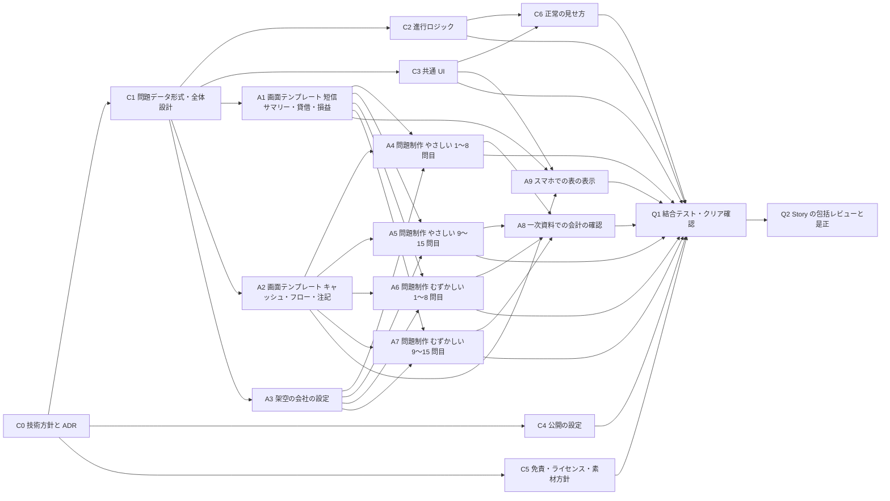
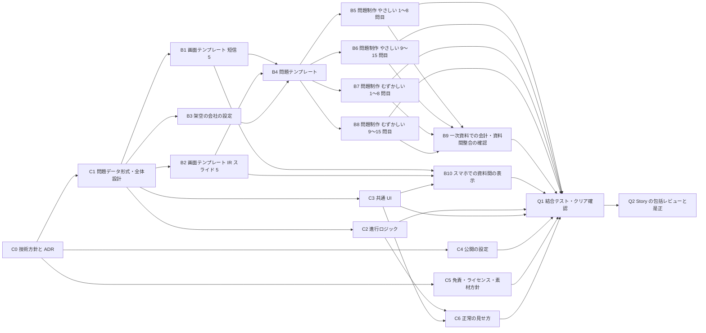
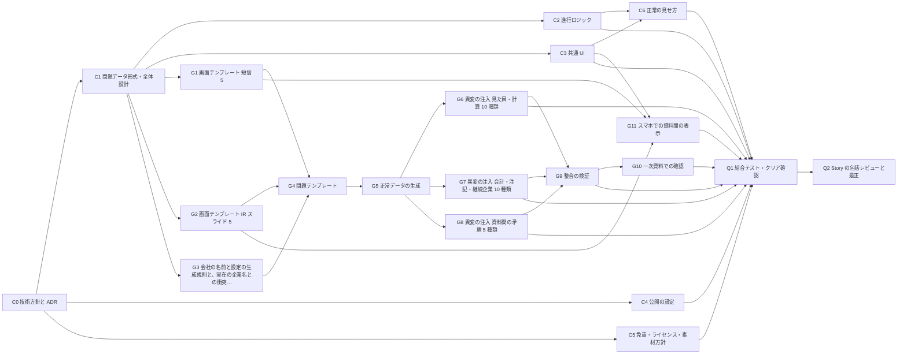

# 案の作成と比較 (遊びの中身・作業の依存・工数・日程・費用・推奨)

Sub-task: #6 (Task #3)。作成日: 2026-11-03。根拠: docs/requirements.md (承認済みの起案の理解)、docs/plans/research.md (#4)、docs/plans/open-decisions.md (#5)。
このページは、人間が案を選ぶためのページの材料。責任者が問いの文面を書く。数字の再現は `docs/plans/estimate.py` (標準ライブラリのみ。`python3 docs/plans/estimate.py`)。

## 0. このページの読みかた

**数字の印**: **人間が言った** / **文書にある** (出典つき) / **測った** / **導いた** (式と入力を示す) / **仮定** (測っていない。人間が確かめるまで要件にしない)。印の無い数字は書かない。

**工数・日程はすべて仮定から導いた相対比較の材料で、実測ではない。** 案のあいだの大小と、「何が効いて順位が変わるか」(§5) を見るためのもので、「何時間で終わる」という約束ではない。**推奨 (§6) は、工数の絶対値に依らず、人間の言葉と、取り消しの費用の非対称と、技術の実現性が未測定であることから導いた。** 工数は、同じ型の先行例の規模と桁が合うかを確かめて添えた (下の参照)。測る手順は §8。

**案の軸は 2 つだけ**: 画面の単位 (決算短信のみ / 決算短信 + IR) と、問題の作りかた (手書き / 生成)。図鑑・共有・演出・解説・3 段目の難易度は、案の軸ではなく、**全案で同じ「追加オプション」**として別に並べた (§3.4)。基本の案には含めない (人間が言っていないため)。

- 工数の単位: 「組 (進める役と監視役) の作業時間」(h)。 **仮定**
- 日程の単位: 作業の経過時間。1 時間の作業 = 1 時間の経過と置く。 **仮定**
- 案のあいだで同じ前提で数える (下の「見積もりの単位」は全案で共通)。

**参照 (測った)**: 同じ型の先行例「プルリクエスト #8」のリポジトリ (GitHub API、2026-11-03 に取得): 履歴は 65 commit が 2026-10-30〜2026-11-01 (約 2.5 日)、作者は 2 (人間 27・AI 38)。問題のファイルは難易度ごとに easy 12・normal 12・hard 17 (計 41。index.ts と common.ts を除く)。 → 本ページの案 A・B の問題数 (30) と作業の桁は、この先行例と同じ桁 (導いた)。commit 数は工数ではないので、桁の確認だけに使う。

### 全案で共通の前提 (すべて仮定。人間が決める点 (§7) は、決まるまでこの値で比べる)

| 項目 | 全案共通の値 | 印 |
| --- | --- | --- |
| クリア条件 | 連続 5 問を正しく判定する。人間が決める (open-decisions の P2) | 仮定 |
| 異変ありの問題の比率 | 5 割 (残りは正常)。5 割だと、毎回同じ答えを押し続ける遊び手のクリア確率は 5 連続で 3.1%、8 連続で 0.39%。7 割に偏らせると、毎回「異変あり」を押し続けるだけで 5 連続 16.8%・8 連続 5.8% になる (導いた: 比率の n 乗) | 仮定 (open-decisions の G4 の既定) |
| 間違えたときの扱い | 最初に戻る (型の標準。research.md §1.1) | 仮定 (G5 の既定) |
| 判定の操作 | 異変の有無を 2 択で答え、答え合わせで異変の場所を示す (先行例と同じ。research.md §1.2) | 仮定 (P8 の既定) |
| 正常の見せ方 | 毎回同じ書式 (画面テンプレートで揃える) + 各難易度の最初の 1 問で、正常な資料を見本として見せる (先行例は説明文を毎回同じ書き方にして正常を覚えさせる。research.md §1.2)。見本の表示は基盤の Task C-C6 | 仮定 (G1 の既定) |
| 難易度 | 2 段 (やさしい = 見た目と計算、むずかしい = 会計を多めに (会計 7 割、残り 3 割は見た目・計算を混ぜる))。人間の言葉は割合を言っていない | 人間が言った (2 段) + 仮定 (割合) |
| 会計基準の範囲 | 日本基準・連結のみ。実在の様式の文面は再現せず、項目の並びだけ参考にする | 仮定 (G3 の既定) |
| 会社 | 架空の会社だけ。実在の企業名との衝突は確認する (JPX の上場会社一覧などと突き合わせる。確認の Task を各案に入れた) | 人間が承認 (Q1) |
| 追加要素 | 図鑑・共有・演出の厚み・解説・3 段目は入れない (基本の演出はミニマル)。別に §3.4 のオプション | 仮定 (人間が言っていないものを足さない) |
| 費用・公開 | 公開は Vercel の静的サイト、費用 0 円 (無料枠の範囲) | 人間が承認 (Q1・Q3) |
| 営利にしない | 広告・課金・制作の対価を受けない | 導いた (費用 0 円 + Vercel Hobby の非営利制限。research.md §3) |

### 見積もりの単位 (全案共通。すべて仮定)

| 項目 | 値 | 印 |
| --- | --- | --- |
| Task の見積もり = 実装時間 × 1.5 (ケース表の固定と Sub-task のレビューの往復を実装の 5 割と置く) | 係数 1.5 | 仮定 |
| Task の包括レビュー (別の監視役が Task ごとに行う) | Task 1 件あたり 0.5 h。総工数にだけ足し、日程の経路には入れない | 仮定 |
| Story の包括レビューと是正 | 5 Story × 1 h。経路の最後に入れる | 仮定 |
| 画面テンプレート 1 つ | 実装 2 h | 仮定 |
| 問題 1 問の制作 (手書き) | 短信のみ 0.5 h / 短信 + IR の資料束 1.0 h (資料束は 2 倍と置く) | 仮定 |
| 一次資料での会計の確認 (全問) | 短信のみ 1 問 0.25 h / 資料間の整合を含む 0.4 h | 仮定 |
| 異変の種類 1 つの実装 (生成して注入する場合) | 実装 1.0 h | 仮定 |
| 架空の会社の設定と、実在の企業名との衝突の確認 | 案 A 実装 1.5 h (6 社)・案 B 2 h (8 社)・案 C 3 h (名前と設定の生成規則) | 仮定 |
| スマホでの表示 | 短信の表のみ 3 h / 短信と IR を組にした資料束 5 h | 仮定 |
| 共通の基盤 (全体設計・進行ロジック・共通 UI・公開の設定・免責・方針・正常の見せ方) | 実装 計 19.5 h (3 + 4 + 6 + 2 + 1 + 2 + 1.5) | 仮定 |
| 1 問の所要 (遊び手が見て判定するまで) | 案 A 45 秒、案 B・C 90 秒 (資料をまたぐため) | 仮定 |
| 1 回のページの転送量 | 案 A 2 MB、案 B・C 3 MB (基本)。厚い演出 (音つき) は +5 MB | 仮定 (測っていない。実装後に測る) |

## 1. 人間の言葉と案の対応 (外した範囲は別の行に残す)

| 人間の言葉の原文 (requirements.md) | 案 A | 案 B | 案 C |
| --- | --- | --- | --- |
| 「8番出口みたいなゲーム作りたい！！」(2026-11-03) | 判定ループの型を使う (固有の名前・見た目は真似ない) | 同じ | 同じ |
| 「投資家向け決算書, IRとかについてやるのとかいいかな〜」 | **決算書だけ。IR は外す** (人間の言葉の一部を落とす。外したものとして人間の選択で明示) | 決算書と IR の両方 | 決算書と IR の両方 |
| 「難易度ごとでいいかも！」(やさしい = 見た目と計算、むずかしい = 会計を多めに) | 2 段 (要件どおり) | 2 段 (同じ) | 2 段 (同じ) |
| 「新しいrepoがいいな！！！」「レポはpublicで！」 | 満たす | 満たす | 満たす |
| URL を開けばブラウザで遊べ、人に見せられる (成功の定義) | 満たす (見栄えは最小。演出・共有はオプション) | 満たす (同じ) | 満たす (同じ) |
| 架空の会社だけ。実在の企業名・ロゴ・人物は使わない | 満たす | 満たす | 満たす |
| 費用 0 円 (無料枠の範囲)・期限なし | 満たす | 満たす | 満たす |
| 日本語だけ。PC 優先でスマホでも遊べる | 満たす | 満たす (資料間の表示に追加の作業) | 満たす (同上) |
| オーケストラが自動で作る。人間は判断が要るときだけ答える | 人間の作業は少ない | 同じ | 同じ |

**人間の言葉に無いもの**: 図鑑・結果共有・演出の厚み・解説・3 段目・音・無限の問題。このうち問題の数 (有限 / 無限) は、案 C の軸 (生成) の結果で、人間は問題の数について何も言っていない。それ以外はすべて基本の案に含めず、§3.4 のオプションとして別に並べた。

## 2. 案の筋と、遊びの中身

3 案は、**画面の単位** (open-decisions の P3) と **問題の作りかた** (T1) だけが違う。

- **案 A 「決算短信のみ」**: 決算短信 (サマリーと財務諸表) の 1 つの資料を深く読む。問題は人が 1 問ずつ書く。IR は外す。いちばん軽い。
- **案 B 「決算短信 + IR」**: 決算短信と IR スライドを組み合わせ、資料のあいだの食い違いも異変にする。問題は、手書きのテンプレート (会社 × 資料束) に数値を当てはめて作る。人間の言葉をすべて満たす標準の案。
- **案 C 「決算短信 + IR、生成」**: 案 B と同じ画面・同じ資料束で、数値を生成して異変を注入する。問題が尽きない。技術の見立てへの依存がいちばん大きい。

| 項目 | 案 A | 案 B | 案 C | 印 |
| --- | --- | --- | --- | --- |
| 画面の単位 (P3) | 決算短信 5 画面 (サマリー・貸借・損益・CF・注記) | 短信 5 画面 + IR スライド 5 画面を組にした資料束 | 案 B と同じ | 仮定 |
| 異変の種類 | 20 種類 (見た目 5・計算 5・会計 10) | 25 種類 (A の 20 + 資料間の矛盾 5) | 25 種類 (B と同じ) | 仮定 (設計値。種類の候補は research.md §2.3) |
| 難易度の分けかた | やさしい = 見た目と計算 / むずかしい = 会計を多めに (全案共通) | 同じ。むずかしいは資料間の矛盾も含む | 同じ | 人間が言った + 仮定 |
| 問題の数 | 30 問 (難易度ごと 15 問) | 30 問 (難易度ごと 15 問) | 生成 (数に上限なし) | 仮定 |
| 全問を見終えるまでの最短の周回 (同じ難易度) | 3 周 (15 ÷ 5)。周回数 8 なら 2 周 (15 ÷ 8 を切り上げ) で、1 回の挑戦で 15 問の半分以上を見る | 同じ | 上限なし | 導いた (プール ÷ クリア条件。クリア条件 5 または 8) |
| 1 回のクリアまでの最短の時間 (5 問) | 3.8 分 | 7.5 分 | 7.5 分 | 導いた (5 問 × 1 問の所要)。間違えると最初からなので実際は長い。周回数 8 なら 6・12・12 分 |
| 当てずっぽうでクリアする確率 | 3.1% (比率 5 割・5 連続) | 同じ | 同じ | 導いた ((1/2)^5。8 連続なら 0.39%) |
| 答え合わせ | 異変の場所を示す (全案共通) | 同じ | 同じ | 仮定 |
| 演出 | ミニマル (文字と表だけ。全案共通) | 同じ | 同じ | 仮定 |
| 会社の設定 | 6 社を使い回す | 8 社を使い回す | 規則から名前と設定を生成 | 仮定 |

## 3. 各案の Story / Task の依存 (DAG)・工数・日程・費用・リスク・取り消しの費用

Story は 5 つ: **基盤** (進行・UI・方針)・**中身** (画面テンプレート・会社・問題)・**遊び** (スマホでの表示)・**公開** (公開の設定・免責・ライセンス)・**品質** (結合テスト・包括レビュー)。Task の ID は案ごとに `案-番号` (例: A-C1 は案 A の共通の基盤の Task、C-G5 は案 C の生成の Task)。人間の作業は DAG に入れず、日程の欄に別に書く。

### 3.1 案 A 「決算短信のみ」

| ID | Task | Story | 実装 (h) | 見積もり (h) | 依存 | 最早開始 (h) |
| --- | --- | --- | --- | --- | --- | --- |
| A-C0 | 技術方針と ADR | 基盤 | 2 | 3 | (根) | 0 |
| A-C1 | 問題データ形式・全体設計 | 基盤 | 3 | 4.5 | A-C0 | 3 |
| A-C2 | 進行ロジック (判定・周回・戻り・クリア) | 基盤 | 4 | 6 | A-C1 | 7.5 |
| A-C3 | 共通 UI (タイトル・難易度選択・結果・答え合わせ・スマホの土台) | 基盤 | 6 | 9 | A-C1 | 7.5 |
| A-C4 | 公開の設定 (Vercel・ビルド・CI) | 公開 | 2 | 3 | A-C0 | 3 |
| A-C5 | 免責・ライセンス・素材方針 | 公開 | 1 | 1.5 | A-C0 | 3 |
| A-C6 | 正常の見せ方 (毎回同じ書式の規則と、各難易度の最初の 1 問の見本表示) | 基盤 | 1.5 | 2.2 | A-C2・A-C3 | 16.5 |
| A-A1 | 画面テンプレート: 短信サマリー・貸借・損益 | 中身 | 6 | 9 | A-C1 | 7.5 |
| A-A2 | 画面テンプレート: キャッシュ・フロー・注記 | 中身 | 4 | 6 | A-C1 | 7.5 |
| A-A3 | 架空の会社の設定 (6 社) と実在の企業名との衝突の確認 | 中身 | 1.5 | 2.2 | A-C1 | 7.5 |
| A-A4 | 問題制作 やさしい 1〜8 問目 | 中身 | 4 | 6 | A-A1・A-A2・A-A3 | 16.5 |
| A-A5 | 問題制作 やさしい 9〜15 問目 | 中身 | 3.5 | 5.2 | A-A1・A-A2・A-A3 | 16.5 |
| A-A6 | 問題制作 むずかしい 1〜8 問目 | 中身 | 4 | 6 | A-A1・A-A2・A-A3 | 16.5 |
| A-A7 | 問題制作 むずかしい 9〜15 問目 | 中身 | 3.5 | 5.2 | A-A1・A-A2・A-A3 | 16.5 |
| A-A8 | 一次資料での会計の確認 (全 30 問 × 0.25) | 中身 | 7.5 | 11.2 | A-A4・A-A5・A-A6・A-A7 | 22.5 |
| A-A9 | スマホでの表の表示 (短信) | 遊び | 3 | 4.5 | A-A1・A-A2・A-C3 | 16.5 |
| A-Q1 | 結合テスト・クリア確認 (全難易度) | 品質 | 3 | 4.5 | A-A4・A-A5・A-A6・A-A7・A-A8・A-A9・A-C2・A-C3・A-C4・A-C5・A-C6 | 33.8 |
| A-Q2 | Story の包括レビューと是正 (5 Story × 1 時間) | 品質 | 3.3 | 5 | A-Q1 | 38.2 |

- 総工数: **102.2 h** (DAG の和 94.2 h + Task の包括レビュー 8 h。Task 18 個)。クリティカルパス: **43.2 h** (A-C0 → A-C1 → A-A1 → A-A4 → A-A8 → A-Q1 → A-Q2)。並列の幅: **6** 組。 導いた (Task の見積もりの和、最早開始の日程)
- 経過時間: 作業を 8 時間/日と置くと 5.4 日、24 時間/日と置くと 1.8 日 (人間の返事待ちを除く)。 導いた (パス ÷ 稼働時間。稼働時間は仮定)
- 費用: 公開 0 円 (人間が承認)。転送量は月 1 万回の利用で 20 GB、Hobby の目安 100 GB の 20% (文書にある: Vercel Hobby。月 1 万回・2 MB は仮定)。AI の利用枠は未測定で、総工数が目安 (Q4)。
- リスク:
  - IR を外すので、人間の言葉「決算書, IRとか」の一部を落とした企画になる (導いた)。選ばれたら人間の選択として明示する (open-decisions §6)。
  - 問題が 30 問で、同じ難易度を遊び続けると 3 周で全問を見終える (導いた)。
  - 会計の確認 (A-A8) の負担。正常と異変の境界を誤ると、会計の分かる遊び手が不正解になる (research.md §2.3)。全 30 問を確認する (やさしいも貸借・CF の正常な数字を見せるため)。
- 取り消しの費用: 公開後に IR を足す場合の追加は、案 B との差分 **57.5 h** (導いた: B の総工数 − A の総工数。IR の画面・資料束の問題・資料間の整合の確認・資料間の表示。A の問題を再利用できない前提。再利用の可否は仮定)。問題データの形式を共通にしておけば (A-C1)、画面と問題を足すだけで拡張できる (仮定)。A は最も取り消しが安い。

### 3.2 案 B 「決算短信 + IR」

| ID | Task | Story | 実装 (h) | 見積もり (h) | 依存 | 最早開始 (h) |
| --- | --- | --- | --- | --- | --- | --- |
| B-C0 | 技術方針と ADR | 基盤 | 2 | 3 | (根) | 0 |
| B-C1 | 問題データ形式・全体設計 | 基盤 | 3 | 4.5 | B-C0 | 3 |
| B-C2 | 進行ロジック (判定・周回・戻り・クリア) | 基盤 | 4 | 6 | B-C1 | 7.5 |
| B-C3 | 共通 UI (タイトル・難易度選択・結果・答え合わせ・スマホの土台) | 基盤 | 6 | 9 | B-C1 | 7.5 |
| B-C4 | 公開の設定 (Vercel・ビルド・CI) | 公開 | 2 | 3 | B-C0 | 3 |
| B-C5 | 免責・ライセンス・素材方針 | 公開 | 1 | 1.5 | B-C0 | 3 |
| B-C6 | 正常の見せ方 (毎回同じ書式の規則と、各難易度の最初の 1 問の見本表示) | 基盤 | 1.5 | 2.2 | B-C2・B-C3 | 16.5 |
| B-B1 | 画面テンプレート: 短信 5 (サマリー・貸借・損益・CF・注記) | 中身 | 10 | 15 | B-C1 | 7.5 |
| B-B2 | 画面テンプレート: IR スライド 5 (ハイライト・業績・セグメント・見通し・補足) | 中身 | 10 | 15 | B-C1 | 7.5 |
| B-B3 | 架空の会社の設定 (8 社) と実在の企業名との衝突の確認 | 中身 | 2 | 3 | B-C1 | 7.5 |
| B-B4 | 問題テンプレート (会社 × 資料束) の設計 | 中身 | 6 | 9 | B-B1・B-B2・B-B3 | 22.5 |
| B-B5 | 問題制作 やさしい 1〜8 問目 (資料束) | 中身 | 8 | 12 | B-B4 | 31.5 |
| B-B6 | 問題制作 やさしい 9〜15 問目 | 中身 | 7 | 10.5 | B-B4 | 31.5 |
| B-B7 | 問題制作 むずかしい 1〜8 問目 | 中身 | 8 | 12 | B-B4 | 31.5 |
| B-B8 | 問題制作 むずかしい 9〜15 問目 | 中身 | 7 | 10.5 | B-B4 | 31.5 |
| B-B9 | 一次資料での会計・資料間整合の確認 (全 30 問 × 0.4) | 中身 | 12 | 18 | B-B5・B-B6・B-B7・B-B8 | 43.5 |
| B-B10 | スマホでの資料間の表示 | 遊び | 5 | 7.5 | B-B1・B-B2・B-C3 | 22.5 |
| B-Q1 | 結合テスト・クリア確認 (全難易度) | 品質 | 3 | 4.5 | B-B5・B-B6・B-B7・B-B8・B-B9・B-B10・B-C2・B-C3・B-C4・B-C5・B-C6 | 61.5 |
| B-Q2 | Story の包括レビューと是正 (5 Story × 1 時間) | 品質 | 3.3 | 5 | B-Q1 | 66 |

- 総工数: **159.8 h** (DAG の和 151.2 h + Task の包括レビュー 8.5 h。Task 19 個)。クリティカルパス: **71 h** (B-C0 → B-C1 → B-B1 → B-B4 → B-B5 → B-B9 → B-Q1 → B-Q2)。並列の幅: **5** 組。 導いた
- 経過時間: 8 時間/日で 8.9 日、24 時間/日で 3 日 (人間の返事待ちを除く)。 導いた
- 費用: 公開 0 円。転送量は月 1 万回で 30 GB (Hobby の目安 100 GB の 30%)。AI の利用枠は未測定で、総工数が目安。
- リスク:
  - 資料をまたぐ画面 (短信と IR) をスマホで見せる難しさ (open-decisions G9)。B-B10 の 7.5 h はこれの見積もりで、仮定。表を縮めると異変が見つからなくなり、難易度そのものが変わる。
  - IR 資料には定型の様式が無い (research.md §2.2)。IR 画面は解説記事の共通の並びからの設計で、「らしさ」の評価は人間の好みになる (導いた)。
  - 問題が 30 問で、3 周で全問を見終える (導いた)。
  - 手書きの単価が想定より高い場合、案 B の総工数が最も伸びる (§5)。
- 取り消しの費用: IR を後から外すのは容易 (IR の画面と資料間の問題を使わないだけ)。生成 (案 C) を足す場合、手書きの問題を残したまま足せる (問題データの形式を共通にしておけば。仮定)。

### 3.3 案 C 「決算短信 + IR、生成」

| ID | Task | Story | 実装 (h) | 見積もり (h) | 依存 | 最早開始 (h) |
| --- | --- | --- | --- | --- | --- | --- |
| C-C0 | 技術方針と ADR | 基盤 | 2 | 3 | (根) | 0 |
| C-C1 | 問題データ形式・全体設計 | 基盤 | 3 | 4.5 | C-C0 | 3 |
| C-C2 | 進行ロジック (判定・周回・戻り・クリア) | 基盤 | 4 | 6 | C-C1 | 7.5 |
| C-C3 | 共通 UI (タイトル・難易度選択・結果・答え合わせ・スマホの土台) | 基盤 | 6 | 9 | C-C1 | 7.5 |
| C-C4 | 公開の設定 (Vercel・ビルド・CI) | 公開 | 2 | 3 | C-C0 | 3 |
| C-C5 | 免責・ライセンス・素材方針 | 公開 | 1 | 1.5 | C-C0 | 3 |
| C-C6 | 正常の見せ方 (毎回同じ書式の規則と、各難易度の最初の 1 問の見本表示) | 基盤 | 1.5 | 2.2 | C-C2・C-C3 | 16.5 |
| C-G1 | 画面テンプレート: 短信 5 | 中身 | 10 | 15 | C-C1 | 7.5 |
| C-G2 | 画面テンプレート: IR スライド 5 | 中身 | 10 | 15 | C-C1 | 7.5 |
| C-G3 | 会社の名前と設定の生成規則と、実在の企業名との衝突の確認 | 中身 | 3 | 4.5 | C-C1 | 7.5 |
| C-G4 | 問題テンプレート (会社 × 資料束) の設計 | 中身 | 6 | 9 | C-G1・C-G2・C-G3 | 22.5 |
| C-G5 | 正常データの生成 (貸借の等式・損益の連鎖・CF の連動・比率) | 生成 | 12 | 18 | C-G4 | 31.5 |
| C-G6 | 異変の注入: 見た目・計算 10 種類 | 生成 | 10 | 15 | C-G5 | 49.5 |
| C-G7 | 異変の注入: 会計・注記・継続企業 10 種類 | 生成 | 10 | 15 | C-G5 | 49.5 |
| C-G8 | 異変の注入: 資料間の矛盾 5 種類 (IR と短信) | 生成 | 5 | 7.5 | C-G5 | 49.5 |
| C-G9 | 整合の検証 (正常データが全規則を満たす・異変が 1 つだけを変える) | 生成 | 8 | 12 | C-G6・C-G7・C-G8 | 64.5 |
| C-G10 | 一次資料での確認 (生成の規則と異変の規則のレビュー) | 中身 | 8 | 12 | C-G9 | 76.5 |
| C-G11 | スマホでの資料間の表示 | 遊び | 5 | 7.5 | C-G1・C-G2・C-C3 | 22.5 |
| C-Q1 | 結合テスト・クリア確認 (全難易度) | 品質 | 3 | 4.5 | C-G6・C-G7・C-G8・C-G9・C-G10・C-G11・C-C2・C-C3・C-C4・C-C5・C-C6 | 88.5 |
| C-Q2 | Story の包括レビューと是正 (5 Story × 1 時間) | 品質 | 3.3 | 5 | C-Q1 | 93 |

- 総工数: **178.2 h** (DAG の和 169.2 h + Task の包括レビュー 9 h。Task 20 個)。クリティカルパス: **98 h** (C-C0 → C-C1 → C-G1 → C-G4 → C-G5 → C-G6 → C-G9 → C-G10 → C-Q1 → C-Q2)。並列の幅: **5** 組。 導いた (案 B より 18.5 h 多い。生成が経路に乗るため、経路も長い)
- 経過時間: 8 時間/日で 12.2 日、24 時間/日で 4.1 日 (人間の返事待ちを除く)。 導いた
- 費用: 公開 0 円。転送量は月 1 万回で 30 GB (Hobby の目安 100 GB の 30%)。AI の利用枠は未測定で、総工数が目安。
- リスク:
  - **生成した正常データが、会計の整合 (貸借の等式・損益の連鎖・CF の連動・比率) をすべて満たすことは、まだ測っていない。** 技術の見立て (仮定)。満たせないと、正常を異変と扱う問題が出る。
  - 生成が想定より難しい場合 (2 倍) の総工数は 245.8 h で、基準の案 B (159.8 h) より 86 h 多い (導いた、§5)。
  - 機械的に作った異変が「作り物らしい」と感じられ、面白さが落ちる恐れ (好みで、測れない)。
- 取り消しの費用: 生成が整合を満たせないと分かったとき、生成まわりの Task (C-G5〜G10) の約 **79.5 h** を捨て、案 B 相当の内容 (B-B5〜B9 の約 **63 h**) を新たに作ることになる (導いた: Task の見積もりの和)。分かるのが遅いほど損失が大きい。

### 3.4 追加オプション (全案で同じ。基本の案には含めない。どれも人間が言っていない)

どのオプションも、基本の Task の後から足せる (進行ロジックと共通 UI の後に始まる。多くは基本のパスより先に終わるので、経路は伸びない。例外が 1 つある: 案 B の O7 は経路を 1.5 h 伸ばす。導いた)。取り消しの費用は小さい。

| ID | 追加オプション | 案 A (h) | 案 B (h) | 案 C (h) | 人間が言ったか |
| --- | --- | --- | --- | --- | --- |
| O1 | 図鑑と保存 (ブラウザ内) | 6 | 6 | 6 | 言っていない |
| O2 | 結果共有と共有用画像 | 4.5 | 4.5 | 4.5 | 言っていない |
| O3 | 雰囲気のある演出 (配色・遷移) | 6 | 6 | 6 | 言っていない |
| O4 | 厚い演出 (遷移・音つき。O3 の代わり) | 12 | 12 | 12 | 言っていない |
| O5 | 理由 1 行の解説 (種類 × 0.2 h) | 6 | 7.5 | 7.5 | 言っていない |
| O6 | 理由 + 用語の解説 (種類 × 0.3 h。O5 の代わり) | 9 | 11.2 | 11.2 | 言っていない |
| O7 | ふつう (3 段目の難易度) | 16.9 | 31.5 | 4.5 | 言っていない |
| 全部入り | O1 + O2 + O4 + O6 + O7 | 48.4 | 65.2 | 38.2 | |

- 厚い演出 (O4) は音を含み、転送量が +5 MB (仮定): 月 1 万回で 案 A 70 GB・案 B・C 80 GB (Hobby の目安 100 GB の 80% 前後)。案 B・C は 1 回 8 MB なので、月 12,500 回で 100 GB に届く (導いた: 100 GB ÷ 8 MB)。
- O3 と O4、O5 と O6 は、どちらかを選ぶ。
- 全部入りの総工数 = 基本 + 全部入り: 案 A **150.6 h**・案 B **225 h**・案 C **216.5 h** (導いた)。

### 全案共通の取り消しの費用

- 題名・URL の公開後の変更は、共有の再発行の手間がかかる (open-decisions P7・R2)。商標「８番出口」は登録済みで、題名に既存作品の語を使うと権利に触れる可能性が高い (research.md §4、測った)。
- ライセンスは公開後の変更が困難 (R4)。

### 人間の作業 (DAG に入れない。案によらず同じ)

| 作業 | 時間 | 印 |
| --- | --- | --- |
| 案の選択に答える | 数分 | 仮定 |
| 凍結のときの理解の表の確認 (承認) | 数分 | 仮定 |
| プロジェクト方針 (charter) の確認 (承認。技術責任者が出す。凍結の後、開発の Task の着手の前) | 数分 | 仮定 |
| Vercel の連携の許可と取り込み (公開の設定 C-C4 の後) | 5〜10 分 | 仮定 (open-decisions R6。Vercel のアカウントは既にある: 測った) |
| 人間のテストプレイ (必要な場合だけ) | 案 A 約 10 分・案 B と C 約 20 分 | 仮定 (最短のプレイ時間の約 3 倍を丸めた値) |

人間の返事待ち: 案の選択・理解の表・プロジェクト方針の 3 回は、いずれも blocking で、期限は送った日から 3 日 (返事の待ち日数の既定)。期限を過ぎたら、同じ問いを再掲して聞き直し、期限を延ばす (上限は無い)。凍結の前は開発の Task に着手できない (導いた: 凍結後に分解して起票する決まり)。方針の承認の待ちも、開発の最初の Task (C-C0) の前に入る。Vercel の作業は、公開の設定 (C-C4) が終わった時点で頼めば、結合テストの前に済み、経路は伸びない (導いた。ただし返事が遅ければ、遅れた分だけ伸びる)。

## 4. 3 案の比較

| 項目 | 案 A 決算短信のみ | 案 B 決算短信 + IR | 案 C 決算短信 + IR、生成 | 印 |
| --- | --- | --- | --- | --- |
| 人間の言葉との対応 | IR を落とす | すべて満たす | すべて満たす (問題が無限になる) | §1 |
| 基本の総工数 | **102.2 h** | **159.8 h** | **178.2 h** | 導いた (仮定から) |
| 全部入りの総工数 (§3.4) | 150.6 h | 225 h | 216.5 h | 導いた |
| クリティカルパス | 43.2 h | 71 h | 98 h | 導いた |
| 並列の幅 | 6 組 | 5 組 | 5 組 | 導いた |
| 経過日数 (8 時間/日・人間待ちを除く) | 5.4 日 | 8.9 日 | 12.2 日 | 導いた (稼働時間は仮定) |
| 公開の費用 | 0 円 | 0 円 | 0 円 | 人間が承認 |
| 転送量 (基本、月 1 万回、Hobby の目安 100 GB に対し) | 20% | 30% | 30% | 導いた (転送量は仮定) |
| 問題の数 | 30 問 | 30 問 | 上限なし | 仮定 |
| 技術の見立てへの依存 | 小 (手書き) | 小〜中 (資料間の表示) | **大 (生成の整合が未測定)** | 仮定 |
| 取り消しの費用 | 小 (B への拡張 57.5 h) | 小〜中 | **大 (失敗時に約 79.5 h を捨て、約 63 h を足す)** | 導いた |
| 人間が言っていないものを基本に含むか | 含まない (IR を落とす) | 含まない | 問題が無限になる (生成の結果) | §1 |
| 人間の作業 | 少ない | 少ない | 少ない | §3 |

## 5. 感度: 数字の前提を変えると順位は変わるか

前提 (すべて仮定) を動かして、総工数 / クリティカルパス (h) を出し直した。

| 前提を変える | 案 A 総工数 / パス | 案 B 総工数 / パス | 案 C 総工数 / パス | 総工数の順 |
| --- | --- | --- | --- | --- |
| 基準 (内容・生成とも 1 倍) | 102.2 / 43.2 | 159.8 / 71 | 178.2 / 98 | A < B < C |
| 内容・生成とも 0.5 倍 | 85.4 / 34.6 | 128.2 / 56 | 138.5 / 69.5 | A < B < C |
| 内容・生成とも 1.5 倍 | 119.1 / 51.9 | 191.2 / 86 | 218 / 126.5 | A < B < C |
| 生成だけ 2 倍 (生成が想定より難しい) | 102.2 / 43.2 | 159.8 / 71 | 245.8 / 143 | A < B < C |
| 内容の制作だけ 2 倍 (手書きが想定より遅い) | 136 / 60.5 | 222.8 / 101 | 190.2 / 110 | A < C < B |

読み取り (導いた):
- 案 A の総工数がいちばん小さい順位は、どの前提でも変わらない。
- **案 B と案 C の順位は、手書きの単価と生成の難しさで入れ替わる。** 手書きの制作が 2 倍遅いと、案 B は 222.8 h、案 C は 190.2 h で、案 C が 32.5 h 少なくなる。逆に生成が 2 倍難しいと、案 C は 245.8 h で、基準の案 B (159.8 h) より 86 h 多くなる。
- 案 C のばらつきは案 B より大きく、生成の難しさが未測定なので、損失の側に偏る (取り消しの費用の欄)。

**この入れ替わりがあるので、推奨 (§6) の根拠は工数の大小にしない。**

## 6. 推奨と導出

**推奨: 案 B 「決算短信 + IR」。**

導出 (工数の絶対値に依らない):
1. **人間の言葉を満たす案に絞る**: 「決算書, IRとか」の IR を落とす案 A は、人間の言葉の一部を落とす (§1)。人間が IR を外したいと言った事実は無いので、既定にしない。案 A が悪いわけではなく、外す根拠が人間の言葉に無い。
2. **案 B と案 C の違いは、問題の作りかただけ**: 案 C は案 B の画面・資料束の上に、手書きのかわりに生成を置く案で、他の要素は同じ。案 C の利点は問題が尽きないこと (案 B は同じ難易度で 3 周すると全問を見終える。導いた)。人間は問題の数や再プレイの回数について何も言っていないので、これは人間の価値判断で、先回りして買わない。
3. **取り消しの費用が非対称**: 案 B から後で生成を足すことは、手書きの問題を残したままできる (仮定)。案 C から案 B に戻るのは、生成が整合を満たさないと分かったときの損失が大きい (約 79.5 h を捨て、約 63 h を足す。導いた)。後から足せる案を先に取る。
4. **技術の実現性が未測定**: 生成した正常データが会計の整合をすべて満たすかは、測っていない (技術の見立て: 仮定)。案 C の根拠が、測っていない事実に乗っている。案 B は手書きで、単価を最初の数問で測れる (§8)。
5. **規模の参照**: 同じ型の先行例は、約 2.5 日・2 者で問題 41 問を作っている (測った。上の参照)。案 B の 30 問は同じ桁で、手書きの規模として無理がない (導いた)。

**この推奨が逆転する条件**: 手書きの制作が想定の 2 倍以上遅く、かつ生成した正常データが会計の整合を満たすと測れたとき、案 C の総工数のほうが小さくなりうる (§5)。測るには、手書き 1〜3 問の制作時間と、生成した正常データ 1 件の整合の検証が要る (§8)。責任者は、案の選択を人間に送る前に、この測る作業を Sub-task にするかどうかを判断する。測れば、案 B と案 C の差は仮定から測った値に変わり、逆転の条件を確かめられる。

**案 B の中の選択** (人間が決める点と重なる): 最初の公開の範囲 (open-decisions P6) を、案 A 相当 (短信のみ) に絞って先に出し、IR 画面を後から足す段階公開にもできる。取り消しの費用が小さい (案 A から案 B への拡張は 57.5 h)。人間が望むなら、案 B を選んだうえで決められる。

## 7. 人間に決めてほしい点 (推奨つき。責任者が問いの文面を書く)

案の選択のほかに、案を選んでも決まらない点が 6 つある (open-decisions §5)。追加オプション (§3.4) は、案の軸ではなく独立の選択として、1 つの問いにまとめる。

| ID | 決めてほしいこと | 選択肢 | 推奨と導出 | 区分 |
| --- | --- | --- | --- | --- |
| (案) | 案の選択 | 案 A / 案 B / 案 C | 案 B (§6) | blocking (後続の全 Task を止める) |
| (追加) | 追加オプションを入れるか (O1 図鑑、O2 結果共有、O3/O4 演出、O5/O6 解説、O7 ふつう) | 入れない / 項目を選ぶ (工数は §3.4) | **入れない**。導出: どれも人間の言葉に無い。基本の案で「URL を開けばブラウザで遊べる」は満たし、各オプションは後から足せる (取り消しの費用は小さい)。入れたい項目があれば人間が選ぶ | non-blocking (既定: 入れない) |
| P2 | クリア条件・周回数 | 5 / 8 / 10 以上。難易度ごとに変えるかも含む | **8**。導出: 人間の言葉「8番出口みたいな」と、承認済みのリポジトリ名 kessan-8 から導けるのは 8 の側。比率 5 割の 2 択で当てずっぽうでクリアする確率は 8 連続で 0.39% (5 連続は 3.1%)。ただし 1 回の最短が案 B で 12 分 (5 なら 7.5 分) と長くなる。「人に見せる長さ」の好みは人間が言っていないので、5 を選んでもよい (導いた) | blocking (問題の数と案の比較の前提) |
| P4 | 想定する遊び手の水準 | 知識なしでも楽しめる / 基礎知識がある人向け / 難易度ごとに変える | **難易度ごとに変える**。導出: 人間の言葉で既にやさしい = 見た目と計算 (知識が要らない)、むずかしい = 会計 (知識が要る) と分けている。その分けかたの延長 | non-blocking (既定: 難易度ごとに変える) |
| P7 | 題名・名前 | 既存作品と連想の無い題 / 型を明示するが固有の語を避けた題 | **連想の無い題**。導出: 「８番出口」は名前として商標が登録済み (測った。research.md §4)。題名・サブタイトル・ストア名・ドメイン名に使うと権利に触れる可能性が高い。登録は名前であって数字ではないので、周回数 8 は P2 の問いとして別に決められる (仮定: 数字そのものは権利にならないと考えられる。法務の専門家の判断ではない) | blocking (公開後の変更は URL・共有の再発行の手間がかかる) |
| R4 | ソースコードのライセンス | MIT / ほかのライセンス / 付けない | **MIT**。導出: 公開リポジトリ (人間が言った) で、制約が少なく、先行例 (research.md §1.2) も MIT。素材は別のライセンス (責任者が方針を決める)。公開後の変更は困難 | non-blocking (既定: MIT。期限までに返事が無ければ MIT) |
| Q3 | 公開後の保守 | 凍結 / 誤りの訂正のみ / 問題の追加も行う | **誤りの訂正のみ**。導出: 人間は保守を言っていない。会計の誤りは誤情報になるので訂正は要る。問題の追加は人間の追加の判断 | non-blocking (既定: 訂正のみ) |
| Q4 | AI の利用枠を費用 0 円に含めるか | 公開の費用だけ / AI の利用枠も含める (上限を決める) | **公開の費用だけ**。導出: 要件の費用 0 円は、公開方式の選択 (Vercel の無料枠) の文脈の承認 (Q1・Q3)。人間は「完全にオーケストラ自動実装」を求めており、AI の利用を前提にしている (人間の言葉)。総工数は参考として §4 に出した | non-blocking (既定: 公開の費用だけ) |

人間の作業 (判断は要らない): Vercel の連携の許可と取り込み、プロジェクト方針の確認 (§3)。凍結のときの理解の表の「推測」の行: 営利にしない (R1)、既定のサブドメイン (R2)。

## 8. 技術の見立て (仮定) と、測る手順

技術責任者の見立てが要る所は、すべて **仮定** として明示している。**Task #3 の完了の前に、責任者が技術責任者への相談のチケットを出す必要がある** (orchestrating-business の手順 3、freezing.md の「領域のあいだの相談」)。出た見立てで、下の仮定を置き換える (open-decisions §5 の申し送り)。

| 仮定 | 効く所 | 測る手順 (測れば「測った」に変わる) |
| --- | --- | --- |
| 手書き 1 問の制作時間 (短信 0.5 h・資料束 1.0 h) | 案 A・B の総工数 | 最初の 3〜5 問を作り、時間を記録する |
| 生成した正常データが会計の整合をすべて満たす実現性と工数 (12 h + 異変 25 種類) | 案 C の総工数・取り消しの費用 | 正常データ 1 件を生成し、貸借の等式・損益の連鎖・CF の連動・比率の検証を通す試作を作り、時間と通過率を記録する |
| 資料をまたぐ画面のスマホでの見せ方 (5 h) | 案 B・C の総工数、難易度 | 試作 1 画面を小画面で表示し、異変の見つけやすさを確かめる |
| 1 回の転送量 (2・3 MB、音つきは +5 MB) | 費用 (無料枠) | ビルドの成果物の大きさを測る |
| 基盤の見積もり (共通 19.5 h) | 全案の総工数 | 基盤の Task の実績で補正する |
| Task の係数 1.5・Task の包括レビュー 0.5 h | 全案の総工数 | 最初の Task の実績で補正する |

案の選択を人間に送る前に、上の手順のうち「手書き 1 問」と「生成の試作」を測れば、案 B と案 C の差 (§5) は仮定から測った値に変わる。測る作業は、責任者が Sub-task として起票する (進める役は自分では起票しない)。

## 9. 外した範囲

| 外したもの | 理由 |
| --- | --- |
| 英語など多言語 | 要件で日本語だけ |
| ネイティブアプリ・アプリストアでの配布 | 要件はブラウザで遊ぶこと |
| ユーザーアカウント・ランキング | 静的サイトで個人情報を扱わない前提 (open-decisions T2・G6) |
| 実在の企業の決算の再現 | 要件で実在企業を使わない |
| 有料化・広告 | 営利にしない前提 (R1) |
| IFRS・米国基準 | 日本基準・連結のみ (G3 の既定。足すと確認の負担が増える) |
| アクセス解析 | 人間が言っていない (R3 の既定: 入れない) |
